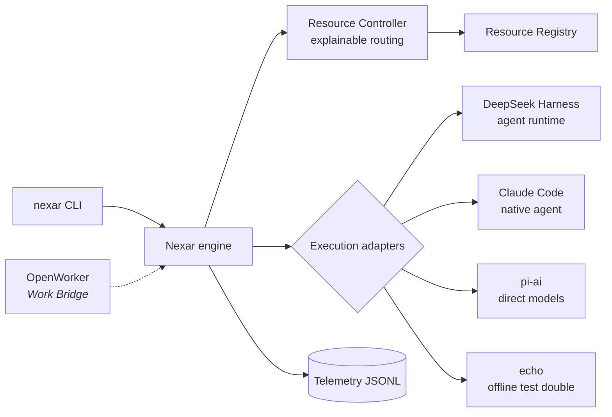

# Nexar

**A local-first Personal AI Operating Layer.** Nexar understands a task, chooses the right AI
resource for it, orchestrates the work, executes it safely, and records what happened — so that
over time it can make better resource decisions.

Nexar is not a chatbot and not a wrapper around one model or vendor. Models, providers, coding
agents, and productivity engines are **components behind adapters**; Nexar owns the stable domain:
tasks, AI resources, the resource registry, the resource controller, routing policy, execution
adapters, and telemetry.

> Status: **v0.1 — Foundation** (developer preview). The architecture is proven end to end; most
> product features are planned, not built. See [Implemented vs planned](#implemented-vs-planned).

## Why

An engineer or consultant today juggles subscriptions (Claude Code, Codex, Antigravity), API keys
(DeepSeek, Anthropic, OpenAI), local models, and productivity tools — each with its own routing,
auth, and blind spots. Nexar is one layer that:

- reasons about **all** available AI resources (not just models) and picks one per task, with an
  explanation;
- runs work through the right engine — an agent harness, a native coding agent, or a direct model
  call — without coupling to any of them;
- keeps credentials in their owners' hands and data on the owner's machine by default;
- records uniform telemetry (usage, cost, latency, outcome) to support quota-, cost-, and
  quality-aware scheduling later.

## Architecture in one picture



Three questions are kept separate: **who executes** (Resource Controller) · **how the work is
orchestrated** (DeepSeek Harness or a native agent's loop) · **how a provider is called** (pi-ai or
the runtime's internals). Details: [`docs/architecture/overview.md`](docs/architecture/overview.md)
and the [ADRs](docs/adr/).

## Implemented vs planned

**Implemented (v0.1)**

| Area                     | Package                               | Notes                                                                                                                                           |
| ------------------------ | ------------------------------------- | ----------------------------------------------------------------------------------------------------------------------------------------------- |
| Domain contracts         | `@nexar/contracts`                    | Tasks, AI resources (descriptor vs state), routing, execution boundary, telemetry, typed errors                                                 |
| Resource Registry        | `@nexar/resource-registry`            | Descriptors + probed state, filtering, discovery seam                                                                                           |
| Resource Controller      | `@nexar/resource-controller`          | Deterministic policy v1, explainable decisions with reason codes                                                                                |
| Telemetry                | `@nexar/telemetry`                    | Redacting JSON logger, JSONL / in-memory sinks                                                                                                  |
| Core engine              | `@nexar/core`                         | Task → route → execute → record; timeouts, cancellation; strict config                                                                          |
| Claude Code adapter      | `@nexar/integration-claude-code`      | Native agent via `claude -p`; read-only by default; **verified live**                                                                           |
| DeepSeek Harness adapter | `@nexar/integration-deepseek-harness` | Nexar-owned JSON-RPC client for `dsh --profile sdk`; handshake verified against real `dsh 0.2.0-rc.2`; model execution needs `DEEPSEEK_API_KEY` |
| pi-ai adapter            | `@nexar/integration-pi`               | Direct models via exact-pinned `@earendil-works/pi-ai@0.99.2`; OpenAI-compatible local endpoints                                                |
| OpenWorker Work Bridge   | `@nexar/integration-openworker`       | Versioned request/response contract + validating handler (no transport yet)                                                                     |
| Echo adapter             | `@nexar/integration-echo`             | Deterministic offline resource for CI and zero-credential runs                                                                                  |
| Workflows                | `@nexar/workflows`                    | Data-driven workflows (`workflows/`): technical docs, SOW, proposal, meeting brief; drafts only, untrusted-input boundary                       |
| CLI                      | `@nexar/cli`                          | `nexar doctor`, `resources`, `route`, `run` (`--workflow`), `workflows`                                                                         |

**Planned** — see [`docs/roadmap/ROADMAP.md`](docs/roadmap/ROADMAP.md) and [`docs/backlog/`](docs/backlog/):
Nexar MCP server for OpenWorker and documentation workflows (v0.2); Codex / Antigravity / Delegate
Skills engineering fleet (v0.3); quota- and cost-aware routing (v0.4); mobile PWA and control plane
(v0.5); memory (v0.6); automation (v0.7).

## Getting started

Requirements: Node ≥ 22.19, pnpm 10 (`corepack enable`), git.

```bash
pnpm install
pnpm check                     # format, lint, boundaries, typecheck, test, build
node apps/cli/dist/main.js doctor
node apps/cli/dist/main.js resources
node apps/cli/dist/main.js route --kind coding "refactor the billing module"
node apps/cli/dist/main.js run --kind general "hello"   # offline echo resource by default
```

Without a config file Nexar uses a built-in offline configuration (the `local-echo` resource). To
use real resources, copy [`config/nexar.config.example.json`](config/nexar.config.example.json) to
`nexar.config.json` (or pass `--config`) and see [`config/README.md`](config/README.md).

### External runtimes (optional)

| Runtime                                                                          | Needed for                  | How Nexar uses it                                                                                          |
| -------------------------------------------------------------------------------- | --------------------------- | ---------------------------------------------------------------------------------------------------------- |
| `claude` (Claude Code CLI), logged in                                            | `claude-code` resource      | `claude -p` subprocess; Nexar never reads its credentials                                                  |
| `dsh` `0.2.0-rc.2` (`npm i -g @deepseek-ai/dsh@0.2.0-rc.2`) + `DEEPSEEK_API_KEY` | `deepseek-harness` resource | `dsh --profile sdk` subprocess, isolated `DSH_HOME`, allowlisted env, DeepSeek session-log upload disabled |
| Provider API key (e.g. `ANTHROPIC_API_KEY`) or a local OpenAI-compatible server  | `pi` resources              | in-process pi-ai call                                                                                      |

`nexar doctor` reports which of these are available.

## Tests

```bash
pnpm test                      # offline, deterministic; no paid calls
NEXAR_LIVE_TESTS=1 pnpm test   # opt-in live tests (may cost money)
NEXAR_DSH_BIN=$(which dsh) pnpm test   # opt-in real dsh handshake (no model call)
```

CI (GitHub Actions) runs the full gate plus a gitleaks secret scan; it never calls paid APIs.

## Security

Local-first; credentials stay in the environment or in each runtime's own store and are referenced
in config by name only; subprocess runtimes get a minimal/scrubbed environment; runtime state lives
in git-ignored `.nexar/`; logs are redacted. Threat assumptions and known gaps:
[`docs/architecture/security.md`](docs/architecture/security.md).

## Repository map

`apps/cli` · `packages/{contracts,resource-registry,resource-controller,telemetry,core}` ·
`integrations/{echo,claude-code,deepseek-harness,pi,openworker}` · `config/` · `docs/{architecture,adr,research,roadmap,backlog,devlog}`.
Contributor/agent operating rules: [`CLAUDE.md`](CLAUDE.md).

## License

No license has been chosen yet; all rights reserved by the repository owner until one is added.
