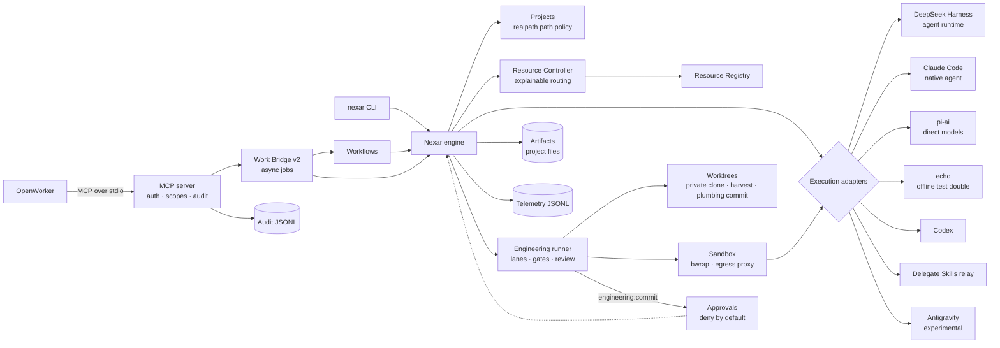

# Nexar

**A local-first Personal AI Operating Layer.** Nexar understands a task, chooses the right AI
resource for it, orchestrates the work, executes it safely, and records what happened — so that
over time it can make better resource decisions.

Nexar is not a chatbot and not a wrapper around one model or vendor. Models, providers, coding
agents, and productivity engines are **components behind adapters**; Nexar owns the stable domain:
tasks, AI resources, the resource registry, the resource controller, routing policy, execution
adapters, and telemetry.

> Status: **v0.3 — Engineering Machine** (developer preview). On top of v0.2 (OpenWorker over an
> authenticated, audited stdio MCP server; documentation and meeting drafts as local files), Nexar can
> now run sandboxed, multi-agent engineering tasks: write-capable coding agents edit a private
> worktree inside a bubblewrap sandbox, Nexar gates and reviews the patch, and — only after your
> approval — commits it to a local `nexar/<task>` branch. It never pushes and sends nothing outside
> your machine. See [Implemented vs planned](#implemented-vs-planned).

## Why

An engineer or consultant today juggles subscriptions (Claude Code, Codex, Antigravity), API keys
(DeepSeek, Anthropic, OpenAI), local models, and productivity tools — each with its own routing,
auth, and blind spots. Nexar is one layer that:

- reasons about **all** available AI resources (not just models) and picks one per task, with an
  explanation;
- runs work through the right engine — an agent harness, a native coding agent, or a direct model
  call — without coupling to any of them;
- keeps credentials in their owners' hands and data on the owner's machine by default;
- records uniform telemetry (usage, cost, latency, outcome) to support quota-, cost-, and
  quality-aware scheduling later.

## Architecture in one picture



Engineering tasks (v0.3) add the lower branch: the runner asks the Resource Controller for a resource
per lane, launches write-capable agents only through the sandbox, harvests a patch from a second
sandbox, verifies it on a fresh clone, has a different resource review it, and commits through an
owner approval. See [Engineering tasks](#engineering-tasks).

Three questions are kept separate: **who executes** (Resource Controller) · **how the work is
orchestrated** (DeepSeek Harness or a native agent's loop) · **how a provider is called** (pi-ai or
the runtime's internals). Details: [`docs/architecture/overview.md`](docs/architecture/overview.md)
and the [ADRs](docs/adr/).

## Implemented vs planned

**Implemented (v0.1 to v0.4)**

| Area                     | Package                               | Notes                                                                                                                                                                                                                                                            |
| ------------------------ | ------------------------------------- | ---------------------------------------------------------------------------------------------------------------------------------------------------------------------------------------------------------------------------------------------------------------- |
| Domain contracts         | `@nexar/contracts`                    | Tasks, AI resources (descriptor vs state), routing, execution boundary, telemetry, typed errors                                                                                                                                                                  |
| Resource Registry        | `@nexar/resource-registry`            | Descriptors + probed state; v0.4 discovery merge (config wins, provenance) and cache                                                                                                                                                                             |
| Resource Controller      | `@nexar/resource-controller`          | `deterministic@1` (default) and v0.4 `resource-intelligence@1`: hard filters, quota, cost, history scoring, fallback                                                                                                                                             |
| Telemetry                | `@nexar/telemetry`                    | Redacting JSON logger, JSONL sinks; v0.4 bounded readers for quota accounting and history                                                                                                                                                                        |
| Core engine              | `@nexar/core`                         | Task → route → execute → record; timeouts, cancellation; strict config; workspace policy enforced before routing                                                                                                                                                 |
| Projects                 | `@nexar/projects`                     | Projects with realpath containment (ADR-012), default merging, document sets as references                                                                                                                                                                       |
| Artifacts                | `@nexar/artifacts`                    | Local store under `<project>/.nexar/artifacts/<task>/`: sanitized names, no overwrite, drafts under `drafts/` (ADR-013)                                                                                                                                          |
| Approvals                | `@nexar/approvals`                    | Fail-closed, fingerprint-bound, single-use approvals with a file store; no outward executors are registered (ADR-016)                                                                                                                                            |
| Access                   | `@nexar/access`                       | Scoped client tokens (hashed at rest, revocable) and a one-record-per-request audit log (ADR-015)                                                                                                                                                                |
| Workflows                | `@nexar/workflows` + `workflows/`     | Data-driven: technical documentation, SOW, solution proposal, meeting brief (+ follow-up draft); untrusted-input boundary, drafts only (ADR-017)                                                                                                                 |
| MCP server               | `@nexar/integration-mcp`              | stdio-only server (`@modelcontextprotocol/server@2.2.0`): `nexar.submit_work`, `work_status`, `route`, `resources`, `workflows`                                                                                                                                  |
| OpenWorker Work Bridge   | `@nexar/integration-openworker`       | Work Bridge v2: project-required requests, async jobs, per-client idempotent request ids, result artifact, route explanations, workflow requests                                                                                                                 |
| Claude Code adapter      | `@nexar/integration-claude-code`      | Native agent via `claude -p`; read-only by default; **verified live**                                                                                                                                                                                            |
| DeepSeek Harness adapter | `@nexar/integration-deepseek-harness` | Nexar-owned JSON-RPC client for `dsh --profile sdk`; handshake verified against real `dsh 0.2.0-rc.2`; model execution needs `DEEPSEEK_API_KEY`; stops its whole process group                                                                                   |
| pi-ai adapter            | `@nexar/integration-pi`               | Direct models via exact-pinned `@earendil-works/pi-ai@0.99.2`; OpenAI-compatible local endpoints                                                                                                                                                                 |
| Echo adapter             | `@nexar/integration-echo`             | Deterministic offline resource for CI and zero-credential runs                                                                                                                                                                                                   |
| Sandbox (v0.3)           | `@nexar/sandbox`                      | Fail-closed bubblewrap launcher (explicit namespaces, read-only root, `.git` read-only), allowlisting egress proxy over a unix socket, self-test (ADR-018)                                                                                                       |
| Worktrees (v0.3)         | `@nexar/worktrees`                    | Private clone per task, sandboxed patch harvest, patch policy, verification clone, plumbing commit on `nexar/<task>` that never touches your tree and never pushes                                                                                               |
| Engineering (v0.3)       | `@nexar/engineering` + `engineering/` | Lane plans as data, per-lane routing, gates, review lane with diversity, owner approval, allowlisted task records (ADR-019)                                                                                                                                      |
| Codex adapter (v0.3)     | `@nexar/integration-codex`            | Native agent via `codex exec --json`; write mode only in the sandbox                                                                                                                                                                                             |
| Antigravity (v0.3)       | `@nexar/integration-antigravity`      | **Experimental, opt-in** `agy` adapter; refuses to run until `acknowledgeExperimental` is set; not validated live                                                                                                                                                |
| Delegate Skills (v0.3)   | `@nexar/integration-delegate-skills`  | Relay executor for a Codex resource: runs a sha256-pinned relay in the sandbox; Nexar still routes                                                                                                                                                               |
| DSH ACP (v0.3)           | `@nexar/integration-deepseek-harness` | `dsh --profile acp` for engineering lanes; ACP permission requests become approvals (deny by default)                                                                                                                                                            |
| CLI                      | `@nexar/cli`                          | `doctor`, `resources [--discovered]`, `route [--explain]`, `run`, `projects list`, `artifacts list`, `approvals list\|approve\|deny`, `clients add\|list\|revoke`, `mcp serve`, `workflows list`, `engineer run\|list\|show\|plans\|cleanup`, `sandbox selftest` |

**Verified live:** OpenWorker v0.3.0's own MCP client (`coworker.mcp.MCPManager`) drove
`nexar mcp serve` → Claude Code → artifacts for a raw request, the `sow` workflow and `meeting-brief`
(including a prompt-injection attempt that produced only drafts), and a CLI `technical-documentation`
run succeeded with the example config. DeepSeek Harness and pi-ai live model runs are still blocked on
credentials ([#1](docs/backlog/001-deepseek-harness-live-smoke-test.md),
[#2](docs/backlog/002-pi-ai-live-smoke-test.md)).

**Verified live (v0.3):** two end-to-end engineering runs on a demo repository, inside the sandbox
with real subscriptions. (1) Codex implemented and Claude Code reviewed, with owner approval. (2)
Claude Code implemented and Codex reviewed, with `ownerApproval: never`. Both ended in a `nexar/<task>`
commit and never pushed. A debug egress log shows the only denied hosts were `ab.chatgpt.com`,
`registry.npmjs.org` and `*.oaiusercontent.com`. Evidence:
[`docs/devlog/evidence/v0.3/`](docs/devlog/evidence/v0.3/). Antigravity and the WSL2-specific checks
are not validated yet.

**Verified live (v0.4):** discovery on a real host found the installed `claude` CLI (config won the
id collision; Codex is configured by path), and `nexar route --explain` ranked Claude Code and Codex
with `resource-intelligence@1` from the real v0.3 telemetry and engineering records, without running
a task. The v0.3 history has one sample per resource, below the default `minSamples` of 5, so with
default settings those factors are neutral. Evidence:
[`docs/devlog/v0.4-resource-intelligence-report.md`](docs/devlog/v0.4-resource-intelligence-report.md).

**Planned, not built** — see [`docs/roadmap/ROADMAP.md`](docs/roadmap/ROADMAP.md) and [`docs/backlog/`](docs/backlog/):

- Outward actions: sending email, calendar changes, publishing or uploading (approvals exist; no executors).
- Persistent multi-turn Operating Sessions and lane orchestration ([ADR-024](docs/adr/024-operating-layer-and-sessions.md)).
- Network (HTTP) MCP transport and remote/mobile access (deferred control plane).
- DOCX / PDF / PPTX export ([NXR-017](docs/backlog/017-document-export-formats.md)).
- Memory and retrieval (v0.7); automation (v0.8); Mobile is deferred after them.
- Parallel engineering lanes, a seccomp filter for the sandbox, MCP access to engineering, and live
  Antigravity validation (see [`docs/backlog/`](docs/backlog/)).
- Vendor quota probes: none of the installed runtimes has a supported, non-experimental quota
  interface yet, so their quota is shown as `unknown` unless the owner declares an allowance.

## Using Nexar from OpenWorker

OpenWorker starts `nexar mcp serve` as a child process and authenticates with a scoped client token
from `nexar clients add`. Setup, tool reference, the 120 s polling model and the `workflow` request
shape are in [`docs/integration/openworker-mcp.md`](docs/integration/openworker-mcp.md).

## Workflows

A workflow is a directory of data (`workflow.json` plus Markdown templates); adding one needs no code
change. Results are saved as artifacts inside the project; anything meant for another person is a
draft under `drafts/`. Nothing is sent.

```bash
node apps/cli/dist/main.js workflows list
node apps/cli/dist/main.js run --workflow sow --project demo-project \
  --input clientName="Acme Corp" --input objectives="Migrate the billing system" \
  --list-input deliverables="Migration plan, Runbook"
```

Project ids come from the `projects` list in your config (`nexar projects list`); the example config
defines `demo-project`. Inputs are untrusted text for the model. See [`workflows/README.md`](workflows/README.md).

## Nexar Desktop (v0.5, in progress)

A desktop app ([ADR-021](docs/adr/021-nexar-desktop.md)) that works on your project folders, like
Claude Cowork or the Codex app, with Nexar's routing, approvals and safety rules underneath.

```bash
pnpm install && pnpm build
pnpm --filter @nexar/desktop start      # opens the app
xvfb-run -a pnpm desktop:e2e            # drives the real app with Playwright (Linux, offline)
```

Working today: open a folder as a project, Cowork chat with a "why this AI?" explanation, results
saved as drafts in the project, project files with preview, AI resources, approvals, workflows, and
six themes. Coming next: Windows packaging and fixes, providers and API keys, AI behavior settings,
scheduled tasks, Code mode on the WSL2 engineering plane, and OpenWorker as the Cowork agent
([backlog NXR-051 to NXR-056](docs/backlog/README.md)). The app has not been run on Windows yet.

**Continuing development locally:** [`docs/guides/local-development.md`](docs/guides/local-development.md)
(setup on Windows, running, testing, how the app is built, what to build next). Phase report:
[`docs/devlog/v0.5-desktop-phase1-report.md`](docs/devlog/v0.5-desktop-phase1-report.md).

## Resource intelligence (v0.4)

`routing.policy: "resource-intelligence"` turns on `resource-intelligence@1` ([ADR-020](docs/adr/020-resource-intelligence-scheduler.md));
`deterministic@1` stays the default. Hard filters (capability, availability, auth, privacy, context,
quota exhausted or reserved, cost over `maxCostUsd`) run first; a score only reorders what is left
and can never re-admit a rejected resource or grant any permission. Owner preferences rank before any
learned signal.

```bash
nexar route --explain --kind coding "refactor the billing module"   # every candidate, factor by factor
nexar route --kind general --max-cost 0.05 --require-known-quota "…"  # budget and strict quota
nexar resources                    # QUOTA and PROVENANCE columns
nexar resources --discovered       # what discovery finds, and a per-source report
```

- **Quota** is `unknown` unless observed: owner-declared allowances counted by Nexar from its own
  telemetry, Claude Code's documented rate-limit events, and `QUOTA_EXHAUSTED` failures. Unknown is
  never treated as unlimited or as zero. Reservations keep headroom for named task kinds or lane roles.
- **Cost** is estimated before execution from size metadata only (the policy never sees the prompt);
  the estimate and the measured actual are both recorded. Unknown cost under a strict limit is rejected.
- **History** (success rate, latency, engineering lane quality) is read from local telemetry and
  engineering records as untrusted input; below `minSamples` every history factor is neutral.
- **Discovery** (installed `claude` / `codex` / `agy` / `dsh`, the pi-ai catalog for providers you list,
  and Ollama / OpenAI-compatible endpoints you list) is off for routing until `discovery.enabled`;
  configured resources always win, and discovered resources are never treated as authenticated.

Settings live under `routing.resourceIntelligence` and `discovery`; see
[`config/README.md`](config/README.md#resource-intelligence-v04).

## Engineering tasks

`nexar engineer run` takes a goal for a project that declares an `engineering` section. It needs Linux
with bubblewrap (the WSL2 plane on Windows) and signed-in agent CLIs; it refuses to run write lanes
without the sandbox.

```bash
nexar sandbox selftest                                   # real processes in the sandbox; must all pass
nexar engineer run --project engineering-demo "Make slugify keep digits"
nexar approvals list                                     # second terminal
nexar approvals approve <id>                             # the run waits for this unless ownerApproval is "never"
nexar engineer show <task-id>                            # allowlisted record: lanes, gates, verdict, commit
git -C <repo> log nexar/<task-id>                        # inspect the branch; merging or pushing is yours
```

Also `engineer list|plans|cleanup`. Agents never commit or push: Nexar harvests the patch, checks it
against a patch policy, runs your gates on a fresh clone with no network, asks a different resource to
review it, and then creates the commit itself. Walkthrough:
[`examples/engineering-demo/README.md`](examples/engineering-demo/README.md). Plane setup (WSL2):
[`docs/integration/wsl2-engineering-plane.md`](docs/integration/wsl2-engineering-plane.md).

## Getting started

Requirements: Node ≥ 22.19, pnpm 10 (`corepack enable`), git.

```bash
pnpm install
pnpm check                     # format, lint, boundaries, typecheck, test, build
node apps/cli/dist/main.js doctor
node apps/cli/dist/main.js resources
node apps/cli/dist/main.js route --kind coding "refactor the billing module"
node apps/cli/dist/main.js run --kind general "hello"   # offline echo resource by default
```

Without a config file Nexar uses a built-in offline configuration (the `local-echo` resource). To
use real resources, copy [`config/nexar.config.example.json`](config/nexar.config.example.json) to
`nexar.config.json` (or pass `--config`) and see [`config/README.md`](config/README.md).

### External runtimes (optional)

| Runtime                                                                          | Needed for                  | How Nexar uses it                                                                                          |
| -------------------------------------------------------------------------------- | --------------------------- | ---------------------------------------------------------------------------------------------------------- |
| `claude` (Claude Code CLI), logged in                                            | `claude-code` resource      | `claude -p` subprocess; Nexar never reads its credentials                                                  |
| `dsh` `0.2.0-rc.2` (`npm i -g @deepseek-ai/dsh@0.2.0-rc.2`) + `DEEPSEEK_API_KEY` | `deepseek-harness` resource | `dsh --profile sdk` subprocess, isolated `DSH_HOME`, allowlisted env, DeepSeek session-log upload disabled |
| Provider API key (e.g. `ANTHROPIC_API_KEY`) or a local OpenAI-compatible server  | `pi` resources              | in-process pi-ai call                                                                                      |
| `codex` (OpenAI Codex CLI), signed in with `codex login`                         | `codex` resource            | `codex exec --json`; write mode only inside the sandbox; Nexar never reads `CODEX_HOME`                    |
| `agy` (Google Antigravity CLI), signed in — **experimental**                     | `antigravity` resource      | headless `agy`; opt-in via `acknowledgeExperimental`; sandboxed workspaces only; prompt is in argv         |
| `bwrap` (bubblewrap ≥ 0.8) and `socat`                                           | engineering write lanes     | `SandboxLauncher`; without them write lanes refuse to run                                                  |

`nexar doctor` reports which of these are available.

## Tests

```bash
pnpm test                      # offline, deterministic; no paid calls
NEXAR_LIVE_TESTS=1 pnpm test   # opt-in live tests (may cost money)
NEXAR_DSH_BIN=$(which dsh) pnpm test   # opt-in real dsh handshake (no model call)
```

CI (GitHub Actions) runs the full gate plus a gitleaks secret scan; it never calls paid APIs.

## Security

Local-first; credentials stay in the environment or in each runtime's own store and are referenced
in config by name only; subprocess runtimes get a minimal/scrubbed environment; runtime state lives
in git-ignored `.nexar/`; logs are redacted. v0.2 adds: realpath containment of every path a request
can influence, client tokens (hashed, scoped, revocable) on every MCP call, an allowlisted audit log
with no prompts, paths or secrets, a stdio-only server whose stdout carries protocol frames only,
human approvals that deny by default, and no code path that sends anything outward. v0.3 adds a
fail-closed bubblewrap sandbox for every write-capable agent (no fallback): read-only root, `.git`
read-only, network denied except through an exact-host allowlisting proxy, owner-declared credential
mounts that Nexar never reads, and gates with no network. Agents cannot commit or push; Nexar
harvests and validates the patch and creates the commit itself, locally, after approval. Threat
assumptions and known gaps (no seccomp filter yet; v0.2 read-only runs are still unsandboxed; prompt
injection is mitigated, not prevented): [`docs/architecture/security.md`](docs/architecture/security.md).
v0.4 routing intelligence is never authorization: scores only reorder resources that passed every hard
filter, history files are bounded untrusted input, discovery stats binaries without running them and
only contacts endpoints the owner lists, and nothing reads runtime credentials to infer quota.

## Repository map

`apps/cli` · `packages/{contracts,resource-registry,resource-controller,telemetry,core,projects,artifacts,approvals,access,workflows,sandbox,worktrees,engineering}` ·
`integrations/{echo,claude-code,deepseek-harness,pi,openworker,mcp,codex,antigravity,delegate-skills}` ·
`workflows/` · `engineering/` (lane plans) · `examples/` · `config/` ·
`docs/{architecture,adr,integration,research,roadmap,backlog,devlog}`.
Contributor/agent operating rules: [`CLAUDE.md`](CLAUDE.md).

## License

No license has been chosen yet; all rights reserved by the repository owner until one is added.
