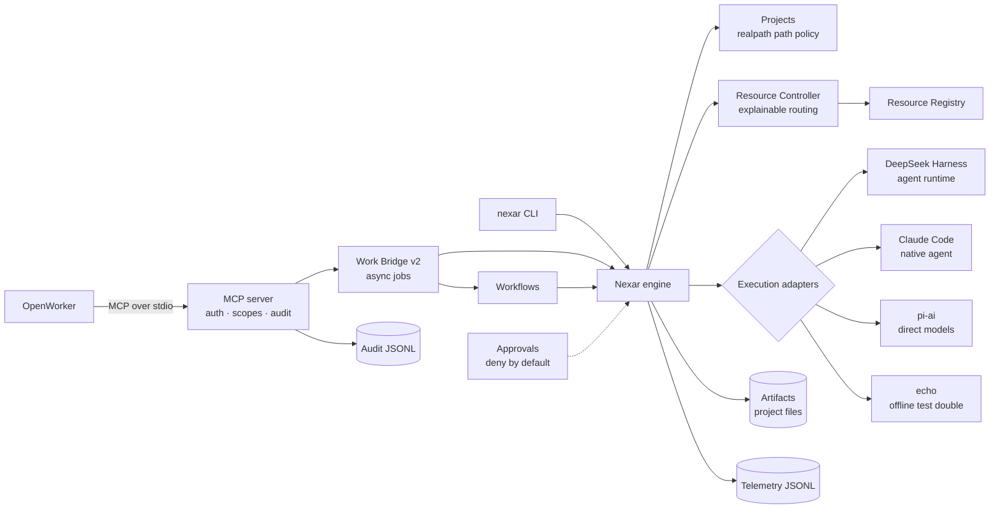

# Nexar

**A local-first Personal AI Operating Layer.** Nexar understands a task, chooses the right AI
resource for it, orchestrates the work, executes it safely, and records what happened — so that
over time it can make better resource decisions.

Nexar is not a chatbot and not a wrapper around one model or vendor. Models, providers, coding
agents, and productivity engines are **components behind adapters**; Nexar owns the stable domain:
tasks, AI resources, the resource registry, the resource controller, routing policy, execution
adapters, and telemetry.

> Status: **v0.2 — Personal Work** (developer preview). Nexar can be driven from OpenWorker over an
> authenticated, audited stdio MCP server and produces documentation and meeting drafts as local
> files inside a project. It sends, publishes and changes nothing outside your machine. See
> [Implemented vs planned](#implemented-vs-planned).

## Why

An engineer or consultant today juggles subscriptions (Claude Code, Codex, Antigravity), API keys
(DeepSeek, Anthropic, OpenAI), local models, and productivity tools — each with its own routing,
auth, and blind spots. Nexar is one layer that:

- reasons about **all** available AI resources (not just models) and picks one per task, with an
  explanation;
- runs work through the right engine — an agent harness, a native coding agent, or a direct model
  call — without coupling to any of them;
- keeps credentials in their owners' hands and data on the owner's machine by default;
- records uniform telemetry (usage, cost, latency, outcome) to support quota-, cost-, and
  quality-aware scheduling later.

## Architecture in one picture



Three questions are kept separate: **who executes** (Resource Controller) · **how the work is
orchestrated** (DeepSeek Harness or a native agent's loop) · **how a provider is called** (pi-ai or
the runtime's internals). Details: [`docs/architecture/overview.md`](docs/architecture/overview.md)
and the [ADRs](docs/adr/).

## Implemented vs planned

**Implemented (v0.1 and v0.2)**

| Area                     | Package                               | Notes                                                                                                                                                                          |
| ------------------------ | ------------------------------------- | ------------------------------------------------------------------------------------------------------------------------------------------------------------------------------ |
| Domain contracts         | `@nexar/contracts`                    | Tasks, AI resources (descriptor vs state), routing, execution boundary, telemetry, typed errors                                                                                |
| Resource Registry        | `@nexar/resource-registry`            | Descriptors + probed state, filtering, discovery seam                                                                                                                          |
| Resource Controller      | `@nexar/resource-controller`          | Deterministic policy v1, explainable decisions with reason codes                                                                                                               |
| Telemetry                | `@nexar/telemetry`                    | Redacting JSON logger, JSONL / in-memory sinks                                                                                                                                 |
| Core engine              | `@nexar/core`                         | Task → route → execute → record; timeouts, cancellation; strict config; workspace policy enforced before routing                                                               |
| Projects                 | `@nexar/projects`                     | Projects with realpath containment (ADR-012), default merging, document sets as references                                                                                     |
| Artifacts                | `@nexar/artifacts`                    | Local store under `<project>/.nexar/artifacts/<task>/`: sanitized names, no overwrite, drafts under `drafts/` (ADR-013)                                                        |
| Approvals                | `@nexar/approvals`                    | Fail-closed, fingerprint-bound, single-use approvals with a file store; no outward executors are registered (ADR-016)                                                          |
| Access                   | `@nexar/access`                       | Scoped client tokens (hashed at rest, revocable) and a one-record-per-request audit log (ADR-015)                                                                              |
| Workflows                | `@nexar/workflows` + `workflows/`     | Data-driven: technical documentation, SOW, solution proposal, meeting brief (+ follow-up draft); untrusted-input boundary, drafts only (ADR-017)                               |
| MCP server               | `@nexar/integration-mcp`              | stdio-only server (`@modelcontextprotocol/server@2.2.0`): `nexar.submit_work`, `work_status`, `route`, `resources`, `workflows`                                                |
| OpenWorker Work Bridge   | `@nexar/integration-openworker`       | Work Bridge v2: project-required requests, async jobs, per-client idempotent request ids, result artifact, route explanations, workflow requests                               |
| Claude Code adapter      | `@nexar/integration-claude-code`      | Native agent via `claude -p`; read-only by default; **verified live**                                                                                                          |
| DeepSeek Harness adapter | `@nexar/integration-deepseek-harness` | Nexar-owned JSON-RPC client for `dsh --profile sdk`; handshake verified against real `dsh 0.2.0-rc.2`; model execution needs `DEEPSEEK_API_KEY`; stops its whole process group |
| pi-ai adapter            | `@nexar/integration-pi`               | Direct models via exact-pinned `@earendil-works/pi-ai@0.99.2`; OpenAI-compatible local endpoints                                                                               |
| Echo adapter             | `@nexar/integration-echo`             | Deterministic offline resource for CI and zero-credential runs                                                                                                                 |
| CLI                      | `@nexar/cli`                          | `doctor`, `resources`, `route`, `run`, `projects list`, `artifacts list`, `approvals list\|approve\|deny`, `clients add\|list\|revoke`, `mcp serve`, `workflows list`          |

**Verified live:** OpenWorker v0.3.0's own MCP client (`coworker.mcp.MCPManager`) drove
`nexar mcp serve` → Claude Code → artifacts for a raw request, the `sow` workflow and `meeting-brief`
(including a prompt-injection attempt that produced only drafts), and a CLI `technical-documentation`
run succeeded with the example config. DeepSeek Harness and pi-ai live model runs are still blocked on
credentials ([#1](docs/backlog/001-deepseek-harness-live-smoke-test.md),
[#2](docs/backlog/002-pi-ai-live-smoke-test.md)).

**Planned, not built** — see [`docs/roadmap/ROADMAP.md`](docs/roadmap/ROADMAP.md) and [`docs/backlog/`](docs/backlog/):

- Outward actions: sending email, calendar changes, publishing or uploading (approvals exist; no executors).
- Network (HTTP) MCP transport and remote/mobile access (v0.5 control plane).
- DOCX / PDF / PPTX export ([NXR-017](docs/backlog/017-document-export-formats.md)).
- Memory and retrieval (v0.6); automation and scheduling (v0.7).
- Quota- and cost-aware routing (v0.4).
- The engineering fleet (v0.3): Codex, Antigravity, DeepSeek Harness ACP, Delegate Skills adapter.
- OS-level sandbox for agent runtimes ([#17](docs/backlog/024-os-level-sandbox-for-agent-runtimes.md)).

## Using Nexar from OpenWorker

OpenWorker starts `nexar mcp serve` as a child process and authenticates with a scoped client token
from `nexar clients add`. Setup, tool reference, the 120 s polling model and the `workflow` request
shape are in [`docs/integration/openworker-mcp.md`](docs/integration/openworker-mcp.md).

## Workflows

A workflow is a directory of data (`workflow.json` plus Markdown templates); adding one needs no code
change. Results are saved as artifacts inside the project; anything meant for another person is a
draft under `drafts/`. Nothing is sent.

```bash
node apps/cli/dist/main.js workflows list
node apps/cli/dist/main.js run --workflow sow --project demo-project \
  --input clientName="Acme Corp" --input objectives="Migrate the billing system" \
  --list-input deliverables="Migration plan, Runbook"
```

Project ids come from the `projects` list in your config (`nexar projects list`); the example config
defines `demo-project`. Inputs are untrusted text for the model. See [`workflows/README.md`](workflows/README.md).

## Getting started

Requirements: Node ≥ 22.19, pnpm 10 (`corepack enable`), git.

```bash
pnpm install
pnpm check                     # format, lint, boundaries, typecheck, test, build
node apps/cli/dist/main.js doctor
node apps/cli/dist/main.js resources
node apps/cli/dist/main.js route --kind coding "refactor the billing module"
node apps/cli/dist/main.js run --kind general "hello"   # offline echo resource by default
```

Without a config file Nexar uses a built-in offline configuration (the `local-echo` resource). To
use real resources, copy [`config/nexar.config.example.json`](config/nexar.config.example.json) to
`nexar.config.json` (or pass `--config`) and see [`config/README.md`](config/README.md).

### External runtimes (optional)

| Runtime                                                                          | Needed for                  | How Nexar uses it                                                                                          |
| -------------------------------------------------------------------------------- | --------------------------- | ---------------------------------------------------------------------------------------------------------- |
| `claude` (Claude Code CLI), logged in                                            | `claude-code` resource      | `claude -p` subprocess; Nexar never reads its credentials                                                  |
| `dsh` `0.2.0-rc.2` (`npm i -g @deepseek-ai/dsh@0.2.0-rc.2`) + `DEEPSEEK_API_KEY` | `deepseek-harness` resource | `dsh --profile sdk` subprocess, isolated `DSH_HOME`, allowlisted env, DeepSeek session-log upload disabled |
| Provider API key (e.g. `ANTHROPIC_API_KEY`) or a local OpenAI-compatible server  | `pi` resources              | in-process pi-ai call                                                                                      |

`nexar doctor` reports which of these are available.

## Tests

```bash
pnpm test                      # offline, deterministic; no paid calls
NEXAR_LIVE_TESTS=1 pnpm test   # opt-in live tests (may cost money)
NEXAR_DSH_BIN=$(which dsh) pnpm test   # opt-in real dsh handshake (no model call)
```

CI (GitHub Actions) runs the full gate plus a gitleaks secret scan; it never calls paid APIs.

## Security

Local-first; credentials stay in the environment or in each runtime's own store and are referenced
in config by name only; subprocess runtimes get a minimal/scrubbed environment; runtime state lives
in git-ignored `.nexar/`; logs are redacted. v0.2 adds: realpath containment of every path a request
can influence, client tokens (hashed, scoped, revocable) on every MCP call, an allowlisted audit log
with no prompts, paths or secrets, a stdio-only server whose stdout carries protocol frames only,
human approvals that deny by default, and no code path that sends anything outward. Threat
assumptions and known gaps (no OS sandbox yet; prompt injection is mitigated, not prevented):
[`docs/architecture/security.md`](docs/architecture/security.md).

## Repository map

`apps/cli` · `packages/{contracts,resource-registry,resource-controller,telemetry,core,projects,artifacts,approvals,access,workflows}` ·
`integrations/{echo,claude-code,deepseek-harness,pi,openworker,mcp}` · `workflows/` · `config/` ·
`docs/{architecture,adr,integration,research,roadmap,backlog,devlog}`.
Contributor/agent operating rules: [`CLAUDE.md`](CLAUDE.md).

## License

No license has been chosen yet; all rights reserved by the repository owner until one is added.
