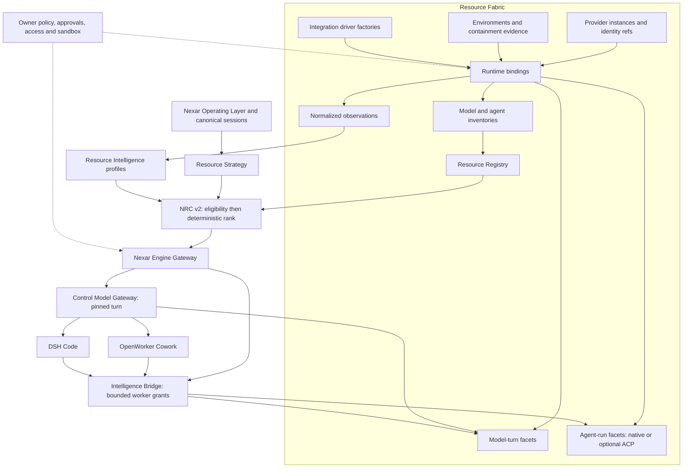

# ADR-029: Resource Fabric and Provider Runtime v2

- Status: **Proposed**
- Date: 2026-10-08
- Research baseline: 4c69d1cd76c8182313f762a90dd7925c98dfa7bc, origin/feat/nexar-resource-orchestration
- Research branch: research/nxr-070-resource-fabric
- Implementation: **NOT STARTED; owner permission not granted**
- Prerequisite: independently accepted v0.6 baseline reconciled before implementation

## Context and problem

Nexar owns intelligence resources, provider policy, Resource Strategy and NRC. OpenWorker owns Cowork orchestration; DSH owns Code orchestration. Existing model-turn and delegated worker gateways enforce different contracts. Those responsibilities remain fixed.

The [source study](../research/upstream/nxr-070-t3code-goose-comparative-study.md) verifies substantial v0.6 functionality: scoped inventory identities, stable resources, freshness/generation guards, deterministic eligibility, measured ranking, bounded canonical context and gateway pinning. Current composition nevertheless uses fixed default connections and credential slots; environment identity and independent account/runtime lifecycle are incomplete. Resource-ID diversity is weaker than account/session independence. A generalized runtime must not erase these distinctions.

This ADR proposes an additive normalized Resource Fabric, supported by [NRC v2 design](../architecture/nxr-070-nrc-v2-resource-intelligence.md) and [implementation blueprint](../architecture/nxr-070-resource-fabric-implementation-blueprint.md). It is an architecture-review proposal, not an accepted decision or a claim that v0.6 acceptance passed.

## Constraints

1. Nexar retains global ownership of resources, provider policy, canonical sessions, authorization and routing.
2. Model-turn, agent-run and tool-use remain separate; tool/MCP support alone does not imply Control compatibility.
3. Control stays pinned for an entire active loop; any vendor change requires a whole safe restart with a new decision. Workers can differ by bounded unit.
4. No harvesting third-party cookies, credential files, keychains or private tokens. Credentials are references or officially runtime-owned.
5. Registry reports facts, Strategy expresses plan intent, NRC allocates. Scores never authorize access.
6. Unknown quota, cost, context or quality stays unknown; policy decides whether unknown is acceptable.
7. Upstream types/protocols remain in integrations. Contracts are dependency-free, versioned, bounded and offline-testable.
8. Existing ChatGPT, Claude, Codex, Antigravity, pi/local/custom resources and pins remain supported throughout migration.
9. No replacement of OpenWorker/DSH, network MCP change, cloud plane, scheduler, memory, automation, mobile, learned routing or automatic billing management.
10. This branch changes architecture documents only and does not modify authoritative v0.6 state.

## Proposed decision

Adopt explicit ProviderInstance identity and scoped lifecycle from T3 as patterns, adapt ACP interoperability demonstrated by Goose as an optional AgentRuntime, and keep Nexar's resource, policy, gateway and security ownership.

Resource Fabric is an ownership and normalization boundary rather than another orchestration engine. Host composition wires driver factories and runtime ports. It has no reason to import T3/Goose wholesale. A proposed packages/resource-fabric module can coordinate config projection and binding lifecycle; vendor implementations remain under integrations. First-slice value does not depend on introducing a new package if existing host/registry seams suffice.

### Domain graph and lifecycle

| Proposed concept            | Responsibility and relationship                                                                     | Persistence / identity                                                           | First slice                               |
| --------------------------- | --------------------------------------------------------------------------------------------------- | -------------------------------------------------------------------------------- | ----------------------------------------- |
| ProviderDriver              | Family behavior and validated configuration factory; discovers supported execution/inventory facets | Code registration, driver kind; no credentials/session persistence               | Small integration/host factory descriptor |
| ProviderInstance            | Owner configuration intent, label, enabled flag, identity reference; distinct from provider         | provider-instance@1; opaque immutable ID, label mutable                          | Project legacy default connections        |
| AccountIdentity             | Optional privacy-safe principal assertion, issuer and verification state                            | Private optional reference, not email in telemetry or auth proof                 | Unknown unless official evidence exists   |
| CredentialRef               | Reference resolved only by authorized host/adapter                                                  | Existing reference semantics; instance-owned keystore slots later                | Preserve legacy resolver                  |
| RuntimeDefinition           | Execution class and integration adapter/capability facets                                           | runtime-definition@1; registered logical key, immutable class                    | Project existing adapters                 |
| RuntimeEnvironment          | Where execution exists and its trust/containment properties                                         | runtime-environment@1; opaque ID, kind and bounded evidence                      | desktop and plane aliases only            |
| RuntimeBinding              | Instance + runtime + environment + route; independently enabled/authenticated                       | runtime-binding@1; opaque binding ID with stable tuple validation                | Project existing inventory tuple          |
| RuntimeSession              | Ephemeral native process/session lifecycle behind binding                                           | Private native ID/optional resume ref, never identity of a Resource              | Existing runtime handling retained        |
| Model/Agent Inventory       | Evidence of selectable explicit models or semantic runtime default and capabilities                 | resource-inventory@2; observed time, generation, source; caches stale on restore | Project inventory@1                       |
| Resource                    | Executable model/agent candidate, capabilities, support and binding references                      | resource@2 view; stable ID/legacy alias rules                                    | Existing descriptor projected             |
| ResourceObservation/Profile | Normalized facts and bounded aggregate suitable for pure policy                                     | observation@1/profile@1; no prompt/secret fields                                 | Minimal identity/health projection        |
| ResourceStrategy            | Plan-level intended resources and independence/budget requirements                                  | Preserve strategy@1; strategy@2 only for new semantics                           | Keep current                              |
| NRCDecision                 | Eligibility/ranking/fallback explanation over one immutable facts snapshot                          | route-decision@2; policy version, facts digest, lineage                          | Add compatible explanation projection     |
| ContextHandoff              | Bounded portable task state with provenance and delivery receipt                                    | context-handoff@1 private content + content-free manifest                        | Deferred to 070J                          |

This is not a mandatory serial chain. Sessions are optional execution state; one instance can have multiple bindings; inventories can be obtained without inference or session creation. Account association does not grant shared authentication.

### Driver versus host/runtime ports

The driver validates family-specific config and supplies factories for supported facets. Host owns lifecycle scopes, registry publication, private credential resolution, cancellation and environment enforcement. Environment discovery belongs to a host/environment service; the driver interprets compatible binaries/endpoints inside that allowed environment. Registry owns inventory/state storage. NRC owns no discovery IO.

Compose existing InventorySource, ModelTurnPort and ExecutionAdapter with optional HealthPort, UsagePort and SessionPort facets. Proposed AgentExecutionPort is an execution facet, not a replacement for ExecutionAdapter. Avoid one mandatory interface requiring all providers to support login, models, threads, fork, quota and tools.

Driver failure creates a structured unavailable binding with preserved config, not deletion. Disable drains/rejects new admissions and cancels bounded jobs according to policy. Remove invalidates inventories and queued routing references, then forgets Nexar-owned credentials; it does not promise vendor grant revocation or delete externally owned runtime homes.

### Identity and inventory authority

Retain current v0.6 inventoryResourceId output for projected defaults. New resource identity includes immutable instance, runtime binding/route, environment, kind and explicit model/agent selection. A versioned tuple specification defines canonical encoding; transient auth/health/generation, labels, tokens and prices never enter the identity.

Aliases retain old pins without silently mapping one account to another. When a configured route is genuinely ambiguous or removed, reject the pin with a migration reason. No arbitrary “closest” resource substitution.

Model and agent candidates remain discriminated. provider-default is a semantic selection for runtime-owned choice, not an explicit fake catalog model. Current model and reasoning configuration belong to a native session or requested options. Static catalogs are advisory metadata and cannot establish availability, auth or quota.

Freshness carries observedAt, attemptedAt, generation, provenance and authority. Restoration is stale. Auth mutation invalidates generation before starting work; late results cannot re-admit old account models. Runtime model rejection produces a fixed reason, marks that route stale/unavailable and permits one bounded refresh, then NRC reconsideration only at a safe boundary.

### Capability negotiation and Control compatibility

Effective compatibility is the intersection of runtime facets, model/agent evidence, environment availability, engine protocol requirements and owner policy. Each facet records supported/unsupported/unknown, evidence generation and options/limits.

Model-turn requires compatible messages, tool-call/reply lineage, streaming/cancellation semantics and normalized provider-private state. Engine Control additionally requires gateway decision lineage, bounded extras, accepted tool protocol and context/options compatibility. Unknown protocol compatibility fails closed. Existing model-turn flags are preserved for v0.6; new runtime classes require explicit evidence.

Agent-run can own substantive native tool execution. It cannot become engine Control merely by offering ACP, MCP, tools or a chat prompt. Future ACP Control compatibility would require a separate verified model-turn adapter and owner decision.

Support classifications remain visible: official-api, official-account, official-native, experimental-client-compat, local/custom. Current source labels do not prove a vendor endorses every runtime combination.

### Sessions, transitions and context

OperatingSession remains canonical. An EngineSession binds its loop/decision; ProviderSession/native ProviderThread are private runtime details referenced by opaque Nexar binding IDs. Add a separate versioned session-binding store instead of rewriting all canonical sessions or copying native state.

Transition results distinguish reuse, next-turn config change, restart/resume within a proven compatible binding, new session with portable handoff and rejection. No mid-loop Control vendor/model option change. Account/environment changes require fresh authentication/session validation; never infer that an opaque resume token is portable.

Extend existing context@1 with typed goals, constraints, decisions, plan/checkpoint, artifact references, prior outcomes, pending work and review requirements. Proposed handoff caps: 24,000 characters plus 32 references, additionally bounded by known target context capacity. Smaller target capacity wins; unknown capacity uses an explicit conservative owner policy and labels estimates. Required constraints must not be silently truncated.

Redact secret-bearing fields before persistence/delivery, treat imported user/artifact text as untrusted, use hashes/revisions/source attribution and artifact references instead of blind file/history dumps. Reject conflicting required constraints or stale checkpoints pending an explicit resolution. Persist pending receipt before delivery; mark delivered only after acknowledgement; ambiguous delivery requires a fresh native session or owner recovery rather than duplicate injection/replay. Cancelled/failed native writes are never automatically replayed.

### ACP and gateways

ACP is one optional AgentRuntime class beside API, account model-turn, native CLI/SDK, local and custom endpoints. Initial candidate: plane-only delegated Codex ACP after an offline conformance/security spike. Claude/Pi follow only if justified; Antigravity ACP availability remains UNVERIFIED.

Negotiate wire version and individual optional facets. Inspect model/config options, load/resume, fork, cancellation and MCP capabilities for each pinned adapter. Do not equate SDK semver to wire version. Existing native routes remain fallback choices; a missing ACP binary disables its binding without disabling a provider family.

Forward only approved stdio MCP configuration and scoped environment/credential references. Native agent tool execution is externally dispatched, preventing duplicate host execution. The Nexar permission broker is authoritative; provider “Auto”/full-access/bypass mappings cannot grant permission. OS containment still limits the process.

No third gateway is required initially: existing Intelligence Bridge grants plus an ExecutionAdapter facet can dispatch an agent-run. An Agent Execution Gateway would require demonstrated new brokerage requirements and its own ADR. Do not rewrite OpenWorker or DSH.

### Resource Intelligence and NRC v2

Keep observation, aggregate, profile, policy and decision separate. Facts carry authority, known/unknown/unavailable/stale semantics, timestamps, sample windows and confidence. Pure NRC v2 hard-filters before deterministic ranking; current policies remain unchanged. Unknown signals are neutral unless owner policy requires known data.

Review diversity becomes explicit across resource, provider, verified principal, runtime/environment and session. Cost/allowance/context privacy and execution health are validated; no fabricated model-quality numbers. Measured evaluation history can enrich task fit after offline calibration.

Fallback is bounded, capability-compatible and safe only at a new dispatch/whole restart boundary. Required pinning, review independence, budget, permissions and containment remain constraints. Decision records expose selection, rejected alternatives, neutral/missing factors, bounded fallback and the facts/policy versions needed for reproduction. Details are in the NRC design.

## Architecture diagrams



```text
                        Nexar Operating Layer / canonical session
                                         |
                                 Resource Strategy
                                         |
              Registry facts -----> NRC v2 <----- Resource Intelligence
                                         ^                  ^
                                         |          Normalized observations
                              Resource Fabric               |
                       instances -- runtime bindings -------+
                                         |
                       environments + inventories + capability evidence
                                         |
                              decisions / bounded grants
                                         v
                                 Engine Gateway
                            /                       \
             pinned Control Model Gateway      Intelligence Bridge
                       |                            |
               OpenWorker / DSH           model-turn / native / ACP worker
                       |                            |
                       +-------- normalized execution facets --------+
```

Arrows distinguish facts, decisions and execution. Fabric does not call engines to choose provider policy; engines consume Nexar decisions.

## Decision register

Every row is a proposed owner decision. “Owner approval” is architecture approval before implementation, not authorization for live login or allowance use. Source keys resolve in the comparative study.

| Decision                 | Options considered                              | Recommendation and reuse    | Evidence                 | Benefit / tradeoff / risk                             | Open question                      | Owner approval              |
| ------------------------ | ----------------------------------------------- | --------------------------- | ------------------------ | ----------------------------------------------------- | ---------------------------------- | --------------------------- |
| D1 Ownership             | Engine-owned vs Nexar-owned resources           | KEEP NEXAR / ADOPT-PATTERN  | N6–N12                   | Cross-engine policy; more host coordination           | None for invariant                 | Confirm scope               |
| D2 Instance identity     | Family key vs first-class instance              | ADOPT / ADOPT-PATTERN       | N13,N16,T1–T3            | Multi-account; config/version migration               | Principal evidence privacy         | Required                    |
| D3 Driver composition    | Giant interface vs optional ports               | ADAPT / REIMPLEMENT         | N2,T2,G1                 | Smaller contracts; negotiation complexity             | Package needed in first slice?     | Required                    |
| D4 Environment binding   | Opaque options vs explicit ID                   | ADOPT / REIMPLEMENT         | N3,N20,T4                | No desktop/plane collision; persisted refs            | Remote environment future only     | Required                    |
| D5 Resource IDs          | Replace all IDs vs preserve/default aliases     | KEEP NEXAR / ADAPT-CONTRACT | N4–N5                    | Pins survive; alias validation complexity             | Ambiguous old config               | Required                    |
| D6 Inventory authority   | Static availability vs evidenced freshness      | KEEP NEXAR / ADOPT-PATTERN  | N3–N5,T11–T12,G3         | No fabricated models; some routes default-only        | Native listing drift               | Confirm                     |
| D7 ACP scope             | ACP-only vs optional worker                     | ADAPT / ADAPT-CONTRACT      | N21,G5–G8                | Runtime portability; extra trust boundary             | Pinned Codex ACP conformance       | Required                    |
| D8 Permissions           | Native Auto vs Nexar grants                     | KEEP NEXAR / REIMPLEMENT    | N12,N21,G5–G6            | No permission widening; mode mismatch handling        | Unknown native tool requests       | Confirm                     |
| D9 Session transitions   | Copy opaque state vs portable handoff           | ADAPT / ADOPT-PATTERN       | N18–N19,T7–T10           | Safe switching; bounded context loss possible         | Required-item overflow             | Required                    |
| D10 Control pinning      | Mid-loop switching vs restart only              | KEEP NEXAR / ADOPT-PATTERN  | N11,T7                   | Lineage continuity; less opportunistic fallback       | Safe engine checkpoint             | Confirm                     |
| D11 Telemetry authority  | Merge counts vs per-field provenance            | ADAPT / ADAPT-CONTRACT      | N9–N10,T14,G11–G13       | Honest NRC inputs; additional metadata                | Supported vendor quota interfaces  | Required                    |
| D12 NRC ranking          | Learned scores vs deterministic rules           | KEEP NEXAR / REIMPLEMENT    | N7–N10                   | Reproducible/cold neutrality; delayed quality ranking | Owner task benchmark cohort        | Required                    |
| D13 Review diversity     | Different ID vs explicit independence           | ADAPT / REIMPLEMENT         | N6,T5–T7                 | Stronger review; unknown identity can block           | Default required dimensions        | Required                    |
| D14 MCP transport        | Stdio only vs HTTP/SSE                          | DEFER / REJECT              | N21,G8                   | Preserve trust boundary; fewer extensions             | Separate security ADR              | Separate approval           |
| D15 Gateway expansion    | Third gateway vs existing bridge facet          | DEFER / REJECT              | N11–N12,G8               | Avoid duplicated grants; facet fit needs proof        | New brokerage requirement          | Required if changed         |
| D16 Secret/history reuse | Third-app import vs owned integrations          | REJECT / REJECT             | N15–N16,T4,T16           | Preserve owner boundary; no effortless imports        | Vendor-supported independent homes | Confirm                     |
| D17 Source reuse         | Copy/embed vs reimplement patterns              | ADAPT / REIMPLEMENT         | T/G pinned LICENSE files | No upstream product coupling; own maintenance         | Per-artifact license/terms         | Required for any code reuse |
| D18 First vertical slice | New login/ACP first vs compatibility projection | ADOPT / REIMPLEMENT         | N1–N14                   | Low risk visible ownership; limited new execution     | Minimal package placement          | Required                    |

## Migration and versioning

Phase 0: reconcile accepted v0.6 and approve architecture. Phase 1: compatibility views and aliases, no credential rewrite. Phase 2: additive instance/environment config and independently versioned inventory capabilities. Phase 3: one optional ACP worker after conformance. Phase 4: observation/profile/NRC enrichment and UX. Phase 5: private session bindings and portable handoff. Phase 6: remove compatibility only after proven migration and rollback.

Use Nexar string-tagged cross-package versions and schemaVersion for documents: provider-instance@1, runtime-definition@1, runtime-binding@1, resource-inventory@2, resource-observation@1, resource-profile@1, route-decision@2, context-handoff@1; new store documents schemaVersion 1. Existing resource descriptor/strategy remain compatible until an explicitly versioned view requires change. Do not claim these proposed tags are implemented exports.

Legacy settings/raw sections remain readable and backed up before additive writes. No destructive rename of existing keystore slots. Alias manifest records origin/version/target with collision rejection. Old reader support is deliberate: new fields travel only under negotiated Desktop/plane features; strict legacy schemas receive legacy projections.

## Threat model and security consequences

| Threat / boundary                      | Required mitigation                                                                               | Residual risk / future gate                          |
| -------------------------------------- | ------------------------------------------------------------------------------------------------- | ---------------------------------------------------- |
| Instance A receives B credentials      | Immutable instance binding, private resolver, distinct owned slots/homes, no renderer values      | Vendor runtime may share state; live isolation spike |
| Desktop credentials cross plane        | Plane-local native auth; references/metadata only over strict protocol                            | Owner-declared mounts are not universally safe       |
| Malicious substituted executable       | Owner install path/version/hash/trust validation, bounded launch, minimal env, argument allowlist | Hash does not establish publisher trust              |
| ACP/MCP input widens scope             | Strict parsers, frame ceilings, negotiated facets, grant intersection, stdio allowlist            | Native process still needs OS containment            |
| Permission modes bypass approval       | Deny default, action fingerprint, single-use token, no *_always translation                       | Unsupported action shape rejects                     |
| Agent tools execute twice              | External-dispatch classification, work-unit idempotency, one authority per action                 | Ambiguous upstream delivery stops/recovery           |
| Native session/resume crosses account  | Bind IDs and verified principal/environment; refuse mismatched opaque state                       | Vendor session semantics require spike               |
| Telemetry leaks prompt/token/path      | Fixed allowlist IDs/counts/reasons/digests; private content store; redaction before write         | Vendor stderr needs bounded scrubbing                |
| Account disable/remove races inventory | Admission closure, generation invalidation, cancel/drain, stale restoration                       | Concurrent old process cannot be treated as fresh    |
| Unknown signals look healthy/free      | Explicit unknown/stale/unavailable; strict policy options                                         | Reduced automatic allocation until observed          |
| Fallback repeats native side effects   | Safe checkpoint requirement, bounded shared retry budget, no auto replay after uncertainty        | Owner recovery may be required                       |

Keep existing sandbox launcher, project containment, ACL/private atomic storage, strict IPC, session leases and engineering approval/commit policy. The hardened plane has no Windows-drive/interop bridge and retains local credentials. Ordinary native read-only work is not automatically equivalent to full OS isolation; current documented security gaps remain gaps. ACP's permissions/capabilities cannot replace process confinement.

## Alternatives and rejected options

| Option                                          | Decision                                      | Reason                                                                                 |
| ----------------------------------------------- | --------------------------------------------- | -------------------------------------------------------------------------------------- |
| Keep v0.6 provider model unchanged indefinitely | REJECT as final target; KEEP during migration | Existing foundations strong, but instance/environment/review gaps remain               |
| Replace provider layer with T3 wholesale        | REJECT                                        | Different product/runtime assumptions and credential patterns                          |
| Embed T3 application/server                     | REJECT                                        | Unnecessary app/session/config coupling; Nexar owns the domain                         |
| Replace OpenWorker with Goose                   | REJECT for NXR-070                            | Cowork engine replacement explicitly outside scope                                     |
| Use Goose as global provider runtime            | REJECT                                        | Would move policy/auth/session ownership and agent-loop semantics                      |
| ACP-only resources                              | REJECT                                        | Direct APIs, account model turns, local/custom and native routes remain                |
| Single giant Provider interface                 | REJECT                                        | Unsupported facets become fake defaults and Control/agent roles blur                   |
| Provider conditionals without common driver     | REJECT as target                              | Repeated ownership/lifecycle logic; some isolated provider-specific code remains valid |
| Big-bang rewrite/migration                      | REJECT                                        | Breaks existing resources/pins/auth and cannot isolate regressions                     |
| Learned model-quality rankings now              | DEFER                                         | No calibrated dataset; deterministic measured policy first                             |

Consequences: more explicit binding/state records, compatibility maintenance and honest unavailable states; better multi-account ownership, deterministic explanation and runtime interoperability. Approval of this ADR alone does not authorize source copying, new network transports, live provider use or release. Review unresolved decisions in D2–D18; implementation follows only the blueprint's baseline and acceptance gates.
