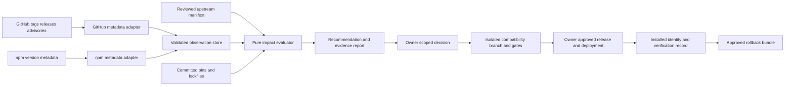

# Nexar Upstream Intelligence & Update Management Architecture

**Date:** 2026-10-17 (Africa/Cairo). **Prepared by:** Codex.
**Status:** Proposed architecture; no service, schedule, dependency update or deployment created.
**Baseline:** Nexar main `6ea56f99d758bc18698c1fa5770b399a283fe6ad`; ADR-030 Accepted.
**Companions:** [reconciliation](nxr-070/NXR070_T3Code_V2_Architecture_Reconciliation.md) and
[approval brief](nxr-070/NXR070_Architecture_Approval_and_Execution_Brief.md).

## 1. Purpose and authority

Nexar should learn about upstream changes continuously while changing its production runtime
deliberately. Discovery is metadata collection. Evaluation is evidence gathering. Approval is an
owner decision with a bounded scope. Installation is a deployment fact. Verification binds test
results to the actual artifact and environment. None implies the others.

Use two upstream roles:

| Role                   | Example          | An update triggers                                                              | It cannot trigger automatically                                     |
| ---------------------- | ---------------- | ------------------------------------------------------------------------------- | ------------------------------------------------------------------- |
| architecture-reference | T3 Code          | Pinned source research, architectural delta, Adopt/Adapt/Defer/Reject decisions | Replacing NRC, adopting T3's thread store, running its agents       |
| runtime-dependency     | DeepSeek Harness | Artifact identity review, compatibility proposal and approved test branch       | Floating package replacement, helper changes, production deployment |

An optional external T3 connector is a **third, separately approved integration role**. Updating an
owner's independently installed T3 application is another activity. Neither changes Nexar's NRC.

DeepSeek Harness remains the primary agent runtime. NRC remains the resource authority.
The updater owns no model credentials, grants, routing policy, task queue or session writer.

## 2. Observed inputs, not invented installed state

The following values were inspected on 2026-10-17 Cairo time:

| Upstream | Available / published                                                                                   | Nexar-approved source state                                                                     | Compatibility observation                                                       |
| -------- | ------------------------------------------------------------------------------------------------------- | ----------------------------------------------------------------------------------------------- | ------------------------------------------------------------------------------- |
| T3 Code  | Stable v0.1.0 → 81493efb71e8e8244f95d3e9f71d8369654ab151; main 67bca6c224b3caf61dc7824f6487d754bcad8f8c | NXR-068 historically studied 8c61e254fd07249b8c420c44d62e8ecd72a78a20; no T3 runtime dependency | Selective stable-source evaluation completed in companion; no T3 protocol tests |
| DSH      | npm latest/next 0.2.0-rc.2; alpha 0.2.1-alpha.5                                                         | ADR-030 approves exact build pin 0.2.0-rc.2; committed runtime package lock                     | Alpha source reviewed; runtime compatibility unknown                            |

“latest” is a mutable npm channel, not a stability assertion: `0.2.0-rc.2` is still a semantic
prerelease, albeit Nexar's deliberately accepted pin. Similarly T3's “Orchestrator V2” product
generation is not its npm/desktop semantic major number.

GitHub's DSH `releases/latest` endpoint returned 404. The individually inspected rc.2 and alpha.5
release records both have `prerelease: true`; no stable release was selected by that endpoint.
Do not relabel a release stable because npm calls its dist-tag `latest`.

### Registry-declared artifact identities

| Exact top-level package        | Published npm integrity (SHA-512 SRI)                                                             | Resolved Git source tag                  |
| ------------------------------ | ------------------------------------------------------------------------------------------------- | ---------------------------------------- |
| @deepseek-ai/dsh@0.2.0-rc.2    | `sha512-EAJ3gPNcVt/uv8X19PMm9NkVhWgT7xXNMk0UKCVm+IQ5rpSQOcsMUa0HWlnYYVybKMsccjcRB21vVVsaXQ6IdA==` | 639ed015397290b3745d163aafe02ffee4aa3f84 |
| @deepseek-ai/dsh@0.2.1-alpha.5 | `sha512-ehpWvmRskdQp+CXO66BeK2HBYB0PQitwdWY13VzUVaspPSFxk0E+cZtvQhDPgc77ZeREbz9InXQzfDJjQ2Wy7g==` | 1517a4dbca0a2789ff1d41ba439600f8547d23fa |

Source: [official npm metadata](https://registry.npmjs.org/@deepseek-ai/dsh). These are declared
identities, not freshly downloaded/verified artifacts. The Git tags were resolved independently;
the inspected npm metadata supplied no gitHead. No transitive artifact closure is attested by this
two-row table. Actual evaluation must check artifact bytes, source association, signatures where
available, and every resolved dependency under the candidate lock.

This assignment did not inspect an owner's currently running installation. A committed pin and
historical acceptance document must not populate a live machine's INSTALLED or VERIFIED records.
Use the exact package metadata, source references and security advisories listed in the companion
evidence index.

## 3. Proposed component boundaries



Proposed implementation locations are design suggestions, not modules present in main:

| Component                           | Suggested location                                                                    | Responsibility / excluded authority                                                                 |
| ----------------------------------- | ------------------------------------------------------------------------------------- | --------------------------------------------------------------------------------------------------- |
| Reviewed manifest                   | config/upstreams.json                                                                 | Allowed upstreams, approved refs, channel policy and evaluation references; no secrets              |
| Neutral observation/event contracts | Small internal types first; add shared contracts only if multiple consumers need them | Version/source/artifact identity and evidence states, not provider/account identities               |
| GitHub adapter                      | integrations/upstream-github                                                          | Official REST releases/tags/commits/advisories, ETags and bounded source metadata                   |
| npm adapter                         | integrations/upstream-npm                                                             | Public metadata, dist-tags, exact versions and declared artifact integrity                          |
| Evaluator                           | A small proposed packages/upstream-intelligence module if a package is justified      | Pure version/channel/impact decisions with injected clock and facts; no IO or authorization         |
| Composition/CLI                     | packages/host and apps/cli                                                            | Owner-started discovery and reports; proposed commands must be clearly labelled as new              |
| Local operational data              | Ignored .nexar/upstream/                                                              | Bounded observations, cursors, ETags, notification acknowledgments and immutable evaluation records |
| Reviewed evaluations                | docs/research/upstream/                                                               | Pinned findings and compatibility reports committed through normal review                           |
| Runtime-specific tests              | integrations/deepseek-harness plus existing Desktop/CLI/sandbox tests                 | Verify exact candidate; never let a metadata adapter start runtime tests                            |

Do not put GitHub/npm response types in NRC contracts. Upstream package internals remain within
integrations under ADR-008. The manifest contains URLs/version data, not imports or vendor runtime
types. Provider account identity and upstream release identity are different domains.

The existing Desktop scheduled-task feature may provide a future invocation seam, but
research/metadata discovery should use a deterministic, non-model job. Do not create a scheduled
AI prompt or duplicate an agent scheduling framework just to poll version metadata.

## 4. Proposed source-controlled manifest

The manifest is a **reviewed policy/configuration document**. High-frequency network observations
live in the local ledger, not in automated daily commits. Approved changes are explicit reviewed
manifest changes; API discovery never writes the approved reference.

Required schema concepts:

- `schemaVersion`, stable upstream id, project name, repository, role and adapter kind.
- Approved reference and evidence/owner decision; exact runtime pin if applicable.
- Source SHA plus association confidence; a tag name alone is insufficient.
- Channel policy; last evaluated version/ref and compatibility state.
- Last approved upgrade; nullable for initial acceptance or architecture-only references.
- Separate per-environment installation/verification observations, referenced from a local ledger.
- Evaluation/report hashes, approved rollback identity, timestamps and immutable lifecycle events.
- No provider keys, tokens, account subjects, credential hashes, local account-home paths or signed URLs.

Example proposal, using the current observations:

```json
{
  "schemaVersion": 1,
  "upstreams": [
    {
      "id": "t3code-reference",
      "projectName": "T3 Code",
      "repository": "https://github.com/pingdotgg/t3code",
      "role": "architecture-reference",
      "discovery": { "adapter": "github", "releaseChannel": "stable" },
      "approvedReference": null,
      "historicalResearchReference": {
        "sourceCommit": "8c61e254fd07249b8c420c44d62e8ecd72a78a20",
        "evidence": "docs/research/upstream/provider-model-inventory-patterns.md"
      },
      "lastEvaluated": {
        "version": "v0.1.0",
        "sourceCommit": "81493efb71e8e8244f95d3e9f71d8369654ab151",
        "scope": "selected-architecture-source",
        "compatibilityState": "REFERENCE_RECONCILIATION_PROPOSED"
      },
      "installedVersion": null,
      "architectureDecisions": ["ADR-008", "ADR-027", "ADR-028", "ADR-030", "ADR-029-proposed"],
      "lastApprovedUpgrade": null
    },
    {
      "id": "deepseek-harness-runtime",
      "projectName": "DeepSeek Harness",
      "repository": "https://github.com/deepseek-ai/deepseek-harness",
      "role": "runtime-dependency",
      "packageName": "@deepseek-ai/dsh",
      "discovery": {
        "adapter": "npm-and-github",
        "releaseChannel": "owner-approved-exact",
        "observePrereleases": true
      },
      "pinnedVersion": "0.2.0-rc.2",
      "approvedReference": {
        "version": "0.2.0-rc.2",
        "sourceCommit": "639ed015397290b3745d163aafe02ffee4aa3f84",
        "sourceAssociation": "resolved-git-tag-not-npm-provenance-attestation",
        "approval": "docs/adr/030-unified-dsh-first-agent-runtime.md"
      },
      "lastEvaluated": {
        "version": "0.2.1-alpha.5",
        "sourceCommit": "1517a4dbca0a2789ff1d41ba439600f8547d23fa",
        "scope": "source-and-registry-metadata",
        "compatibilityState": "RUNTIME_COMPATIBILITY_UNKNOWN"
      },
      "installedVersion": null,
      "installationObservation": null,
      "architectureDecisions": ["ADR-002", "ADR-008", "ADR-027", "ADR-030"],
      "lastApprovedUpgrade": null
    }
  ]
}
```

The T3 approved reference is intentionally null: being researched, or being the requested research
target, is not an owner decision to adopt source or deploy an integration. DSH's initial approval
is recorded separately from a later approved _upgrade_. The deployment ledger will carry actual
Windows/Linux installed observations after an authorized operator records them.

### State model

Use append-only events per upstream **version/artifact/evaluation/environment**, rather than one
global enum that loses a previous approved version when a new version appears.

| State/event | Required evidence                                                                       | Does not imply                                                   |
| ----------- | --------------------------------------------------------------------------------------- | ---------------------------------------------------------------- |
| AVAILABLE   | Official version/tag/release observation with retrievedAt and identity                  | Safe, stable, installed or approved                              |
| EVALUATED   | Named scope, pinned source/artifact, report and unresolved findings                     | Runtime compatible; a source-only evaluation must say so         |
| APPROVED    | Explicit owner decision, exact artifact/closure, scope and accepted risks               | Installed or tests already passed unless linked evidence says so |
| INSTALLED   | Actual deployed artifact/helper identity and environment observation                    | Verified in that environment                                     |
| VERIFIED    | Passing source/artifact-bound gates, environment and limits                             | Every platform or future version is verified                     |
| ROLLED_BACK | Actual previous artifact restored, identities checked, reason and post-restore evidence | Canonical data rolled back or newly approved data deleted        |

Compatibility is a separate dimension, for example UNKNOWN, SOURCE_REVIEW_ONLY, INCOMPATIBLE,
GATES_PENDING, VERIFIED_FOR_ENVIRONMENT. Reference-only records may never enter INSTALLED.
APPROVED decisions need an explicit scope such as evaluation execution or production promotion;
an evaluation approval cannot be reused for deployment.

A new availability event must not overwrite the existing approved/verified baseline.
An advisory or failed gate can suspend an approval for future rollout while retaining its history.

## 5. Discovery and impact analysis

### Discovery sources and normalization

1. Query GitHub releases and tags independently. Store draft/prerelease flags, tag object and
   peeled commit, publication/update times and release-body digest. Release target_commitish may
   be a mutable branch; resolve the tag to an exact commit.
2. Observe current main only as a research signal. Do not make a moving branch an approved build
   dependency. Detect a tag resolving to a different commit as a supply-chain incident.
3. Query npm dist-tags and exact version metadata separately. Record version publication time,
   tarball URL, integrity, signature/provenance metadata and dependency declarations. Dist-tag
   movement is its own event, not an approval.
4. Classify SemVer prereleases, nightly tags and project-specific channels independently from
   GitHub flags and npm labels. Conflicts become explicit “classification uncertain”.
5. Collect release notes as untrusted text. Extract affected paths/APIs and maintainer-declared
   breaking changes; compare pinned source where relevant. No changelog command is executable
   instruction and no model-generated summary can approve an update.
6. Match current and candidate dependency closures against public advisories. Keep advisory ID,
   affected ranges, update timestamp, matched package path, severity and exposure assessment.
   Advisory absence is not a vulnerability-free certificate.

Impact classification should include protocol, overlay/profile rows, permissions/tools,
routing/accounting, credentials, context/memory, lifecycle, isolation, packaging/helper,
dependencies, migrations and documentation-only change. A patch version is not a guarantee
against breaking behavior, particularly in a preview runtime.

The evaluator emits a recommendation such as HOLD_PIN, RESEARCH_REFERENCE, PROPOSE_COMPATIBILITY_EVALUATION,
SECURITY_REVIEW_REQUIRED or NO_RELEVANT_CHANGE, with evidence and confidence. It cannot emit an
installation command as an automatically executable action.

### Safety and reliability requirements

- Metadata discovery never downloads/executes release binaries, installs npm packages, enables
  plugins, authenticates providers or consumes model allowance.
- Use allowlisted official repository/package identities and HTTPS destinations; reject arbitrary
  URLs, redirects to unapproved hosts, local/private network targets, excessive bodies and malformed JSON.
- Suggested limits: 2 MiB metadata response, 128 KiB release-note text retained per release,
  bounded pagination and per-run request budget. Oversized responses fail explicitly; keep old state.
- Use ETag/Last-Modified, bounded caches, Retry-After, exponential backoff with jitter and GitHub
  rate-limit headers. Preserve a reserve; do not assume 304 responses eliminate every rate limit.
- Prefer public unauthenticated access; if an owner configures an API token, resolve its reference
  from host-owned secret storage, with read-only minimum access. Never store it in the manifest,
  logs, alerts, prompts, source snapshots or the WSL runtime.
- One active discovery writer under a lock; atomic updates and immutable bounded event records.
  Restart resumes metadata cursors only; it cannot replay deployments or runtime jobs.
- Offline/API/billing failures produce an unavailable/stale observation with last success age.
  They never become “no updates” and never erase a previous approved pin.
- No updater listens on a new network port, modifies security settings or reads provider homes.

### Scheduling proposal — not installed by this document

| Trigger                       | Proposed default                                 | Result                                                                 |
| ----------------------------- | ------------------------------------------------ | ---------------------------------------------------------------------- |
| Metadata discovery            | Daily 09:00 Africa/Cairo, small randomized delay | New release/tag/dist-tag/advisory facts; no repeated unchanged notice  |
| Impact summary                | Monday 09:15 Africa/Cairo                        | One digest of changed or unresolved actionable evaluations             |
| Advisory triage               | Immediately after each newly observed advisory   | Range match and exposure classification; urgent alert only if relevant |
| Optional faster advisory feed | Owner-approved hourly metadata-only feed         | Shorter discovery latency; no executable update                        |
| Upgrade execution             | Explicit owner assignment                        | Isolated evaluation branch, named gates and later promotion approval   |

“Immediate” means immediate classification on observation. A daily poll cannot guarantee immediate
notification at the moment the vendor publishes an advisory. Record this latency honestly.

Run the same deterministic discovery entry point manually or under an owner-controlled Windows Task
Scheduler task or a Linux user timer. Hosted GitHub Actions is optional, using the same fixtures,
manifest and report schema; hosted billing/runner restrictions must not prevent local discovery.
Do not require a cloud runner or a running Desktop window. Do not create a schedule without the
owner accepting execution location, network access, timing and notification destination.

Deduplication key: upstream id + version/tag/commit or advisory id + artifact/notes/advisory revision.
Acknowledge delivery separately. Retry the same event without duplicate notifications. An unchanged
version with a changed integrity, advisory or release-note digest is a new event worth evaluation.
Weekly digests group existing unresolved events; they do not create a new issue every week.

Retention should keep approved decisions and release/rollback evidence indefinitely, and prune
routine unchanged checks under an owner-approved bounded policy. Never prune the only record
binding a deployed artifact to its approval.

## 6. Controlled DSH upgrade pipeline

**Do not run this pipeline as part of NXR-070R.** It is the proposed procedure for a future
explicitly authorized assignment. Production promotion is forbidden until all applicable gates pass.

| Gate | Required work                                            | Passing evidence / stop condition                                                                                                                                                            |
| ---- | -------------------------------------------------------- | -------------------------------------------------------------------------------------------------------------------------------------------------------------------------------------------- |
| 1    | Compare pinned, deployed-observed and candidate versions | Exact pins, dist-tags, channel and both environment identities; unknown installed identity is recorded, not guessed                                                                          |
| 2    | Verify published artifact identity                       | Download only during approved evaluation; compute bytes vs registry SRI, verify signatures/provenance when available, pin source association and full transitive closure; discrepancy blocks |
| 3    | Inspect relevant breaking/security changes               | Source/release/lock diff covering ACP, profiles, tools, lifecycle, compaction, plugins, credentials and native payloads; explicit unresolved findings                                        |
| 4    | Change pins on an isolated branch                        | Reviewed exact pin, dsh-runtime package lock and build manifests; existing approved branch and artifacts preserved                                                                           |
| 5    | Verify overlays/tool catalogs                            | Effective composed config and callable tools for Cowork/Coding; every new row classified; no shell/web/plugin/subagent escape in Cowork                                                      |
| 6    | Verify ACP initialization and permission round-trips     | Real initialize/new/config/prompt/cancel/close plus broker deny/default and one-shot decisions; generic ACP agentInfo version is not artifact identity                                       |
| 7    | Verify NRC model routing                                 | One intended NRC route, pin continuity, rejected route mutation, bounded fallback, once-only accounting and preserved Code native-key exception                                              |
| 8    | Verify Cowork and Coding profiles                        | Real profile smoke and permission behavior; no second harness or provider authority in DSH                                                                                                   |
| 9    | Verify Windows/WSL helper compatibility                  | Exact protocol/release/capabilities/runtime match and deliberate mismatch/missing-helper rejection; coordinated deployment manifest                                                          |
| 10   | Verify filesystem/network isolation                      | Real kernel read/write denial, approved inputs, flat scratch, no host/private sockets or direct egress; sandbox-unavailable turn fails closed                                                |
| 11   | Verify Project Memory/compaction                         | Required entries and hashes remain across real compaction and model steps; project/session isolation and auxiliary calls through NRC                                                         |
| 12   | Verify cancellation/cleanup                              | Foreground + descendant cancellation, helper disconnect, process exit, relay/dir cleanup, no success artifact on interrupted turn                                                            |
| 13   | Verify credential isolation                              | Minimal environment, no provider keys in Cowork, distinct connection scopes and Code-only owner-declared credential mounts                                                                   |
| 14   | Run Full Windows CI                                      | All required stages PASS with stable source identity; missing mandatory stage is FAIL, not accepted skip                                                                                     |
| 15   | Run mandatory WSL2 regressions                           | Real isolated Cowork transport/kernel and Coding regressions, no fixture substitution for required assertions                                                                                |
| 16   | Run Desktop source + packaged E2E                        | Fresh built source and fresh packaged executable; checks refer to their exact source/artifacts                                                                                               |
| 17   | Verify installer and helper identities                   | Windows installer/unpacked bundle and Linux helper/DSH closure hashes, source manifest, Node/platform versions and deployment compatibility                                                  |
| 18   | Rehearse rollback                                        | Restore approved executable/helper pair in disposable/controlled environment; sessions/memory/IDs/credential refs retained; post-restore checks                                              |
| 19   | Obtain explicit production approval                      | Owner signs exact candidate/closure, passed evidence, target platforms, remaining risks and rollback; approval cannot name a floating latest                                                 |

Use the repository's Full Local CI and WSL verification entry points after checking them at the
candidate source. Historical counts are context, not hard-coded candidate acceptance totals.
Do not relax assertions, silently skip a stage or increase policy scope to get a candidate through.
Any live login or paid-provider acceptance remains separately owner-initiated.

After gate 19, an authorized operator deploys the immutable pair, records INSTALLED identities,
performs post-deploy compatibility checks, and records VERIFIED for those environments.
Deployment must quiesce turns/refresh/native processes, preserve canonical data and fail closed on
a mixed helper/runtime pair. An unapproved install is never legitimized by retroactively marking
a test PASS.

### Candidate-specific risks now known

For `0.2.1-alpha.5`, prioritize changed ACP descendant/cancellation settlement, new base rows
including remote-access and working-directory tooling, shared instructions-home behavior, revised
plugin compatibility and pi-ai dependency changes. The source still pins ACP SDK 1.4.0; this is
partial structural evidence only.

The candidate npm MCP client moves to 2.2.0, outside the known OAuth substitution advisory range.
Its source lock still contains nested fflate 0.8.2. Do not claim that upgrading fixes every advisory.
Recompute the actual candidate lock and exposure; keep any residual debt explicitly accepted and
time-bounded where appropriate. Current pin preservation is the recommendation, with a separate
security-prioritized evaluation proposal if exposure or a supported fixed release warrants it.

## 7. T3: three separate update activities

### Architectural reference refresh

Pin a stable tag to its commit, compare relevant source to the last evaluated ref, classify
patterns, update the architecture matrix and owner decisions. Acceptance means reproducible source
citations and a reviewed reconciliation, not code imported or T3 compatibility tests passed.
Changing this reference must not change DSH/NRC build artifacts.

### Optional external T3 MCP resource

**Recommendation: defer production integration.** A later authorized read-only protocol study can
be useful if the owner has a concrete T3 project/workflow to access. It is not needed for 070A′.

At v0.1.0 the official T3 MCP is authenticated HTTP `/mcp`, with broad thread/project/delegation
operations. Its internal provider-session tokens are scoped and revoked; those tokens are not
credentials Nexar is entitled to harvest. Read-only client checks in McpToolAccess are useful
defense, but Nexar must enforce its own ceiling too.

A future proposal must define:

- Owner-authorized environment and dedicated supported read-only client grant; no private-token
  extraction or borrowing a T3 agent session's credentials.
- A distinct Nexar connection/resource identity and separate model-turn/native-agent capability
  decision. An MCP endpoint is not automatically a model-turn resource or unlimited executor.
- An explicit transport decision under ADR-008/014/015. Keep Nexar inbound MCP stdio-only.
  If a trusted host adapter talks outbound HTTP to T3, approve that new integration separately;
  do not expose T3 directly to the Cowork sandbox or use a general HTTP proxy.
- An allowlist such as project-scoped list/read/status with byte/entry/time limits. Deny launch,
  send, delegate, queue edits, scheduling, worktree changes, browser actions, permissions, secrets
  and cross-project searches by default.
- Owner-selected project mapping, bounded context/file transfer, untrusted returned text, and
  normal artifact import. No arbitrary host paths or implicit canonical-memory promotion.
- Revocation, token expiry, server-version negotiation, schema/transport tests, replay/idempotency,
  cancellation and partial-result semantics.
- If execution is later proposed, explicit bounded work admission and no recursive delegation
  beyond the Nexar grant. If the external runtime cannot enforce that ceiling, reject execution
  integration instead of treating a prompt as enforcement.

Passing a read-only spike does not approve write execution. T3 threads stay external references;
Nexar sessions and Project Memory remain canonical.

### Standalone T3 application updates

The official v0.1.0 instructions describe the sidebar update flow coordinating connected machines,
provider updates, servers and Desktop; server actions depend on installation mode. They also
describe explicit `t3 update <client-version>`, service restart coordination and exact-version
relaunch for command-line/npx installations. Use the applicable official instructions at the
selected release rather than inventing a universal update command.

The inspected stable docs also state that V1→V2 is a one-way copy into separate state and that
older/newer apps and servers require coordinated updating. An external T3 rollback therefore needs
its own database/runtime procedure; it is not the same as rolling back Nexar. This research
performs none of those actions. See [official updating instructions][T3-update] and
[server update/rollback architecture][T3-server-update].

## 8. Acceptance and rollback contracts

| Change                          | Acceptance                                                                                                           | Rollback / preservation                                                                                                       |
| ------------------------------- | -------------------------------------------------------------------------------------------------------------------- | ----------------------------------------------------------------------------------------------------------------------------- |
| T3 reference refresh            | Exact refs; source-backed delta; Adopt/Adapt/Defer/Reject; no runtime/source import; owner reviews changed decisions | Restore prior approved reference/report association; retain evaluation history                                                |
| T3 external read-only connector | Explicit ADR/scope approval; auth/project/permission/revocation and negative protocol tests; no paid generation      | Revoke grant, disable resource, keep external reference metadata and canonical records; no automatic T3 data deletion         |
| DSH upgrade                     | All 19 gates; exact build/deployment identities; owner approval                                                      | Restore complete prior approved Windows + helper + Linux DSH closure, overlays and launch settings                            |
| Windows helper update           | Exact hello tuple and capability match, mismatches rejected, release content digests recorded out of band            | Restore paired helper/runtime; keep hardened WSL settings unchanged                                                           |
| NRC preservation                | Built-ins/pins/connection keys unchanged; hard filters, review lineage, grants and accounting match baseline         | Revert code/config feature; preserve definitions/tombstones/credential references; disable unknown resources explicitly       |
| Memory/session change           | Current readers and required-memory behavior preserved; new-policy migration/overflow tests and rollback roundtrip   | Keep canonical sessions, Project Memory, sidecars, owner decisions and lease authority; no data restore over newer owner work |
| Security change                 | Effective profile catalog, boundary denials, minimal env, no new egress/credentials and failure cleanup              | Fail closed; operator-controlled rollback; never run unsandboxed to recover availability                                      |

Rollback must restore **code and immutable runtime artifacts**, not erase a day's owner data.
If a candidate introduces a data migration, require reversible/additive schema strategy and actual
old-reader/new-writer evidence before deployment. Backups are encrypted/private, outside source
control. Do not log prompts, account subjects, tokens or credential blobs in rollback evidence.

An upgrade cannot silently alter account binding, connection IDs, resource IDs, permission scope,
session ownership or routing authority. An upstream native resume feature carries no Nexar
authorization across turns.

## 9. Minimal implementation slices, after separate approval

| Slice                                          | Scope                                                                               | Exit criteria                                                                                                                              |
| ---------------------------------------------- | ----------------------------------------------------------------------------------- | ------------------------------------------------------------------------------------------------------------------------------------------ |
| UI-01 — Manifest and neutral evaluation        | Reviewed manifest schema, pure channel/identity/state rules, offline fixture ledger | Missing identities, retagging, prerelease confusion, duplicate events and forged state transitions rejected; no network/runtime invocation |
| UI-02 — Metadata discovery and local execution | Two bounded metadata adapters, owner-invoked CLI/report, local scheduling runbook   | Rate limits/offline/stale/ETag/restart/dedup tests; no executable downloads, secrets or model calls; owner opt-in schedule                 |
| UI-03 — Compatibility proposal assembly        | Source/dependency/advisory impact report with evidence links and approval template  | Candidate remains uninstalled; reports distinguish declared integrity from verified bytes and source review from runtime tests             |
| UI-04 — One controlled runtime evaluation      | A separately authorized exact-version DSH branch, all applicable 19 gates           | Production unchanged until approval; source-bound report and rollback bundle; explicit hold if any gate fails                              |

UI-01/02 do not require Resource Fabric v2. NXR-070A′ does not require an updater implementation.
Share vocabulary and host composition only where useful. Do not turn these four slices into a
new mandatory dependency chain for connection identity.

## 10. Evidence and limits

Inspected Nexar seams: `integrations/deepseek-harness/{dsh-runtime.json,dsh-runtime.package-lock.json,
src/profiles.ts,src/overlay.ts}`, `apps/desktop/src/main/wsl-cowork.ts` (verifyCoworkHello),
`scripts/provision-wsl-cowork-helper.mjs`, `packages/{host,resource-registry,resource-controller,
operating,sessions,project-memory}`, and ADR-008/027/028/030 plus PR #40's proposed contracts.

Upstream source, package identities, lifecycle deltas and advisory ranges are indexed in the
[companion reconciliation evidence index](nxr-070/NXR070_T3Code_V2_Architecture_Reconciliation.md#9-evidence-index).
Additional current-main source inspected: T3
[ProviderLatestVersions][T3-version-cache] and [instanceIdentity][T3-instance-identity].
These support metadata-caching and attribution patterns; they do not approve T3 main for Nexar.

Public sources queried: GitHub release/commit/tag metadata, npm package metadata and GitHub
Advisory Database. No provider credentials, account dashboards or private quota APIs were read.
No package upgrade, T3 installation, paid request, security-setting mutation, CI run, schedule,
push, merge or ADR-status change occurred.

[T3-update]: https://github.com/pingdotgg/t3code/blob/81493efb71e8e8244f95d3e9f71d8369654ab151/docs/user/updating.md
[T3-server-update]: https://github.com/pingdotgg/t3code/blob/81493efb71e8e8244f95d3e9f71d8369654ab151/docs/internals/server-updates.md
[T3-version-cache]: https://github.com/pingdotgg/t3code/blob/67bca6c224b3caf61dc7824f6487d754bcad8f8c/packages/provider-core/src/server/ProviderLatestVersions.ts
[T3-instance-identity]: https://github.com/pingdotgg/t3code/blob/67bca6c224b3caf61dc7824f6487d754bcad8f8c/packages/provider-core/src/server/instanceIdentity.ts
