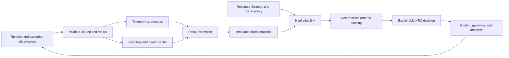

# NXR-070: NRC v2 and Resource Intelligence design

Status: PROPOSED; implementation NOT STARTED. Fixed Nexar base: 4c69d1cd76c8182313f762a90dd7925c98dfa7bc (2026-10-08). [ADR-029](../adr/029-resource-fabric-provider-runtime-v2.md) governs boundaries; [the study](../research/upstream/nxr-070-t3code-goose-comparative-study.md) provides N/T/G source keys; [the blueprint](nxr-070-resource-fabric-implementation-blueprint.md) defines implementation gates. This document does not update v0.6 acceptance.

## Existing behavior and proposed extension

VERIFIED at this base: hard-filters.ts rejects incompatible capabilities, excluded resources, unavailable/auth-failed resources and known privacy/context/cost/quota violations. intelligence-policy.ts ranks eligible candidates deterministically, places owner preference before measured factors by default, gives cold/unknown history neutral contribution and uses stable tie behavior. strategy.ts separates plan intent from allocation/revalidation. telemetry/history.ts bounds untrusted history and excludes caller/policy faults from resource reliability denominators (N6–N10).

These are foundations, not missing features. Proposed NRC v2 adds binding/environment compatibility, per-field signal provenance, principal/runtime/session review independence, measured cohort confidence and richer decision explanations. deterministic@1 and resource-intelligence@1 behavior remain unchanged; new semantics require an explicit policy version such as resource-intelligence@2.

NRC decides which intelligence executes. It does not authorize files, tools, commits, egress or outward actions; it does not orchestrate the engine loop; it does not discover providers or read credentials.

## Observation to decision pipeline



IO, clock access, pricing catalog lookup and inventory refresh happen outside the pure policy. Inject one facts.now for freshness checks, one snapshot generation and explicit policy/config versions. Routing input uses task category/size/capability requirements, not raw prompt content.

### Proposed contracts

| Contract              | Contents                                                                                                                 | Excluded                                                                         |
| --------------------- | ------------------------------------------------------------------------------------------------------------------------ | -------------------------------------------------------------------------------- |
| ResourceObservation@1 | resource/binding/environment IDs, observation kind, field authority, times, generation, normalized failure/usage/timing  | Tokens as credentials, prompts, raw responses, full paths, arbitrary vendor data |
| ResourceProfile@1     | Capabilities, support, facet health, freshness, context facts, quota/cost evidence, bounded cohort summaries             | Invented quality, unbounded history, native session secrets                      |
| AllocationFacts@2     | Profiles, task/role features, strategy intent, pin constraints, budget/grant, review lineage, injected now               | IO services and mutable provider config                                          |
| RouteDecision@2       | Selected candidate, eligibility results, ordered factors, missing signals, alternative/fallback reasons, versions/digest | Sensitive content or authority to execute a forbidden action                     |

Compatible views retain existing Measured<T> wrappers. New provenance is attached alongside their measured/estimated/unavailable representation, not substituted in a way that silently changes v1 consumers.

## Signal semantics and provenance

Separate status from authority. A runtime-reported number can be stale; a measured latency can have too few samples. A configuration unsupported by an adapter is unavailable rather than a fabricated zero.

| Status      | Meaning                                            | Routing treatment                                                                    |
| ----------- | -------------------------------------------------- | ------------------------------------------------------------------------------------ |
| known       | Valid value within applicable freshness bound      | Apply its declared authority and confidence                                          |
| stale       | Previously known but expired or superseded         | Display explicitly; no hard execution entitlement; optional advisory use only        |
| unknown     | No valid observation yet                           | Neutral unless owner requires known evidence                                         |
| unavailable | Source cannot supply this signal or is unsupported | Neutral/explicit rejection according to required capability; do not repeatedly probe |

| Authority        | Example                                                | Limits                                                   |
| ---------------- | ------------------------------------------------------ | -------------------------------------------------------- |
| measured         | Nexar monotonic start/end, counted attempts/outcomes   | Measures Nexar executions, not global account usage      |
| runtime-reported | Native agent token counters, current config            | Vendor/runtime may omit cache/subagent usage             |
| vendor-reported  | Documented rate-limit window or API usage endpoint     | Account/route scope and reset semantics must be explicit |
| estimated        | Tokenizer length, price-catalog calculation, task size | Never relabel as actual usage/cash paid                  |
| owner-declared   | Owner policy/headroom estimate or budget               | Not independently verified; carries expiry/source        |
| unknown          | No supported observation                               | Cannot imply free, healthy or unlimited                  |

Every observed field carries source ID, binding scope, observedAt, attemptedAt when useful, generation and expiry policy. Aggregates also carry sample count/window/cohort identity and excluded-count reasons. Keep precision units explicit: milliseconds, tokens, currency, percentage, time window. Different currencies/windows cannot be summed blindly.

A subscription with zero additional cash cost can still consume allowance. API-equivalent price is an estimate useful for comparison, not a subscription bill. Absence of a quota API remains unknown. No dashboard scraping, private API probing or third-party credential-file reading.

## Decision dimensions

| Dimension                   | Initial evidence                                              | Hard eligibility or rank                                                               | Missing/stale handling                                  |
| --------------------------- | ------------------------------------------------------------- | -------------------------------------------------------------------------------------- | ------------------------------------------------------- |
| Task fit                    | Task category + declared capability + observed cohort results | Required capabilities hard; optional deterministic preference                          | No invented quality prior                               |
| Engine/Control protocol     | Adapter/model-turn compatibility and gateway lineage          | Hard for requested role                                                                | Unknown rejects Control                                 |
| Authentication              | Official/native status scoped to binding                      | Known failed hard; admitted unknown only where existing policy permits safe validation | Connected UI alone is insufficient                      |
| Runtime/environment         | Installed/reachable/contained compatible binding              | Hard for execution and write grants                                                    | Unknown containment rejects write                       |
| Inventory freshness         | Authoritative current generation                              | Hard for explicit discovered selection                                                 | Stale route cannot be re-admitted by rank               |
| Latency                     | Nexar execution p50/p95, task/runtime cohort                  | Rank after sufficient samples                                                          | Cold/stale neutral                                      |
| Recent failures             | Resource-owned failure classes in bounded window              | Rank or health circuit state                                                           | Caller/policy/cancel exclusions                         |
| Historical success          | Resource/task/role cohort outcomes                            | Rank after calibrated sample threshold                                                 | No general vendor quality score                         |
| Context continuity          | Same compatible session/checkpoint; valid handoff receipt     | Required checkpoint hard; optional preference                                          | Unknown session portability cannot justify resume       |
| Context pressure/window     | Reported capacity + bounded estimate                          | Known overflow hard; pressure rank                                                     | Unknown window retains explicit conservative policy     |
| Reasoning/options           | Reported supported option IDs/values                          | Required feature hard, preference after                                                | Unknown option rejected if required                     |
| Tool/MCP support            | Negotiated facets and approved extension availability         | Hard when required                                                                     | Generic “tools” flag is insufficient                    |
| Native-agent support        | AgentExecutionPort/runtime class                              | Hard for agent-run                                                                     | Does not imply model-turn                               |
| Subscription headroom/quota | Supported windows or owner-declared evidence                  | Known exhaustion hard; headroom rank                                                   | Unknown neutral or strict reject                        |
| Marginal/API cost           | Currency/price/counters with authority                        | Known budget hard; price preference rank                                               | Unknown is not zero; strict budget can reject           |
| Locality/privacy            | Data-locality declaration + environment policy                | Hard                                                                                   | Unknown cannot satisfy local-only                       |
| Review diversity            | Verified lineage/principal/runtime/session dimensions         | Required independence hard                                                             | Unknown distinctness cannot prove required independence |
| Owner preference            | Explicit eligible pin or tier preference                      | Pin constraint / primary ordering                                                      | Never overrides hard rejection                          |
| Support class               | official/experimental/local labels                            | Policy hard or secondary preference                                                    | Experimental never becomes official by successful use   |

Task features initially include coding, documentation, research, vision, review, planning, tool-heavy, long-context, low-latency and private/local. Mapping from features to required capabilities is versioned and visible. No provider names hard-code who should implement or review.

## Eligibility algorithm

Proposed ordered stages, each producing fixed reason codes:

1. Validate request, strategy/grant lineage, unit budget, policy version and immutable snapshot.
2. Resolve exact pin or eligible provider-instance/runtime restriction. Alias resolution can only preserve the same legacy route.
3. Validate resource kind/role, required capabilities, engine protocol, environment and containment.
4. Validate enabled binding, account/auth state, inventory generation and explicit model selection.
5. Enforce locality/privacy, support-class policy and required context/options.
6. Enforce known quota exhaustion, strict-known quota policy, known cost budget and approved allowance policy.
7. Enforce review independence and side-effect-safe session/checkpoint requirements.
8. Rank remaining candidates; if none remain, return a structured no-eligible-resource decision.

A candidate rejected at any stage cannot re-enter through scoring or fallback. The v1 filter invariants should be reused as fixtures and property checks. Partial/unknown principal evidence must not be interpreted as equal or distinct unless explicitly known.

### Pin semantics

- Explicit resource pin: stable ID/validated alias, required selection; if unavailable, explain and fail unless owner explicitly selected a documented fallback policy.
- Runtime pin: only eligible resources in the exact binding/runtime scope; no accidental account/environment substitution.
- Provider-instance pin: eligible runtimes/resources in that instance; no provider-family-wide substitution.
- Auto — NRC: all eligible resources permitted by strategy/grant and owner policy.

The first slice preserves current explicit resource pins. Instance/runtime pins are advanced features added only after the lifecycle contract is approved. A pin is a constraint, not approval to execute.

## Deterministic ranking and confidence

Use ordered comparison rather than one mysterious total score initially:

1. Owner preference tier/pin policy among eligible resources.
2. Required strategy role/task fit and permitted continuity preference.
3. Healthy/fresh authoritative binding facts.
4. Known applicable quota/cost preference within owner policy.
5. Measured task/runtime cohort success and latency, only when confidence requirements pass.
6. Stable resource-ID tie break.

If owner config explicitly enables weighted measured factors, serialize weights and formulas/version in the decision. Do not add provider-specific quality constants. The existing v1 minimum-sample and neutral-factor behavior is a useful baseline, not evidence that a new quality metric is already calibrated.

Cohorts key task kind/role, runtime class and relevant version, model selection, environment and configured execution mode. Do not attribute one environment's network failure to a model's intrinsic ability. A renamed instance should not erase its same-binding history; a model/runtime upgrade should not silently inherit a claim of equivalent quality.

Confidence is descriptive: sample count, recency, completeness, task match and provenance. Initial insufficient evidence contributes neutral factors. A future confidence threshold/decay policy is a versioned, tested owner decision. No fabricated “Codex=0.94 / Claude=0.91” rating.

### Quality evaluation before quality ranking

Create a private or synthetic offline task corpus with declared rubrics: functional result, gate success, review-found defects, rework, report correctness and artifact completeness. Human/independent review outcomes are not identical to inherent model quality. Avoid selecting only successful traces.

For each cohort record attempts, resource-owned failures, gates, rework, independent verdict, owner outcome when available and excluded reasons. Fix dataset version and task rubric; include held-out tasks; compare against deterministic@1 and current resource-intelligence@1. Require replayable decisions and explain where confidence is insufficient. Learned/ML routing remains out of scope.

## Telemetry and Resource Profiles

| Field group                  | Actually observable initial source                                | Rules                                                                              |
| ---------------------------- | ----------------------------------------------------------------- | ---------------------------------------------------------------------------------- |
| Attempts/success/failure     | Nexar dispatch lifecycle and normalized outcome                   | Attempt ID deduplication, terminal event once                                      |
| Failure classes              | Adapter/gateway normalization                                     | Resource fault vs caller/policy/engine fault separate                              |
| Latency p50/p95              | Nexar measured durations                                          | Task/runtime cohort, success/failure distributions separate                        |
| Input/output/cache tokens    | Supported runtime reports                                         | Unknown cache/subagent fields stay absent; normalize inclusive/exclusive semantics |
| Estimated cost               | Versioned known price + supported counts                          | Currency/source/estimated authority mandatory                                      |
| Subscription quota           | Only documented vendor/runtime windows or owner declaration       | Own accounting cannot prove global remaining headroom                              |
| Context utilization          | Supported runtime usage/capacity plus separately labeled estimate | No invented capacity for unknown models                                            |
| Runtime health               | Passive metadata + bounded validated observation                  | No paid inference as background “health”                                           |
| Task category/review outcome | Nexar unit/engineering records                                    | No raw prompt or free-form native output in routing telemetry                      |

Observation parser has finite frame/event/label limits, strict allowlists and prototype-safe maps. History remains untrusted: validate, clamp, reject symlinks, bound bytes/windows and record dropped counts. Do not propagate vendor additional_data or raw response payloads.

Recommended initial retention policy is owner-approved bounded windows, not unlimited logging: aggregates by day/cohort plus recent decision ring; private handoff/session content stored separately. Exact duration/size defaults are unresolved owner decisions, tested with injected clock and quotas. Changing retention never changes already-issued execution authorization.

## Failure taxonomy and health

| Proposed class    | Existing normalization inputs / treatment                                               |
| ----------------- | --------------------------------------------------------------------------------------- |
| AUTH              | AUTH_REQUIRED or native status failure; invalidate binding auth generation              |
| NETWORK           | Bounded connectivity/timeout evidence; environment-specific                             |
| UPSTREAM          | Provider service errors; retry only when declared safe/retryable                        |
| MODEL_UNAVAILABLE | Explicit model rejection; stale inventory + bounded refresh                             |
| RATE_LIMIT        | Runtime/vendor retry/reset hint, bounded delay metadata                                 |
| QUOTA             | Supported exhaustion signal; no inference from generic 403                              |
| CONTEXT_LIMIT     | Known overflow or normalized vendor rejection; rebuild bounded context at safe boundary |
| POLICY            | Grant/privacy/approval/sandbox rejection; not resource quality failure                  |
| RUNTIME           | Missing/crashed executable/session lifecycle failure                                    |
| PROTOCOL          | Invalid frame/version/config/lineage; fail closed                                       |
| ENGINE            | Orchestrator failure, not automatically provider fault                                  |
| UNKNOWN           | Fixed bounded reason; do not guess auth/quota                                           |

Map actual NexarError codes into this taxonomy behind adapters without replacing the public codes blindly. Keep ownership attribution and retryable separate from class. HTTP status alone is not proof of quota or successful login.

Facet health: authenticated, reachable, inventory fresh, execution healthy, degraded, rate-limited, quota-exhausted, runtime-unavailable and stale are independently representable. A summary label is derived for display and must not hide the raw eligible facts. Installed != authenticated != reachable != inference healthy.

Circuit behavior uses measured recent runtime-owned failures with injected expiry, not permanent provider blacklisting. A closed circuit becomes “needs bounded validation” rather than fabricated healthy. Inventory and health refresh are cached/deduplicated, TTL-based and never fan out synchronous probes for every allocation.

## Review independence

| Dimension         | Distinctness proof                                         | Why ID difference alone is inadequate                 |
| ----------------- | ---------------------------------------------------------- | ----------------------------------------------------- |
| Resource          | Different stable executable resource                       | Two model IDs may use same account/session            |
| Principal/account | Verified privacy-safe principal references differ          | Two instance labels can share credentials             |
| Provider family   | Normalized provider keys differ                            | Useful diversity but not proof of independent context |
| Runtime           | Distinct runtime binding/process lifecycle                 | Same native process can expose many labels/models     |
| Environment       | Distinct allowed environment/trust boundary                | Optional locality separation, not always necessary    |
| Session/context   | Fresh reviewer native session, bounded review-only handoff | Shared session may repeat implementation assumptions  |

Strategy declares required dimensions and permitted unknown behavior. Defaults require owner approval; initial v1 resource-ID rule remains unchanged until a v2 policy is selected. Unknown principal/session distinctness fails a requirement for verified independence, with an explanatory rejection rather than silent downgrade.

ReviewOf references an existing completed unit/lineage. Reviewer receives bounded artifact refs, review criteria and necessary task constraints, not hidden implementation reasoning or vendor-private extras. Trace identifies implementation and review resource/binding/session scope without exposing native secret IDs. No eligible independent reviewer means stop/explain, not self-review labeled independent.

## Fallback and retry state model

```text
validate -> select -> dispatch -> complete
                          |
                     classified failure
                          |
           side effects known? + safe boundary? + remaining budget?
                 /                                    \
              no                                      yes
     stop / explicit recovery             invalidate / bounded refresh if applicable
                                                     |
                               revalidate allowed alternatives -> new dispatch/loop
```

One shared per-turn/unit retry/fallback budget prevents nested adapter+gateway+NRC amplification. Initial proposal permits the existing bounded same-resource retry where safe and one cross-resource reconsideration only at an established safe checkpoint; exact defaults must be explicit in policy and offline-tested. Inventory auth-refresh attempts count in their separate metadata budget, never create inference retries.

Control: continue with pinned resource only; failed loop can be cancelled and restarted as a new decision using canonical safe state. Worker: a new unit attempt may select another equivalent resource only if no ambiguous native side effects remain, grant/budget permits and required review independence survives. Model rejection cannot cause a mid-loop Control switch.

Cancellation, pending approvals, partial writes or uncertain delivery require recovery; no automatic replay. Missing MCP/tool capabilities, local-only policy, required pin and exhausted cash budget cannot be relaxed by fallback. Explain both exhausted alternatives and the constraint that prevented retry.

## Explainable decision record and UX

| Record facet | Example form, without invented production values                             |
| ------------ | ---------------------------------------------------------------------------- |
| Reproduction | policy/config/schema version, injected time, facts generation/digest         |
| Request      | task kind/role/required facets, strategy/unit/turn IDs, pin scope            |
| Eligibility  | Candidate ID + fixed accepted/rejected reasons + known/unknown signal status |
| Ranking      | Ordered factors, authority, cohort sample count, neutral reasons, tie rule   |
| Selection    | Resource/instance/binding/environment IDs and support class                  |
| Alternatives | Eligible ranked alternatives plus why rejected candidates stayed excluded    |
| Fallback     | Remaining budget, safe boundary/checkpoint requirement and fixed reason      |
| Lineage      | Control decision or worker grant, reviewOf and independence dimensions       |
| Privacy      | No prompts, native payloads, credentials, raw paths or account email         |

Default UX remains Auto — NRC. Advanced details show selected resource, provider/account label, runtime/environment, why selected, alternatives/rejected reasons, capability/health/freshness, quota/cost authority and fallback. Private account labels are not exported to telemetry by default. Explain “quota unknown” explicitly rather than inventing a progress bar.

Example: if a plane agent satisfies coding/write containment and a desktop model satisfies report drafting, NRC can select each for its unit. A reviewer must independently satisfy the configured account/session/provider rules. A provider-specific plan such as Gemini -> Codex -> Claude -> GPT is an illustrative possibility, not hard-coded policy.

## Offline evaluation and future opt-in live gates

Fixture corpus covers expired auth, stale/late inventory, removed model, missing runtime, network failure, upstream 502, quota exhaustion, ACP crash, session load/cancel failure, MCP unavailable, oversized context and ambiguous write completion. Use fake runtime/session/ACP transport, inventories, clocks, IDs, price/quota sources and telemetry. No subscriptions in normal tests.

| Metric / invariant    | Pass condition                                                                |
| --------------------- | ----------------------------------------------------------------------------- |
| Constraint violations | Zero rejected candidate re-admissions across seeded permutations              |
| Determinism           | Same versioned facts/config/clock produces identical decision                 |
| Unknown neutrality    | No fabricated cost/quota/quality; strict-known policy rejects explicitly      |
| Budget accounting     | No execution attempt escapes grant/retry/cash/allowance limits                |
| Review independence   | Required dimensions proven or selection rejects                               |
| Pinning               | All Control calls in a decision use the same compatible binding               |
| Freshness races       | Auth-invalidated late result cannot republish executable models               |
| Explanation coverage  | Every rejected candidate and selected factor has a fixed reason               |
| Failure attribution   | Caller/policy/cancel faults excluded from resource quality denominator        |
| Replay equivalence    | Golden decisions under v1 remain unchanged when v2 is not selected            |
| Performance           | Decisions use cached bounded facts; allocation performs no provider IO        |
| Quality improvement   | Report task/rubric/cohort outcomes against baseline; no universal score claim |

Live gates are separately authorized per runtime/provider and budget after exact-head CI and matching builds. Measure actual model/config discovery, account isolation, usage availability, native session recovery, bounded fallback and independent review; unavailable vendor signals remain unknown and do not fail an honest implementation merely for being absent. Do not perform these tests during architecture research.

Unresolved owner decisions: required review dimensions, treatment of unknown auth/continuity/quota, context overflow policy, retention, acceptable runtime trust, first ACP adapter and measured ranking confidence. These are recorded in ADR-029; implementation begins only after their scope is approved.
