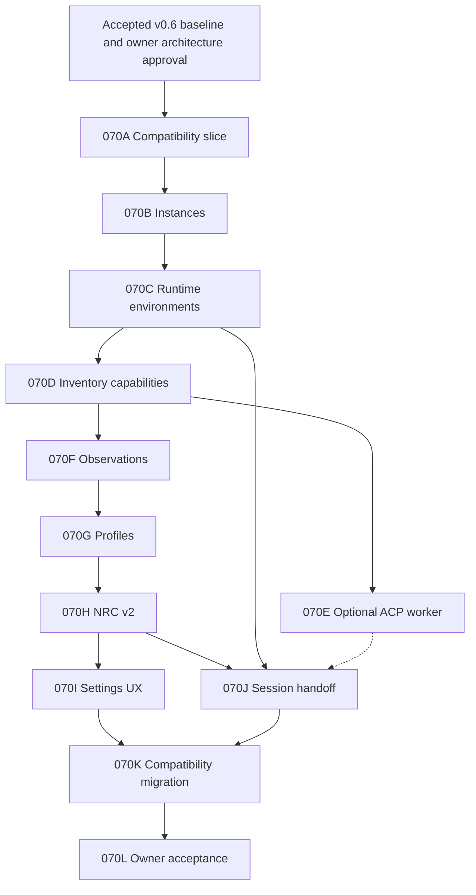

# NXR-070 Resource Fabric implementation blueprint

Status: PROPOSED, architecture-only. Implementation permission NOT GRANTED. Research base 4c69d1cd76c8182313f762a90dd7925c98dfa7bc, origin/feat/nexar-resource-orchestration, 2026-10-08. This is an implementation-ready proposal for owner review, not authorization to begin implementation.

Read [ADR-029](../adr/029-resource-fabric-provider-runtime-v2.md), [the comparative study](../research/upstream/nxr-070-t3code-goose-comparative-study.md) and [NRC v2 design](nxr-070-nrc-v2-resource-intelligence.md). [Backlog 070](../backlog/070-resource-fabric-provider-runtime-v2.md) indexes this work without repeating its design.

## Entry conditions and boundaries

Before implementation: owner approves the proposed architecture/scope; v0.6 is independently accepted; reconcile/rebase this branch once onto the accepted baseline; re-inspect source deltas and revise exact seams. Do not chase acceptance changes during research. Historical 944b602 does not replace this fixed research base. Architecture documents do not change authoritative project state.

No production/test code, provider login or live model calls belong to this research. Future units retain OpenWorker Cowork and DSH Code; global resources/auth policy remain Nexar-owned. Model-turn, agent-run, tool-use, Control and Worker stay distinct.

## Minimal viable first vertical slice

NXR-070A is a useful standalone slice:

1. Take an existing ProviderConnection plus ProviderRuntimeIdentity and validated fresh inventory.
2. Project an immutable default ProviderInstance and RuntimeBinding/environment alias without changing auth or discovery.
3. Materialize the same legacy resource ID and expose its binding in a compatible Registry view.
4. Route through current Strategy/NRC and existing Control/Worker gateway; project an ownership explanation without changing v1 selection.
5. Use a second fake instance with the same provider/model to prove collision separation offline.
6. Restore legacy pins/settings/session fixtures unchanged; disable the projection to prove rollback.

Do not start with new auth, two owner accounts, ACP, a new engine or an entire rewritten provider UI. The first slice's tangible value is an inspectable ownership path and proven compatibility seam. Any new package must justify dependency/lifecycle need; contracts and host/registry projection may suffice initially.

## File map

Brace notation below identifies existing source seams; expand and verify against the reconciled baseline before writing code. A path marked “proposed” does not exist yet.

| Area                       | Retain                                                                                                                                                           | Adapt in future units                                              | Proposed addition                                                                                  |
| -------------------------- | ---------------------------------------------------------------------------------------------------------------------------------------------------------------- | ------------------------------------------------------------------ | -------------------------------------------------------------------------------------------------- |
| Domain                     | packages/contracts/src/{resource,connection,inventory,measured,intelligence,gateway}.ts                                                                          | Versioned optional views; no upstream imports                      | packages/contracts/src/{provider-instance,runtime-binding,resource-observation,context-handoff}.ts |
| Registry                   | packages/resource-registry/src/{registry,inventory,materialize}.ts                                                                                               | Identity projection, generation/capability metadata, aliases       | Private compatibility/alias helper if needed                                                       |
| Host                       | packages/host/src/{composition,native-inventories}.ts                                                                                                            | Factory/binding scopes, environment ownership                      | packages/resource-fabric/src/{instances,runtimes,profiles}.ts only if justified                    |
| NRC                        | packages/resource-controller/src/{controller,hard-filters,strategy,intelligence-policy}.ts                                                                       | New versioned policy/facts/explanations; v1 stays unchanged        | Separate v2 module after reviewed contracts                                                        |
| Gateway                    | packages/engine-gateway/src/{gateway,bridge,select-control}.ts                                                                                                   | Binding evidence and safe fallback/review dimensions               | Agent execution facet; third gateway deferred                                                      |
| Telemetry                  | packages/telemetry/src/{history,reader,redact,sinks}.ts                                                                                                          | Per-field authority and bounded aggregates                         | Rebuildable profile cache                                                                          |
| Native/direct integrations | integrations/{claude-code,codex,antigravity}/src/{adapter,inventory}.ts; integrations/pi/src/model-turn.ts; integrations/openai-account/src/{client,models}.ts   | Normalize facets and observations inside each integration          | integrations/acp-agent/src/* after spike                                                           |
| OpenWorker/DSH             | integrations/openworker/src/{session,providers}.ts; integrations/deepseek-harness/src/acp/{run,permissions}.ts                                                   | Consume gateway contracts; no engine rewrite                       | None required initially                                                                            |
| Canonical sessions/context | packages/sessions/src/{types,store}.ts; packages/operating/src/context.ts                                                                                        | Optional binding refs and handoff projection                       | packages/sessions/src/{bindings,handoff}.ts                                                        |
| Desktop main               | apps/desktop/src/main/{providers,provider-inventory,chatgpt-plan,chatgpt-plan-resources,desktop-key-store,settings-store,config-store,engine-host,code-plane}.ts | Scoped instances, private stores and strict services               | Instance lifecycle service if needed                                                               |
| Desktop boundary           | apps/desktop/src/shared/{channels,api,providers,plane}.ts                                                                                                        | Strict additive DTOs/channels; apps/desktop/src/preload/preload.ts | Versioned instance DTO module                                                                      |
| Desktop renderer           | apps/desktop/src/renderer/components/{ProvidersView,ResourcesView,PlaneResources}.tsx                                                                            | Instance cards and advanced decisions                              | No default provider juggling                                                                       |
| Plane                      | packages/plane-protocol/src/{schemas,limits,codec}.ts; apps/cli/src/{commands/plane,plane-readiness}.ts; apps/desktop/src/main/{code-plane,plane-connection}.ts  | Negotiated feature/projections only                                | No arbitrary command/env/path bridge                                                               |
| Security                   | Existing access/approvals/projects/artifacts/sandbox/worktrees packages                                                                                          | Retain authority; inspect adapter conformance                      | No alternate permission or commit authority                                                        |

Production dependencies remain exact-pinned; driver/protocol packages never enter domain packages. Proposed package names are design candidates, not approved manifests.

## Dependency graph and independently reviewable units

After shared contracts, observation normalization and ACP conformance can progress independently in isolated implementation scopes. UX can use fake DTOs after contract approval but cannot publish unimplemented capability claims. No parallel task may change live acceptance/auth state.

All units share these gates: approved scope and baseline; source/contract review; exact-pinned third-party artifacts and license/NOTICE/vendor-term review if added; meaningful offline failure tests; full pnpm check before commit; strict secret/IPC/permission review; explicit branch push; **full exact-head CI before merge/release and before allowance-consuming owner acceptance**; matching Desktop/plane builds whenever those surfaces change. A local gate is not an exact-head CI substitute.

### NXR-070A: Compatibility contracts and first vertical slice

| Field                                    | Specification                                                                                                                                                                                              |
| ---------------------------------------- | ---------------------------------------------------------------------------------------------------------------------------------------------------------------------------------------------------------- |
| Goal and scope / non-goals               | Project existing connections/inventory into instance/runtime/environment views and existing Registry/NRC explanation; a second fake instance proves collision separation. No new login or execution route. |
| Dependencies                             | Baseline reconciliation + approved ADR                                                                                                                                                                     |
| Existing file seams / proposed new files | packages/contracts/src/{connection,resource,inventory,gateway}.ts; packages/resource-registry/src/{materialize,inventory,registry}.ts; packages/host/src/{composition,native-inventories}.ts               |
| New and retained contracts               | provider-instance@1/runtime-binding@1 views; retain ResourceDescriptor, InventorySource, inventoryResourceId and v1 NRC                                                                                    |
| Migration                                | Read-only projection and explicit alias manifest; old IDs/pins preserved, no writes to credentials/settings                                                                                                |
| Security                                 | Validate bounded tuples and alias collisions; no secret fields                                                                                                                                             |
| Offline acceptance                       | Golden legacy resource/pin decisions, fake second account with same model name, stale generation and alias collision fixtures                                                                              |
| Future live acceptance                   | Metadata-only inspection after opt-in; no inference required for this unit                                                                                                                                 |
| Rollback                                 | Disable projection flag; old resources and policy remain intact                                                                                                                                            |
| Complexity / risk                        | S / medium; relative engineering size, not a calendar estimate                                                                                                                                             |
| Definition of done                       | All legacy projections identical where observable; proposed ownership visible in explanation; dependencies stay vendor-free; shared gates below also required                                              |

### NXR-070B: Instance configuration and lifecycle

| Field                                    | Specification                                                                                                                                                         |
| ---------------------------------------- | --------------------------------------------------------------------------------------------------------------------------------------------------------------------- |
| Goal and scope / non-goals               | Independent label/enabled/config lifecycle and admission scopes. No native credential harvesting or automatic second-account login.                                   |
| Dependencies                             | 070A                                                                                                                                                                  |
| Existing file seams / proposed new files | packages/host/src/composition.ts; apps/desktop/src/main/{config-store,settings-store,desktop-key-store,provider-inventory}.ts; integrations/*/src inventory factories |
| New and retained contracts               | New instance-store@1 and driver factory registration; retain legacy settings and private credential resolver                                                          |
| Migration                                | Additive versioned store/backup; keep raw unknown sections and fixed legacy credential slots readable                                                                 |
| Security                                 | Immutable instance refs; generation invalidation before auth mutation; drain/forget only owned slots                                                                  |
| Offline acceptance                       | Create/disable/remove races, corrupt schema, unknown driver shadow state, queued late inventory, scope cleanup                                                        |
| Future live acceptance                   | Owner approves two independent configurations; auth tested only later with declared official method                                                                   |
| Rollback                                 | Stop new admissions; keep legacy store; restore additive-store backup without changing runtime credentials                                                            |
| Complexity / risk                        | M / high; relative engineering size, not a calendar estimate                                                                                                          |
| Definition of done                       | Lifecycle idempotent; failed instance preserved with fixed reason; no cross-instance resolver access; shared gates below also required                                |

### NXR-070C: Runtime and environment bindings

| Field                                    | Specification                                                                                                                                                                                                                 |
| ---------------------------------------- | ----------------------------------------------------------------------------------------------------------------------------------------------------------------------------------------------------------------------------- |
| Goal and scope / non-goals               | Bind existing API/native/account/local routes to desktop/plane; independently record install/auth/reachability/containment. No remote agent deployment.                                                                       |
| Dependencies                             | 070A/B                                                                                                                                                                                                                        |
| Existing file seams / proposed new files | packages/contracts/src/resource.ts; packages/host/src/{composition,native-inventories}.ts; apps/desktop/src/main/{engine-host,code-plane}.ts; apps/cli/src/commands/plane.ts; packages/plane-protocol/src/{schemas,limits}.ts |
| New and retained contracts               | runtime-definition@1/runtime-environment@1/runtime-binding@1; retained ExecutionAdapter and plane/1 legacy projection                                                                                                         |
| Migration                                | Alias desktop/plane locality; negotiate new resource feature before new strict fields                                                                                                                                         |
| Security                                 | No arbitrary executable/env/path protocol field; minimal environment; plane-local credentials; executable trust validation                                                                                                    |
| Offline acceptance                       | Missing binary, mismatched environment, containment unknown/write denied, old/new handshake matrix                                                                                                                            |
| Future live acceptance                   | Passive install/reachability inspection; account isolation in each environment separately authorized                                                                                                                          |
| Rollback                                 | Disable new bindings; legacy handshake receives its unchanged projection                                                                                                                                                      |
| Complexity / risk                        | M / high; relative engineering size, not a calendar estimate                                                                                                                                                                  |
| Definition of done                       | No account/environment collisions; old Desktop/plane pairs still function; containment evidence explicit; shared gates below also required                                                                                    |

### NXR-070D: Inventory and capability normalization

| Field                                    | Specification                                                                                                                                                                                                                                                                                        |
| ---------------------------------------- | ---------------------------------------------------------------------------------------------------------------------------------------------------------------------------------------------------------------------------------------------------------------------------------------------------- |
| Goal and scope / non-goals               | Account/runtime scoped explicit models and semantic agent defaults; capability intersection and freshness. No static catalog treated as entitlement.                                                                                                                                                 |
| Dependencies                             | 070A/C                                                                                                                                                                                                                                                                                               |
| Existing file seams / proposed new files | packages/contracts/src/{inventory,resource,connection}.ts; packages/resource-registry/src/{inventory,materialize}.ts; integrations/openai-account/src/models.ts; integrations/{claude-code,codex,antigravity}/src/inventory.ts; apps/desktop/src/main/{provider-inventory,chatgpt-plan-resources}.ts |
| New and retained contracts               | resource-inventory@2 and capability evidence; retain inventory@1 and explicit/provider-default selections                                                                                                                                                                                            |
| Migration                                | Versioned projection; old cache restored stale; stable IDs unchanged for existing tuple                                                                                                                                                                                                              |
| Security                                 | Bounded listing, no inference probe, source authority, auth-generation races, private cache                                                                                                                                                                                                          |
| Offline acceptance                       | Removed model, stale cache, malformed limits/options, unsupported dialect, timeout and late results                                                                                                                                                                                                  |
| Future live acceptance                   | Explicit authorized metadata refresh; log status/counts only, not tokens/full payloads                                                                                                                                                                                                               |
| Rollback                                 | Retain old source/consumer; invalidate new cache instead of rewriting legacy data                                                                                                                                                                                                                    |
| Complexity / risk                        | M / medium; relative engineering size, not a calendar estimate                                                                                                                                                                                                                                       |
| Definition of done                       | Agent never gains model-turn by catalog label; explicit routes require fresh authoritative evidence; shared gates below also required                                                                                                                                                                |

### NXR-070E: Optional ACP delegated agent runtime

| Field                                    | Specification                                                                                                                                                                                                                                                                           |
| ---------------------------------------- | --------------------------------------------------------------------------------------------------------------------------------------------------------------------------------------------------------------------------------------------------------------------------------------- |
| Goal and scope / non-goals               | One plane-only Codex ACP worker through existing grants/adapters. No ACP Control, engine replacement, HTTP MCP or default full-access.                                                                                                                                                  |
| Dependencies                             | 070C/D + ACP conformance/security spike                                                                                                                                                                                                                                                 |
| Existing file seams / proposed new files | integrations/deepseek-harness/src/acp/{run,permissions}.ts (security pattern retained); packages/contracts/src/gateway.ts; packages/host/src/composition.ts; packages/engine-gateway/src/bridge.ts; proposed integrations/acp-agent/src/{adapter,transport,capabilities,permissions}.ts |
| New and retained contracts               | AgentExecutionPort facet, normalized session/tool events; retain IntelligenceBridge and ExecutionAdapter                                                                                                                                                                                |
| Migration                                | Optional binding; native Codex remains; exact-pin SDK/binary only after license/terms/version review                                                                                                                                                                                    |
| Security                                 | Strict frames, bounded subprocess, containment, active-session checks, deny default/action-bound approvals, external tool dispatch once                                                                                                                                                 |
| Offline acceptance                       | Fake ACP initialize/config/options/load/cancel/crash/oversize/permission/MCP scenarios and kill cleanup; no subscriptions                                                                                                                                                               |
| Future live acceptance                   | Separate owner approval for pinned runtime/install/native login and budgeted agent work; verify cancel and no scope widening                                                                                                                                                            |
| Rollback                                 | Disable ACP binding and select eligible native agent at a safe new unit; never replay ambiguous writes                                                                                                                                                                                  |
| Complexity / risk                        | L / high; relative engineering size, not a calendar estimate                                                                                                                                                                                                                            |
| Definition of done                       | Conformance matrix passed; absent capabilities honest; no vendor payload exported; native routes unchanged; shared gates below also required                                                                                                                                            |

### NXR-070F: Observations and telemetry authority

| Field                                    | Specification                                                                                                                                                                                                        |
| ---------------------------------------- | -------------------------------------------------------------------------------------------------------------------------------------------------------------------------------------------------------------------- |
| Goal and scope / non-goals               | Normalize own attempts/failures/timing/usage/cost/quota with per-field provenance. No external history scraping or billing controls.                                                                                 |
| Dependencies                             | 070A/D; ACP enrichment after 070E                                                                                                                                                                                    |
| Existing file seams / proposed new files | packages/contracts/src/{measured,intelligence,telemetry}.ts; packages/telemetry/src/{history,reader,redact,sinks}.ts; integrations/pi/src/model-turn.ts; integrations/{codex,claude-code,antigravity}/src/adapter.ts |
| New and retained contracts               | resource-observation@1 and taxonomy/provenance; retain Measured<T> compatibility and existing public error codes                                                                                                     |
| Migration                                | Versioned events/readers accept old records; missing provenance explicitly legacy/unknown                                                                                                                            |
| Security                                 | Allowlist counters/IDs/reasons only; bounded untrusted history; runtime/session identifiers opaque                                                                                                                   |
| Offline acceptance                       | Reported vs estimated counters, inclusive cache semantics, incomplete prices, unknown subscription quota, duplicate terminal events                                                                                  |
| Future live acceptance                   | Budgeted supported runtime observations; unsupported metrics remain unknown                                                                                                                                          |
| Rollback                                 | Stop writing enriched events; old readers remain; rebuild aggregates from compatible records                                                                                                                         |
| Complexity / risk                        | M / medium; relative engineering size, not a calendar estimate                                                                                                                                                       |
| Definition of done                       | No unknown converted to zero; resource-owned failures distinguished from caller/engine faults; shared gates below also required                                                                                      |

### NXR-070G: Resource Profiles and cached facts

| Field                                    | Specification                                                                                                                                                                                                   |
| ---------------------------------------- | --------------------------------------------------------------------------------------------------------------------------------------------------------------------------------------------------------------- |
| Goal and scope / non-goals               | Build bounded profiles/cohorts with signal freshness/confidence and snapshot digests. No learned quality or synchronous provider fanout.                                                                        |
| Dependencies                             | 070C/D/F                                                                                                                                                                                                        |
| Existing file seams / proposed new files | packages/contracts/src/intelligence.ts; packages/resource-registry/src/{registry,inventory}.ts; packages/telemetry/src/history.ts; proposed packages/resource-fabric/src/{profiles,observations}.ts if approved |
| New and retained contracts               | resource-profile@1/AllocationFacts@2; retain current ResourceState and RoutingHistory                                                                                                                           |
| Migration                                | Read-only projection plus rebuildable cache; no settings rewrite                                                                                                                                                |
| Security                                 | Validate prototype-safe counts, clamp windows, omit prompts/account email, injected time                                                                                                                        |
| Offline acceptance                       | Cold history, missing authority, stale windows, version upgrade cohorts, corrupted cache and bounded inputs                                                                                                     |
| Future live acceptance                   | Passive profile inspection; compare facts to actual observations without inferred entitlement                                                                                                                   |
| Rollback                                 | Drop new cache; v1 facts/history readers remain usable                                                                                                                                                          |
| Complexity / risk                        | M / medium; relative engineering size, not a calendar estimate                                                                                                                                                  |
| Definition of done                       | Every factor has scope/source/freshness; snapshot immutable; no quality constant; shared gates below also required                                                                                              |

### NXR-070H: NRC v2 and explainability

| Field                                    | Specification                                                                                                                                                                                                |
| ---------------------------------------- | ------------------------------------------------------------------------------------------------------------------------------------------------------------------------------------------------------------ |
| Goal and scope / non-goals               | New pure policy with hard eligibility, review dimensions and deterministic factors. No ML ranking or authorization delegation.                                                                               |
| Dependencies                             | 070A/G                                                                                                                                                                                                       |
| Existing file seams / proposed new files | packages/resource-controller/src/{controller,hard-filters,strategy,intelligence-policy}.ts; packages/contracts/src/{intelligence,gateway}.ts; packages/engine-gateway/src/{select-control,gateway,bridge}.ts |
| New and retained contracts               | resource-intelligence@2, route-decision@2, optional strategy@2; retain deterministic@1/resource-intelligence@1 unchanged                                                                                     |
| Migration                                | Explicit policy opt-in; v1 decision golden corpus; pins/aliases validated                                                                                                                                    |
| Security                                 | Hard filters never bypassed; no mid-loop Control switch; one shared retry budget; review principal/session proof                                                                                             |
| Offline acceptance                       | Seeded eligibility/permutation invariants, failure injection, unknown neutrality, cost/quota/capability/pin/diversity/explanation replay                                                                     |
| Future live acceptance                   | Authorized multi-resource tasks after exact-head CI; independently verify selection/rejection reasons                                                                                                        |
| Rollback                                 | Switch policy to v1 at next safe turn; no change within an active loop                                                                                                                                       |
| Complexity / risk                        | L / high; relative engineering size, not a calendar estimate                                                                                                                                                 |
| Definition of done                       | No rejected candidate re-entry; every decision reproducible; independent review proven or rejected; shared gates below also required                                                                         |

### NXR-070I: Provider and resource settings v2

| Field                                    | Specification                                                                                                                                                                                                                                             |
| ---------------------------------------- | --------------------------------------------------------------------------------------------------------------------------------------------------------------------------------------------------------------------------------------------------------- |
| Goal and scope / non-goals               | Instance cards, runtime/environment states and advanced explanation. Default Auto — NRC retained. No secret values in UI or automatic login.                                                                                                              |
| Dependencies                             | 070B/C/D/H                                                                                                                                                                                                                                                |
| Existing file seams / proposed new files | apps/desktop/src/shared/{channels,api,providers,plane}.ts; apps/desktop/src/main/{providers,provider-inventory,code-plane}.ts; apps/desktop/src/renderer/components/{ProvidersView,ResourcesView,PlaneResources}.tsx; apps/desktop/src/preload/preload.ts |
| New and retained contracts               | Strict instance/resource DTOs and feature negotiation; retain existing providers IPC                                                                                                                                                                      |
| Migration                                | Additive channels/store views; legacy single-provider view remains during rollout                                                                                                                                                                         |
| Security                                 | Sender validation, renderer sandbox, bounded IDs, no raw credentials/native payload/path exposure                                                                                                                                                         |
| Offline acceptance                       | Fake IPC create/disable/remove/refresh states, unknown quotas, unavailable environment, forged IDs, old preload/plane matrix                                                                                                                              |
| Future live acceptance                   | Owner UI verification with metadata first; login and model calls separately approved                                                                                                                                                                      |
| Rollback                                 | Feature flag returns legacy views; no credential/settings deletion                                                                                                                                                                                        |
| Complexity / risk                        | M / high; relative engineering size, not a calendar estimate                                                                                                                                                                                              |
| Definition of done                       | Each instance independently enabled/refreshed/removed; configured vs installed vs authenticated vs reachable visibly differ; shared gates below also required                                                                                             |

### NXR-070J: Private session bindings and context handoff

| Field                                    | Specification                                                                                                                                                                                                       |
| ---------------------------------------- | ------------------------------------------------------------------------------------------------------------------------------------------------------------------------------------------------------------------- |
| Goal and scope / non-goals               | Canonical Nexar conversation binds native sessions; bounded portable handoff and delivery receipt. No opaque cross-vendor transfer or replay of writes.                                                             |
| Dependencies                             | 070C/D/H; ACP facet conditional on 070E                                                                                                                                                                             |
| Existing file seams / proposed new files | packages/sessions/src/{types,store}.ts; packages/operating/src/context.ts; packages/engine-gateway/src/{gateway,bridge}.ts; integrations/pi/src/model-turn.ts; proposed packages/sessions/src/{bindings,handoff}.ts |
| New and retained contracts               | session-binding@1/context-handoff@1; retain OperatingSession schemaVersion 1 and context@1 projection                                                                                                               |
| Migration                                | Separate private store and optional refs; existing sessions reopen unchanged; stale bindings not automatically resumed                                                                                              |
| Security                                 | Redact before persistence, contained artifact refs, account/env validation, leases/revisions, ambiguous-delivery stop                                                                                               |
| Offline acceptance                       | Required-context overflow, stale artifact hash, conflicting constraints, replayed receipt, load failure, crash/cancel and duplicate handoff                                                                         |
| Future live acceptance                   | Separate consented provider switch/resume experiment with bounded context; verify no hidden state/credential transfer                                                                                               |
| Rollback                                 | Ignore new bindings for new turns; keep old canonical history; require recovery for uncertain native writes                                                                                                         |
| Complexity / risk                        | L / high; relative engineering size, not a calendar estimate                                                                                                                                                        |
| Definition of done                       | Required constraints delivered or rejected explicitly; acknowledgement durable; no automatic side-effect replay; shared gates below also required                                                                   |

### NXR-070K: Compatibility migration and retirement

| Field                                    | Specification                                                                                                                                                                                                                                                     |
| ---------------------------------------- | ----------------------------------------------------------------------------------------------------------------------------------------------------------------------------------------------------------------------------------------------------------------- |
| Goal and scope / non-goals               | Migrate existing default routes and pins additively; retire compatibility only after all families pass. No destructive config/auth migration.                                                                                                                     |
| Dependencies                             | 070A/B/C/I/J; baseline regression evidence                                                                                                                                                                                                                        |
| Existing file seams / proposed new files | packages/host/src/{composition,native-inventories}.ts; packages/resource-registry/src/materialize.ts; apps/desktop/src/main/{settings-store,config-store,desktop-key-store,provider-inventory}.ts; packages/sessions/src/store.ts; apps/cli/src/commands/plane.ts |
| New and retained contracts               | Versioned migration/alias manifest and read-only legacy projection; retain legacy readers until gate                                                                                                                                                              |
| Migration                                | Backups/dry-run/collision report; owner-approved batch by provider; no token movement                                                                                                                                                                             |
| Security                                 | Private backups, contained atomic writes, rollback while no admitted new work, no acceptance-config edits by research                                                                                                                                             |
| Offline acceptance                       | All v0.6 fixture settings/resources/sessions/strategy pins; interrupted migration/unknown fields/downgrade/collision tests                                                                                                                                        |
| Future live acceptance                   | Owner v0.6 regression checklist and identical Desktop/plane build SHA before retirement                                                                                                                                                                           |
| Rollback                                 | Restore additive stores/flags/alias manifest; preserve canonical records and owned legacy credentials                                                                                                                                                             |
| Complexity / risk                        | M / high; relative engineering size, not a calendar estimate                                                                                                                                                                                                      |
| Definition of done                       | Migration idempotent and reversible until explicit retirement; no pin redirected to another account; shared gates below also required                                                                                                                             |

### NXR-070L: Owner acceptance and release readiness

| Field                                    | Specification                                                                                                                                                                  |
| ---------------------------------------- | ------------------------------------------------------------------------------------------------------------------------------------------------------------------------------ |
| Goal and scope / non-goals               | Execute A–J acceptance after full exact-head CI and matched deployment. No automatic merge/release/login.                                                                      |
| Dependencies                             | 070A–K applicable scope + owner authorization                                                                                                                                  |
| Existing file seams / proposed new files | docs/backlog/070-resource-fabric-provider-runtime-v2.md; future docs/devlog/nxr-070-owner-acceptance.md; existing checks/workflows retained without changing acceptance branch |
| New and retained contracts               | Evidence schema records SHA/build/runtime versions/consent/budget/outcomes; no new execution contract                                                                          |
| Migration                                | Reconcile accepted v0.6; scope any partial release explicitly; no rewrite of NXR-066b results                                                                                  |
| Security                                 | Status/count/hash-only evidence, no auth payloads, owner controls live permissions                                                                                             |
| Offline acceptance                       | All offline corpus + pnpm check + exact-head CI; deployment mismatch and missing consent blocks                                                                                |
| Future live acceptance                   | A–J matrix below; each allowance-consuming action explicitly authorized with budget                                                                                            |
| Rollback                                 | Rollback matched Desktop/plane build at safe boundary, disable new routes; keep evidence                                                                                       |
| Complexity / risk                        | M / high; relative engineering size, not a calendar estimate                                                                                                                   |
| Definition of done                       | Owner accepts scoped results; full exact-head CI green, matching builds, unresolved risk recorded; implementation/release approval explicit; shared gates below also required  |

## Additive migration and provider order

| Phase | Action                                                   | Proof required before advance                                              |
| ----- | -------------------------------------------------------- | -------------------------------------------------------------------------- |
| 0     | Accept v0.6 elsewhere; reconcile once; approve ADR/slice | Independent acceptance evidence + reviewed baseline delta                  |
| A     | Read-only compatibility projections and aliases          | Legacy IDs/pins/decisions identical, fake second instance isolated         |
| B     | Additive instance/environment stores and driver scopes   | Private atomic stores; unknown fields preserved; disable/remove race tests |
| C     | Family-by-family normalized inventory/observations       | Authority/generation/cost/unknown semantics retained                       |
| D     | Optional plane ACP worker                                | Offline conformance/security/license spike before live install/auth        |
| E     | Profiles and explicit NRC v2 opt-in                      | Deterministic invariant corpus and explanation replay                      |
| F     | Instance UI and bounded handoff                          | Strict DTOs, native binding isolation, ambiguous recovery                  |
| G     | Compatibility retirement                                 | Complete scoped v0.6 regression and downgrade evidence; owner approval     |

Risk-based family order differs from blindly starting with OpenAI auth migration:

1. Project **all existing legacy defaults** first, without changing any credentials.
2. API/local/custom configuration has a smaller auth lifecycle surface; prove metadata/binding identity with fake endpoints and existing refs first.
3. Add the existing ChatGPT account route through its current owned resolver, preserving the one encrypted blob and explicit plan-sharing opt-in; never export/move the token.
4. Project native Claude/Codex routes; new independent native accounts require official isolated-home/auth support proved per OS/environment.
5. Introduce optional plane Codex ACP as a new worker binding after conformance, leaving native Codex available.
6. Preserve Google/Antigravity native experimental routes; new ACP/account routes wait for actual availability, terms, inventory and platform evidence.

This order minimizes credential and live acceptance risk. It does not disable providers while waiting for new features.

Persistence plan: new schemaVersion 1 stores beside legacy documents, bounded private files with backups and serial atomic mutations; explicit version tags for cross-package contracts; read-only compatibility views; aliases include source version/tuple and collision proof. Session-binding store is separate from canonical session history. Unknown legacy settings sections survive. No direct read/copy of runtime credential files. Removal forgets only Nexar-owned data and cannot imply vendor revocation.

Downgrade plan: stop new admissions, finish/cancel active work under its original pinned decision, restore compatible feature flags/stores and matched build, preserve canonical history and legacy credential slots. Newly created v2-only accounts may be unavailable to old UI without deleting them. Ambiguous native effects require manual recovery. Compatibility removal is a later owner-approved change, not an automatic cleanup.

## UX blueprint

Default: user talks to Nexar using Auto — NRC. Advanced resource/pin details are optional.

Settings -> Providers -> family -> instances. Each card has label, enabled state, connection method and environment bindings. Independently refresh/disable/remove/authenticate each instance. Distinguish “account configured”, “runtime installed”, “runtime authenticated” and “currently reachable”; models/agents, freshness, usage authority and support class are visible.

Runtime details show provider/account label, runtime class, model/agent, environment, negotiated facets, health and observation times. Decision details show selection, reason, alternatives, rejected constraints and safe fallback. Unknown quota remains text, not an invented meter. Secret inputs go through owned secure flows and never return over IPC.

A vendor login or paid/subscription call remains owner-authorized, including after architecture approval. Experimental integrations remain visibly experimental. Native subscription login in plane remains plane-owned.

## Security review and required spikes

| Spike                 | Offline/source work                                          | Later opt-in live proof                                       | Blocks                                                  |
| --------------------- | ------------------------------------------------------------ | ------------------------------------------------------------- | ------------------------------------------------------- |
| Two-account isolation | Driver homes/bindings/credential resolver fixtures           | Official independent accounts on Windows and plane            | New multi-account login support                         |
| Codex ACP conformance | Pinned adapter/source/license/version; fake wire transcript  | Install/auth and bounded worker/cancel exercise               | 070E                                                    |
| Model/config dialects | ConfigOptions/legacy models/current/default fixtures         | Report actual adapter offered options                         | Explicit model switching                                |
| MCP/permissions       | Stdio scoping, untrusted frames, single-use action approvals | Confirm no native bypass and no duplicate tools               | ACP tool use                                            |
| Resume/fork/cancel    | Optional capabilities, crash/timeout/ambiguous writes        | Runtime-specific persistence and cancellation acknowledgement | Native session promises                                 |
| Antigravity ACP       | Canonical adapter/platform/terms evidence                    | Only separately authorized if supported                       | Google ACP route                                        |
| Quota/usage           | Documented source and authority mapping                      | Observe actual supported windows/counters                     | Known quota preference; unknown still usable per policy |
| Context handoff       | Required-item overflow, redaction/hash/ref/receipt fixtures  | Cross-provider task continuity without hidden state           | 070J                                                    |
| Executable trust      | Path/version/hash/config substitution fixtures               | Publisher/install verification in isolated environment        | New binary launch                                       |
| Quality calibration   | Versioned task/rubric/cohort and held-out results            | Optional budgeted measured owner task evaluation              | Any quality-sensitive ranking                           |

Current security limits remain visible: approval prompts and ACP negotiation do not establish OS confinement; ordinary native read-only execution is not automatically equivalent to the hardened engineering sandbox. Preserve the plane's isolation and no host credential transfer.

## Future owner acceptance A–J

Every row has offline proof first. Live steps are a **future plan**, not commands to run now. Record build SHA, exact-head CI result, runtime versions, consent/budget, status/counts/hashes, decision reasons and outcome. No tokens/full prompts/native payloads in evidence.

| Scenario             | Offline proof                                                  | Later opt-in live acceptance                                       | Pass criteria                                                                          |
| -------------------- | -------------------------------------------------------------- | ------------------------------------------------------------------ | -------------------------------------------------------------------------------------- |
| A Multiple instances | Same family/model fake accounts with separate IDs/auth scopes  | Owner configures two officially isolated accounts                  | No credential/session/catalog cross-binding; independent enable/remove                 |
| B Live inventory     | Stale/malformed/removed/late catalog fixtures                  | Refresh each approved account/runtime                              | Explicit models are actually offered; unknown/default-only honest; stable IDs          |
| C Runtime diversity  | Model-turn/native/ACP fakes and engine requirements            | One approved model-turn plus native/optional ACP worker            | Both Registry resources work in compatible roles; no ACP Control assumption            |
| D Auto — NRC         | Deterministic replay and hard-filter corpus                    | Owner task chooses without provider juggling                       | Eligible policy-driven selection with explainable facts                                |
| E Independent review | Known/unknown principal/runtime/session matrix                 | Implementation and independent review under configured policy      | Required dimensions proven; self-review not mislabeled                                 |
| F Health/fallback    | Missing binary/auth/network/502/quota/context fixtures         | One safe induced runtime failure within budget                     | Bounded safe fallback, no widening or ambiguous replay                                 |
| G Context handoff    | Redaction, required overflow, stale refs and receipt fixtures  | Approved next-turn provider switch                                 | Goal/constraints/plan/artifacts preserved; no opaque vendor state transfer             |
| H Explainability     | Reasons/version/digest/neutral-factor golden corpus            | Inspect selected/rejected alternatives                             | Owner can see why, missing evidence and fallback limitations                           |
| I Security           | IPC/secret/scope/path/executable/permission/telemetry fixtures | Owner tests approved consent/deny actions in contained environment | No leaks, no native permission bypass or scope escalation                              |
| J v0.6 regression    | Legacy settings/pins/session/plane protocol fixture corpus     | Matching Desktop + plane approved baseline behaviors               | Existing ChatGPT/Claude/Codex/Antigravity/pi routes, Control/Worker and Auto preserved |

Scenario illustrates policy-driven planning/model, implementation/agent, independent review/agent and report/model resources. Specific vendors are not hard-coded. SOW artifacts, engineering gates and owner approvals remain their existing authorities, not NRC scoring outputs.

## Completion boundary

This proposal is ready for architecture review. Owner approval must define unresolved review dimensions, runtime trust, initial ACP scope, context overflow/retention and migration retirement policy. Implementation begins only after accepted v0.6 reconciliation and an approved unit. No acceptance status, authentication state, runtime process or live provider allowance is changed by these documents.
