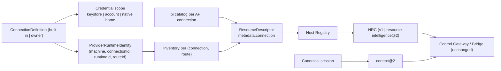
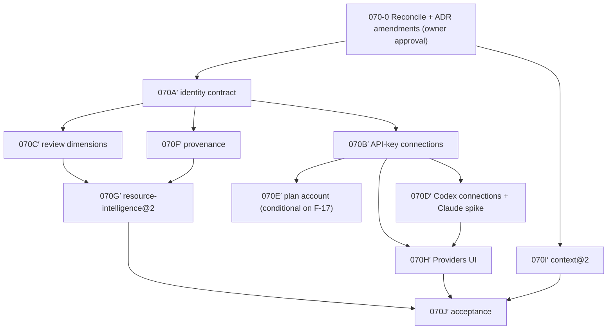

# NXR-070 — Implementation Blueprint (Reviewed)

Status: **PROPOSED** correction of `b843d04:docs/architecture/nxr-070-resource-fabric-implementation-blueprint.md`. Implementation NOT authorized. Baseline: accepted v0.6 `9e71014`.
Rationale for each change: Findings Register (`F-nn`, `O-n`). Threat ids (`T-nn`): Security Threat Model.

## 1. Reviewed architecture in one paragraph

Keep v0.6's resource system and grow it along **connections**, the axis ADR-028 already defined. A connection becomes owner-configurable (label, enabled, credential scope), while built-in connections keep today's ids so nothing that exists changes. Each host (Desktop, plane) stays a separate authority. NRC gains connection-aware hard filters and opt-in review dimensions while keeping v1 scoring. Cross-model continuity stays per-turn and canonical, upgraded to a typed `context@2`. Deferred: ACP runtimes, native session resume/fork, cross-host allocation, learned quality, budgets and network MCP.



## 2. Entity ownership matrix (corrected domain)

| Entity                    | Kind               | Identity                                                                                  | Owner                                | Lifecycle / creation                                                        | Discovery / validation                                                   | Persistence / version                                        | Revocation / failure                                                                                      | Security boundary                                            |
| ------------------------- | ------------------ | ----------------------------------------------------------------------------------------- | ------------------------------------ | --------------------------------------------------------------------------- | ------------------------------------------------------------------------ | ------------------------------------------------------------ | --------------------------------------------------------------------------------------------------------- | ------------------------------------------------------------ |
| ConnectionDefinition      | Configuration      | `connectionId` opaque; built-ins = v0.6 constants; owner = `<provider>.<method>.<suffix>` | Host main (Desktop main / plane CLI) | Built-ins compiled in; owner ones created via IPC (Desktop) or plane config | Strict zod; id pattern; provider/method allowlist                        | Desktop settings `connections[]` (schemaVersion 1, additive) | Disable: close admission, invalidate inventories. Remove: also forget Nexar-owned scope; ids never reused | Renderer sends label/provider/method only; main generates id |
| ConnectionCredentialScope | Configuration      | derived from `connectionId`                                                               | Host main                            | Created with the connection                                                 | Name pattern `CREDENTIAL_NAME_PATTERN`; home = Nexar-created private dir | key store / private state                                    | Removal deletes the key/blob/home Nexar created; never external homes                                     | Values never cross IPC; adapter receives only its own scope  |
| ProviderRuntimeIdentity   | Derived            | tuple                                                                                     | Integration definition + host        | Built per (connection, route)                                               | `identityCopy` strict                                                    | inventory cache                                              | Invalidated on auth/lifecycle change                                                                      | No account identifiers                                       |
| ProviderModelInventory    | Runtime state      | identity + generation                                                                     | Registry inventory service           | Owner refresh / sign-in / rejection                                         | Existing strict copy                                                     | Existing cache (stale on restore)                            | `invalidate` generation bump                                                                              | Existing                                                     |
| ResourceDescriptor        | Derived projection | built-in: unchanged; owner connection: hashed connection-qualified                        | Registry                             | Materialized from inventory/catalog                                         | Existing                                                                 | none (recomputed)                                            | Disappears with connection                                                                                | No secrets                                                   |
| Review dimensions         | Policy             | strategy setting                                                                          | Resource Strategy                    | Owner setting                                                               | Enum allowlist                                                           | strategy settings                                            | —                                                                                                         | Never authorizes                                             |
| `context@2`               | Derived projection | manifest hash                                                                             | Operating layer                      | Every turn                                                                  | Bounded, untrusted-wrapped                                               | Turn manifest                                                | —                                                                                                         | Untrusted input wrapping (ADR-017)                           |
| Execution attribution     | Runtime record     | record id                                                                                 | Telemetry                            | Every execution                                                             | Allowlist                                                                | telemetry JSONL                                              | —                                                                                                         | Ids/counts only                                              |

Redundant proposed entities removed: ProviderDriver, ProviderInstance (= ConnectionDefinition), RuntimeDefinition, RuntimeEnvironment, RuntimeBinding (new; name collision), RuntimeSession, Resource@2, ResourceProfile (rebuildable aggregate, not an entity), NRCDecision@2 (additive fields).

## 3. Corrected component contracts (PROPOSED, additive)

```ts
// packages/contracts/src/connection.ts — additive
export type ConnectionCredentialScope =
  | { readonly kind: 'keystore'; readonly name: string } // CREDENTIAL_NAME_PATTERN; built-in: e.g. OPENAI_API_KEY
  | { readonly kind: 'account'; readonly name: string } // built-in: 'chatgpt-plan'
  | {
      readonly kind: 'native-home';
      readonly runtimeId: SubscriptionRuntimeId;
      readonly home: 'default' | 'private';
    }
  | { readonly kind: 'none' };

export interface ConnectionDefinition extends ResourceConnection {
  readonly machine: 'desktop' | 'plane';
  readonly label: string; // mutable, never part of any identity
  readonly enabled: boolean;
  readonly builtIn: boolean;
  readonly credentialScope: ConnectionCredentialScope;
}

/** Policy/telemetry/lifecycle key. Never a path or env name. */
export function connectionKey(machine: 'desktop' | 'plane', connectionId: string): string;

/** Built-in definitions reproduce v0.6 exactly (ids, scopes). Golden-tested. */
export const BUILTIN_CONNECTIONS: readonly ConnectionDefinition[];
```

```ts
// packages/resource-registry/src/materialize.ts — additive
/** Default connection → existing `pi.<provider>.<model>` id; any other → `catalog:<sha256(connectionKey, provider, model)>`. */
export function catalogResourceId(
  connection: ConnectionDefinition,
  provider: string,
  model: string,
): ResourceId;
```

Naming for owner API keys: `<PROVIDER>_API_KEY__C<SUFFIX>` (uppercase base32). It satisfies `CREDENTIAL_NAME_PATTERN` and never collides with built-ins.

## 4. Corrected units, dependency graph and sequence

| New unit                                 | Replaces (old)              | Goal                                                                                                                                    | Size / risk  | Provider access                       |
| ---------------------------------------- | --------------------------- | --------------------------------------------------------------------------------------------------------------------------------------- | ------------ | ------------------------------------- |
| 070-0 Reconcile & amend docs             | — (F-01/F-02)               | Apply ADR amendments, update the study's status, record invariants                                                                      | S / low      | none                                  |
| 070A′ Connection identity contract       | A (partly K)                | `BUILTIN_CONNECTIONS`, `connectionKey`, catalog/inventory id rules, host-qualified plane DTO keys                                       | S / medium   | none                                  |
| 070B′ API-key connections                | B (partly I, K)             | Owner adds/disables/removes extra API-key connections end to end on Desktop                                                             | M / high     | none offline; optional owner key live |
| 070C′ Review dimensions                  | part of H                   | Opt-in `reviewDimensions` in strategy; default unchanged                                                                                | S–M / medium | none                                  |
| 070D′ Codex connections (+ Claude spike) | C, part of D                | Private `CODEX_HOME` per connection; per-connection inventory; fix `codexHome` attribution; Claude isolation spike (investigation only) | M / high     | owner-initiated `codex login` live    |
| 070E′ Plan account scope (conditional)   | part of B/D                 | Per-connection account blob; blocked by F-17 doc check                                                                                  | M / high     | owner sign-in live                    |
| 070F′ Provenance & attribution           | F, G                        | Connection key + per-field authority on execution records and aggregates                                                                | M / medium   | none                                  |
| 070G′ `resource-intelligence@2`          | H                           | Hard filters (disabled/removed connection, host, required dimensions), explanation fields; v1 scoring                                   | M / high     | none                                  |
| 070H′ Providers UI v2                    | I                           | Connection cards: configured / installed / authenticated / reachable; refresh/disable/remove                                            | M / medium   | none                                  |
| 070I′ `context@2`                        | J                           | Typed canonical handoff; required items never truncated                                                                                 | M / medium   | none                                  |
| 070J′ Acceptance                         | L                           | Offline corpus + owner live matrix                                                                                                      | M / high     | owner-authorized                      |
| Deferred                                 | E, J (native), K retirement | ACP worker, native resume/fork, cross-host allocation, budget, learned quality                                                          | —            | —                                     |



Parallel tracks after 070A′: {B′→D′→H′}, {C′,F′→G′}, {I′} (independent of A′). Sequential default for one implementer: 0 → A′ → B′ → C′ → F′ → G′ → D′ → H′ → I′ → J′.

## 5. Unit specifications

### 070A′ — Connection identity contract

- **Scope:** `contracts/src/connection.ts` (+`ConnectionDefinition`, `ConnectionCredentialScope`, `connectionKey`, `BUILTIN_CONNECTIONS`); `resource-registry/src/materialize.ts` (`catalogResourceId`); `host/src/native-inventories.ts` and `apps/desktop/src/main/plan-inventory-identity.ts` read identities from `BUILTIN_CONNECTIONS`; Desktop qualifies plane DTO connections with `machine: 'plane'` on receipt (no plane wire change).
- **Non-goals:** settings, IPC, UI, credentials, execution.
- **Migration:** none; built-ins reproduce constants.
- **Tests:** golden id vectors for every v0.6 identity (native ×3, plan, each pi provider/model sample) unchanged; two owner connections of the same provider/model produce distinct ids from inventory and catalog; Desktop+plane Claude produce distinct `connectionKey`s; NRC golden decision corpus unchanged; `RuntimeBinding` type unchanged.
- **DoD:** byte-identical ids for all built-ins (vector test); 0 changes to persisted settings fixtures; `pnpm check` green; boundaries show no new package.
- **Rollback:** revert commit (pure, no persisted state).

### 070B′ — API-key connections

- **Scope:** Desktop settings `connections[]`; key store accepts `<PROVIDER>_API_KEY__C<SUFFIX>` names for owner connections; pi catalog discovery per connection; IPC `providers:connectionAdd|Disable|Remove|List` (strict); minimal UI row.
- **Security:** main generates ids; renderer supplies label/provider only; forged id/name rejected; removal invalidates inventories and closes admissions before deleting the key; invariant B2 (unit counter) untouched.
- **Migration:** additive `connections` section; absent = built-ins only; unknown sections preserved; backup before first write.
- **Tests:** offline fake OpenAI-compatible server with two keys proves per-connection credential use (sentinel per key, never logged); disable/remove races with in-flight inventory; corrupt `connections` section fails closed to built-ins; IPC forged-id tests; E2E add → route → remove.
- **DoD:** two API connections of one provider route independently in Auto and pinned modes; removing one leaves the other's pins and history intact.
- **Rollback:** feature flag hides owner connections; key entries remain until the owner removes them.

### 070C′ — Review dimensions

- **Scope:** strategy setting `reviewDimensions` (`resource` default; `connection`, `provider`, `host`) with `preferred|required`; hard filter for required; reasons `strategy.diversity.<dimension>`.
- **Tests:** permutation corpus; unknown never distinct; standalone one-unit grant rejects `reviewOf` unchanged (9e71014 regression); `deterministic@1`/v1 golden unchanged when unset.

### 070D′ — Codex connections and Claude spike

- **Scope:** native-home scope: Nexar creates `<appData>/Nexar/runtime-homes/<connectionId>/codex` (0700, no symlinks); adapter rejects a resource whose `codexHome` differs from its connection's; inventory source per connection; owner-initiated `codex login --device-auth` with that `CODEX_HOME`. Plane: same model with plane-local homes.
- **Claude spike (investigation, no product code):** verify `CLAUDE_CONFIG_DIR` isolation of credentials, settings, sessions on Windows and plane; report → owner decision.
- **Tests:** fake Codex binary echoes `CODEX_HOME`; mismatch → `CONFIGURATION_ERROR`; probe/login never inherit API-key env; removal deletes only the Nexar-created home.

### 070E′ — Plan account scope (conditional)

- Starts only after a documented OpenAI answer on multiple accounts per `ext_agent_host_id` (F-17). Otherwise stays one plan connection.

### 070F′ — Provenance and attribution

- Add `connectionKey` and per-field authority (`measured|runtime-reported|vendor-reported|estimated|owner-declared|unknown`) to execution records and aggregates; old records read as `legacy/unknown`. No budget, no billing.

### 070G′ — `resource-intelligence@2`

- v1 scoring code reused; new hard filters before scoring; explanation fields (policy version, facts digest, rejected reasons); explicit opt-in; v1 remains default until owner switches.
- **Tests:** seeded invariant suite incl. "known headroom ≡ unknown" rank parity (F-09), starvation check (non-preferred eligible resource still selectable under `weighted` mode), replay determinism.

### 070H′ — Providers UI v2

- Connection cards with independent configured/installed/authenticated/reachable states; refresh/disable/remove; no ids shown that are not opaque; quota "unknown" as text.

### 070I′ — `context@2`

- Typed sections; required constraints/review requirements never truncated (reject + explain); artifact refs by safe name/hash; same untrusted wrapping; manifest records policy, counts, hash.

### 070J′ — Acceptance

- See §6 and Execution Readiness Plan.

## 6. Verification strategy (PASS/FAIL)

| Layer               | What                                 | PASS criterion                                                                                                                                            |
| ------------------- | ------------------------------------ | --------------------------------------------------------------------------------------------------------------------------------------------------------- |
| Contract            | `ConnectionDefinition`, scopes, keys | zod/type tests; malformed member rejected before normalization                                                                                            |
| Schema              | settings `connections`, IPC          | strict; forged/oversize/unknown keys rejected                                                                                                             |
| Unit                | id rules, filters, context@2         | golden vectors byte-identical; permutation invariants 0 violations over ≥1,000 seeds                                                                      |
| Component           | inventory service per connection     | late result after invalidate never republishes (0 occurrences)                                                                                            |
| Adapter conformance | pi, codex                            | each connection's sentinel credential/home observed only by its own executions                                                                            |
| Offline fixtures    | fake OpenAI server, fake codex       | deterministic, no network                                                                                                                                 |
| Desktop/Plane       | Desktop+plane DTO                    | distinct connection keys; old plane (no new fields) still works                                                                                           |
| Security regression | v0.6 suites                          | engine-gateway, mcp relay, cowork, approvals suites unchanged and green                                                                                   |
| Migration           | settings fixtures from v0.6          | load → identical routing; corrupt section → built-ins only, file untouched                                                                                |
| Fault injection     | remove/disable during execution      | in-flight execution finishes or cancels under its pinned decision; no new admissions; no retries on another connection unless policy allows at a new unit |
| E2E                 | Playwright                           | add/route/remove second API connection; no key in page (sentinel)                                                                                         |
| Live (owner)        | per Execution Plan                   | owner-authorized only                                                                                                                                     |

Required negative cases (each one test, PASS = stated outcome):

| Case                                             | Expected outcome                                                                                         |
| ------------------------------------------------ | -------------------------------------------------------------------------------------------------------- |
| Same provider/model on two connections           | Two resource ids; pins resolve to their own connection                                                   |
| Resource id collision attempt (crafted model id) | Hash-qualified ids differ; duplicate → materialization error, nothing published                          |
| Unknown auth identity                            | `auth.unknown` neutral as v1; never "distinct" for review                                                |
| Stale inventory                                  | Not routable; visible stale                                                                              |
| Removed connection / binding                     | Pin fails `pin.connection-removed`; no substitution                                                      |
| Wrong session/account association                | Impossible by construction (per-turn sessions); test asserts no native session id persisted across turns |
| Unsupported ACP capability                       | N/A (deferred); assert no ACP adapter registered                                                         |
| Malformed runtime metadata                       | Inventory rejected `invalid-response`                                                                    |
| Incomplete context handoff                       | Required item overflow → turn rejected with reason                                                       |
| Permission escalation via request field          | Rejected; grant scopes unchanged                                                                         |
| Duplicate execution                              | Duplicate unit id rejected (existing)                                                                    |
| Mid-workflow provider failure                    | Control: restart once as new decision (existing); worker: unit fails, no auto-replay                     |
| Failed migration rollback                        | Backup restored byte-identical                                                                           |
| Restart during delegated execution               | `DelegationUnitLimit` count preserved                                                                    |
| Unknown quota                                    | Rank parity with known-headroom candidate                                                                |
| Incompatible old configuration                   | Fails closed to built-ins; raw file preserved                                                            |

## 7. Security requirements (summary)

Main-generated ids; scope values never cross IPC; adapters receive only their connection's scope; Nexar-created homes are private and not symlinks; removal deletes only Nexar-owned material; host-qualified keys everywhere policy acts; invariants B1–B6 (Amendments §B); full threat list in the Security Threat Model.

## 8. Rollback strategy

070A′, C′, F′, G′, I′ are code-only and opt-in or behaviour-neutral, so a revert rolls them back. 070B′, D′ and H′ add persisted state. That state is additive and sits behind a flag, so disabling the flag restores v0.6 behaviour. Owner keys and homes are kept until the owner removes them. Built-ins are permanent, so there is no compatibility-retirement phase.

## 9. Definition of Done (programme)

1. All built-in resource ids, pins and NRC golden decisions are byte-identical to v0.6.
2. Two API-key connections and two Codex connections run independently, offline and in the owner-approved live run.
3. The review-dimension and `@2` invariant suites pass, and v1 is unchanged.
4. A cross-model turn sequence keeps the required `context@2` items.
5. The v0.6 security regression suites are unchanged and green.
6. Exact-head CI is green on Ubuntu and Windows, including source and packaged Desktop E2E.
7. The owner acceptance evidence is recorded with SHAs.
