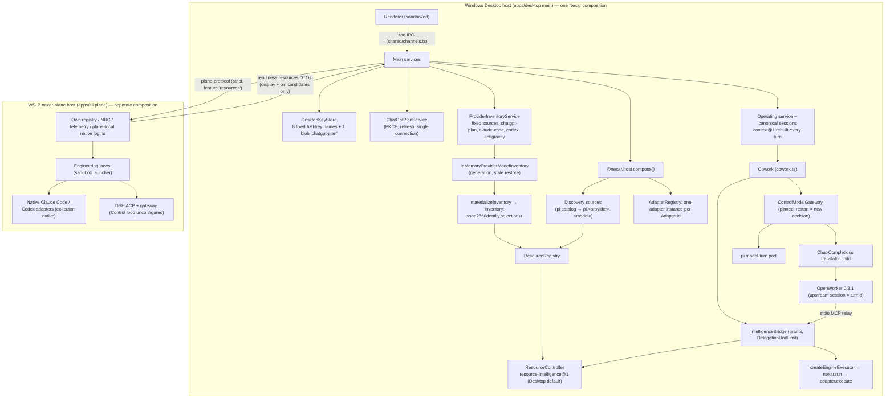

# NXR-070 — v0.6 Architecture Reconciliation (As-Is Model vs Proposed Resource Fabric)

Status: independent review artifact, PROPOSED corrections only. Not an approval of ADR-029.
Reviewer: Claude Opus 5.5 (independent audit). Date: 2026-10-09.

Baselines inspected (read-only):

| Reference                                   | SHA                                                                                                                                | How inspected                                                                                                                             |
| ------------------------------------------- | ---------------------------------------------------------------------------------------------------------------------------------- | ----------------------------------------------------------------------------------------------------------------------------------------- |
| Accepted v0.6 implementation                | `9e71014979db7a7619bb6ac909b8418a0d198573`                                                                                         | source tree identical to merge                                                                                                            |
| v0.6 merge                                  | `2f856f935a1ca51fc0f2c179386baa31bd82c3bd`                                                                                         | `git diff 9e71014 2f856f9` → no source delta beyond PR merge                                                                              |
| Main (docs-only)                            | `677eefd282fb240cb9583dead80ae100bdeab176`                                                                                         | review worktree `D:/Nexar-Ai-nxr070-opus-review` (branch `review/nxr070-opus-architecture-audit`), 7 docs files changed vs merge, no code |
| CI receipts (verified via `gh`, 2026-10-09) | PR #39 MERGED as `2f856f9`; run `37955286149` attempt 1 on `2f856f9` = success; run `37958959182` attempt 2 on `677eefd` = success | `gh pr view` / `gh run view`                                                                                                              |
| NXR-070 research                            | `b843d04a8e84b281b8031809dbbe71cf69a311db`                                                                                         | `git show` only; Codex's worktree `D:/Nexar-Ai-nxr070` untouched                                                                          |
| Research base                               | `4c69d1cd76c8182313f762a90dd7925c98dfa7bc`                                                                                         | `git diff 4c69d1c 9e71014`: 26 files, +2149/−212                                                                                          |

Evidence labels: **VERIFIED** (inspected source/tests/docs), **INFERRED**, **UNVERIFIED**, **INCORRECT**, **PROPOSED**.
Finding IDs (`F-nn`) resolve in `NXR070_Critical_Findings_Register.md`.

---

## 1. As-Is Architecture Model (derived from code, not from proposals)

### 1.1 Component interaction

### 1.2 Component boundaries and ownership (VERIFIED)

| Responsibility               | Owner (file)                                                                                                                                                | Notes                                                                                                                                                                              |
| ---------------------------- | ----------------------------------------------------------------------------------------------------------------------------------------------------------- | ---------------------------------------------------------------------------------------------------------------------------------------------------------------------------------- |
| Domain types                 | `packages/contracts/src/{resource,connection,inventory,gateway,execution}.ts`                                                                               | `ResourceDescriptor`, `RuntimeBinding` **(already a type: adapter/locality/options)**, `CredentialRef`, `ProviderConnection`, `ProviderRuntimeIdentity`, `ExecutionAdapter`        |
| Connection identity          | `connection.ts` `connectionOf()`                                                                                                                            | explicit `metadata.connection` or deterministic inference; native agents map to fixed ids (`anthropic.subscription`, `openai.subscription`, `google.subscription`, `deepseek.api`) |
| Route identity               | `inventory.ts` `ProviderRuntimeIdentity{provider, connectionId, runtimeId, routeId, machine}`                                                               | the tuple ADR-029 calls instance+runtime+binding+environment                                                                                                                       |
| Stable resource IDs          | `resource-registry/src/materialize.ts:15` `inventoryResourceId`                                                                                             | sha256 of identity tuple + selection; `legacyId` hook (`:38`)                                                                                                                      |
| Inventory freshness          | `resource-registry/src/inventory.ts:57` `InMemoryProviderModelInventory`                                                                                    | `hydrateStale`, `invalidate` (generation+1), `markStale`, late-result rejection                                                                                                    |
| Native inventory definitions | `packages/host/src/native-inventories.ts`                                                                                                                   | three **hard-coded** identities, all `machine: 'desktop'`                                                                                                                          |
| Account inventory            | `apps/desktop/src/main/chatgpt-plan-resources.ts`, `plan-inventory-identity.ts`                                                                             | `openai.chatgpt-plan` / `openai.responses.account`; `migratePlanResourceId` = existing read-time pin alias precedent                                                               |
| API-key resources            | `integrations/pi/src/catalog-discovery.ts:104,141`                                                                                                          | connection `${provider}.api`; id `pi.<provider>.<model>` — **not connection-qualified**                                                                                            |
| Credentials                  | `desktop-key-store.ts:16,32`; `CONNECTION_CREDENTIAL_NAMES=['chatgpt-plan']`                                                                                | one key per provider, one account blob                                                                                                                                             |
| Native runtime home          | Codex: per-resource `runtime.options.codexHome` (`integrations/codex/src/settings.ts`), Claude: inherits parent env (`integrations/claude-code/src/env.ts`) | Codex inventory uses the default home only                                                                                                                                         |
| Routing                      | `resource-controller/src/{hard-filters,strategy,intelligence-policy}.ts`                                                                                    | hard filters → weighted/lexicographic v1 score; review diversity compares **resource ids** (`strategy.ts:262–330`)                                                                 |
| Control                      | `engine-gateway/src/gateway.ts:100`                                                                                                                         | pinned per loop; `restart` excludes failed resource and emits new decision                                                                                                         |
| Workers                      | `engine-gateway/src/bridge.ts:139,207`                                                                                                                      | per-turn shared `DelegationUnitLimit`; `reviewOf` same-grant earlier unit                                                                                                          |
| Agent-run execution          | `host/src/bridge-ports.ts:13`                                                                                                                               | Bridge units run through `nexar.run` → any `ExecutionAdapter` (native agents included)                                                                                             |
| Canonical sessions/context   | `packages/sessions`, `packages/operating/src/context.ts`                                                                                                    | `context@1`: 6 turns / 24,000 chars, rebuilt from canonical history every turn                                                                                                     |
| Native session lifetime      | `apps/desktop/src/main/cowork.ts:596–601`; adapters stateless                                                                                               | OpenWorker session id = `turnId` (restart `-rN`); **no cross-turn native resume anywhere**                                                                                         |
| Permissions (ACP)            | `integrations/deepseek-harness/src/acp/permissions.ts:53` `PermissionBroker`                                                                                | deny-default, fingerprint-bound, single-use                                                                                                                                        |
| ACP client                   | `integrations/deepseek-harness/src/acp/run.ts:35`                                                                                                           | hand-written, `SUPPORTED_PROTOCOL_VERSION = 1`, strict equality                                                                                                                    |
| Plane boundary               | `packages/plane-protocol/src/schemas.ts:39,132`                                                                                                             | feature `resources`; `planeResourceSchema.connection` has **no machine**                                                                                                           |

### 1.3 Resource lifecycle (VERIFIED)

`InventorySource.fetch` (integration-owned, bound to one route) → strict copy (`entryCopy`, bounded) → generation-guarded store → `materializeInventory` (fresh only, never `static-verified`, native never gains `model-turn`) → Registry → NRC hard filters → score → decision → adapter. Auth mutation calls `invalidate` (generation bump) so late results cannot re-admit. Restored caches are stale and cannot route.

### 1.4 Authentication ownership (VERIFIED)

| Route                             | Owner                                        | Multi-account today                                                                     |
| --------------------------------- | -------------------------------------------- | --------------------------------------------------------------------------------------- |
| API keys                          | Nexar key store (`safeStorage`), fixed names | No (one name per provider)                                                              |
| ChatGPT plan                      | Nexar PKCE service, one blob                 | No                                                                                      |
| Native Claude/Codex/agy (Desktop) | vendor runtime in the user's default home    | Codex: resource-level `codexHome` possible but inventory/identity ignore it; Claude: no |
| Native (plane)                    | plane-local vendor logins                    | No; plane connection ids equal Desktop's                                                |

### 1.5 Session lifecycle (VERIFIED)

Canonical `OperatingSession` (revisioned, leases) → `Turn` records with lane, control/delegation/task resource ids → `context@1` built per turn → engine gets a **new** native session per turn. Consequence: cross-model continuity is portable by construction; native/provider-private state never crosses turns, accounts or vendors (see F-07).

### 1.6 Control/Worker flow (VERIFIED)

Cowork: `selectControl` → pinned `ControlDecision` → per-turn grant token → translator → OpenWorker loop. Delegation: relay `nexar.intelligence_submit` → Bridge (grant + shared unit limit + `reviewOf` integrity; standalone one-unit schema excludes `reviewOf`, 9e71014) → `controller.allocate` → `createEngineExecutor`. Code: Desktop → plane protocol → plane lanes; executor `native` in the accepted environment (DSH Control unconfigured).

### 1.7 Security enforcement points (VERIFIED)

Renderer isolation + zod IPC; key store ACL + atomic writes; minimal child env per adapter (Codex strips API keys so billing cannot silently switch); sandbox launcher for write lanes; plane no automount/interop; grant tokens per turn; `PermissionBroker`; read-only Cowork broker denies write/shell/network/foreign MCP (4559857); malformed capability arrays rejected before alias normalization (834a865); telemetry allowlists.

### 1.8 Known limitations (VERIFIED from baseline doc + code)

DSH Control unconfigured on plane; Antigravity unavailable in the validation environment; fixed connection ids/credential slots; review independence = resource id only; plane/desktop connection id collision (F-05); no structured handoff fields in `context@1`; Windows Job Object/orphan containment limits; unsigned installer.

### 1.9 Capabilities that must NOT be rebuilt

Inventory identity/freshness/generation; `inventoryResourceId` and `legacyId` hook; `migratePlanResourceId` alias pattern; hard-filter-before-score invariant tests; Control pinning + restart; Bridge grants + `DelegationUnitLimit`; `ExecutionAdapter` as the agent-run port; `PermissionBroker` and DSH ACP client; `context@1` + untrusted wrapping; key store; strict plane feature negotiation.

---

## 2. Concept mapping: proposal vs reality

| ADR-029 concept             | Existing v0.6 equivalent (VERIFIED)                                                     | Genuinely new?                                                | Review classification                                        |
| --------------------------- | --------------------------------------------------------------------------------------- | ------------------------------------------------------------- | ------------------------------------------------------------ |
| ProviderDriver              | integration package + `ExecutionAdapter` + `InventorySource` + host composition         | No                                                            | Redundant name; keep composition seams (F-03)                |
| ProviderInstance            | `ProviderConnection` / `connectionId` (ADR-028: "multiple opaque Nexar connection ids") | Partly: owner-configured lifecycle + label + credential scope | Extend `ProviderConnection`; do not add a type (F-03)        |
| AccountIdentity             | none; forbidden to derive from credentials                                              | Only as owner-declared assertion                              | Defer "verified principal" (F-12)                            |
| CredentialRef               | exists                                                                                  | Per-connection scope missing                                  | Extend (F-06)                                                |
| RuntimeDefinition           | `runtimeId` + adapter id                                                                | No                                                            | Redundant                                                    |
| RuntimeEnvironment          | `machine: 'desktop'                                                                     | 'plane'` = separate host authority                            | No (remote envs future)                                      | Keep enum; environment ≠ shared registry (F-04) |
| RuntimeBinding (new)        | `ProviderRuntimeIdentity` tuple                                                         | No                                                            | **Name collides with existing `RuntimeBinding` type** (F-03) |
| RuntimeSession              | none by design (stateless per turn)                                                     | Would be new risk                                             | Defer (F-07)                                                 |
| Model/Agent Inventory @2    | `ProviderModelInventory` (ADR-028)                                                      | Capability evidence fields only                               | Additive fields, no new version unless wire changes (F-14)   |
| Resource @2 view            | `ResourceDescriptor` + `metadata.connection/inventory`                                  | No                                                            | Not needed                                                   |
| ResourceObservation/Profile | `ExecutionAggregate`, `RoutingHistory`, `QuotaObservation`                              | Provenance per field                                          | Additive (070F′)                                             |
| NRCDecision @2              | `RouteDecision` + `PolicyStamp` + reasons                                               | Review dimensions + connection facts                          | Additive                                                     |
| ContextHandoff              | `context@1` + `ContextManifest`                                                         | Typed fields                                                  | `context@2`, canonical-only (F-07)                           |

## 3. Reconciliation with accepted deltas after the research base

| Delta                                          | Invariant any NXR-070 unit must keep                                                 | Research status                                                                        |
| ---------------------------------------------- | ------------------------------------------------------------------------------------ | -------------------------------------------------------------------------------------- |
| `1feb97f` canonical delegation vocabulary      | Capability projections use registered own-property aliases only                      | Not reflected (F-02)                                                                   |
| `2f26b36` in-turn polling/session continuity   | Completed-result return in the same parent turn                                      | Not reflected                                                                          |
| `834a865` malformed arrays / inherited keys    | New capability/facet arrays validate each member before normalization                | Not reflected                                                                          |
| `3cbd6a6` shared per-turn admission            | Restart, fallback, grant remint, new connection must not reset `DelegationUnitLimit` | Not reflected — 070H/J "shared retry budget" must reuse it, not add a parallel counter |
| `4559857` read-only interactive broker         | Protocol permission mode ≠ Nexar authority                                           | Partly (D8)                                                                            |
| `9e71014` standalone schema without `reviewOf` | Review-dimension work must not reintroduce `reviewOf` into one-unit grants           | Not reflected — D13 must state it                                                      |
| `f5925b9`/final acceptance                     | Research claim "incomplete NXR-066b" is superseded                                   | **INCORRECT now**                                                                      |

## 4. Cardinality (VERIFIED where marked)

| Relationship                        | Supported today                                                                        | Proposed handling                                          |
| ----------------------------------- | -------------------------------------------------------------------------------------- | ---------------------------------------------------------- |
| Provider → many connections         | Contract yes (ADR-028); composition no (fixed ids)                                     | 070B′ owner-configured connections                         |
| Connection → many runtimes/routes   | Yes (`runtimeId`, `routeId`)                                                           | Keep                                                       |
| Runtime → many environments         | Only as separate hosts; each host owns its credentials                                 | Same connection on two hosts = two connections (F-05)      |
| Runtime → many models               | Yes (inventory entries)                                                                | Keep                                                       |
| Many connections → same model       | Inventory ids distinct by hash (VERIFIED); `pi.<provider>.<model>` collides (VERIFIED) | 070A′ connection-qualified ids for non-default connections |
| One connection → model-turn + agent | Yes as distinct routes (ChatGPT plan pi route vs native Codex)                         | Keep distinct connections when credentials differ          |
