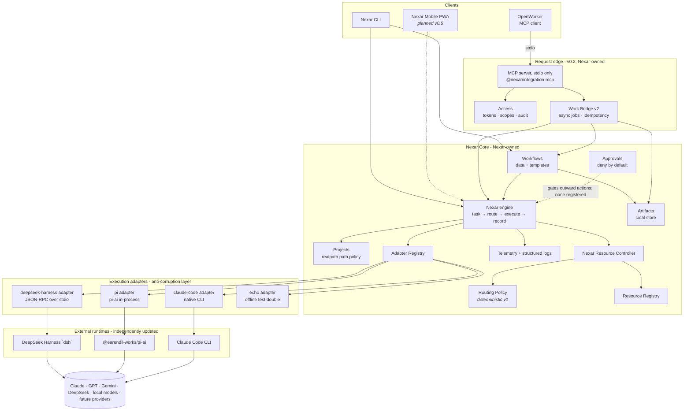
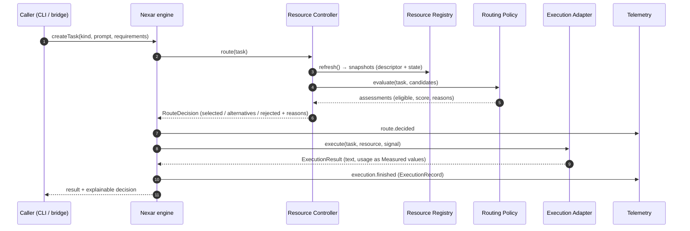
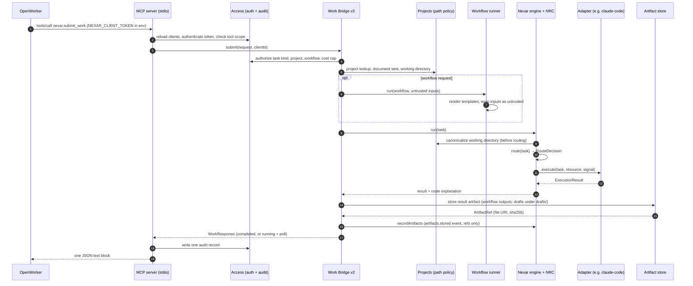
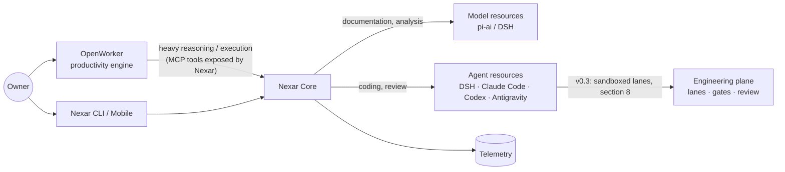
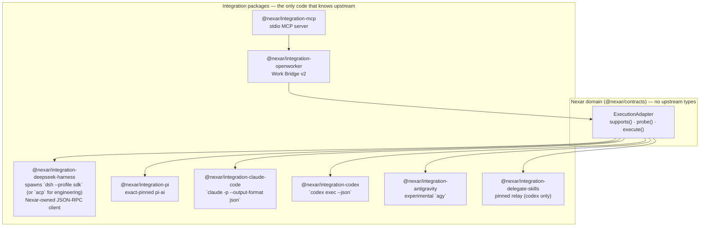
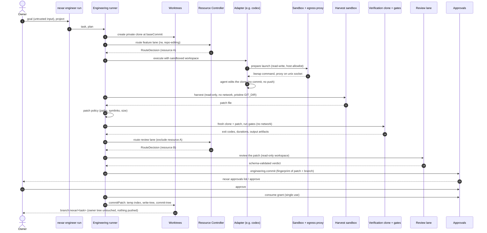
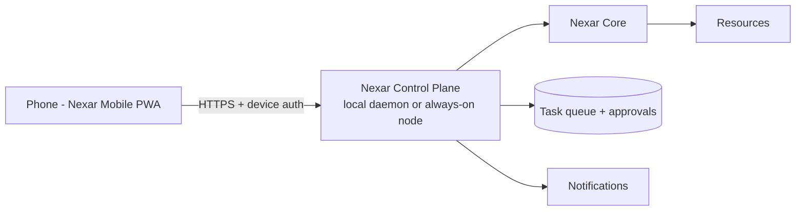

# Nexar architecture overview

Status: v0.3 (2026-10-01); v0.1 baseline, v0.2 personal-work capabilities, and the v0.3 engineering plane (section 8). Decisions are recorded in [`docs/adr/`](../adr/). Evidence for
every upstream claim is in [`docs/research/upstream/`](../research/upstream/).

## 1. What Nexar is

Nexar is a **Personal AI Operating Layer**: one local-first system that understands a task, chooses
the right AI resource for it, orchestrates the work, executes it safely, records what happened, and
(later) improves its resource decisions over time. It combines:

- **Personal work** — documents, proposals, SOWs, meeting prep, email, calendar, files, routine
  automation. Primary engine: **OpenWorker**.
- **Engineering work** — repository understanding, coding, debugging, review, delegation to coding
  agents. Primary engines: **DeepSeek Harness**, native coding agents (Claude Code, Codex,
  Antigravity), **Delegate Skills**, and **pi-ai** for direct model access.

Nexar is not a wrapper around any one model, provider, or agent. External projects are
_components_; Nexar owns the stable domain concepts: **Task, AI Resource, Resource Registry,
Resource Controller, Routing Policy, Execution Adapter, Telemetry, Control Plane, Work Engine
interfaces**.

## 2. The three separated questions

| Question                                       | Owner                                             | Implementation                                                               |
| ---------------------------------------------- | ------------------------------------------------- | ---------------------------------------------------------------------------- |
| **Who should execute?**                        | Nexar Resource Controller (NRC)                   | Deterministic, explainable policy over the Resource Registry                 |
| **How is the work orchestrated?**              | An execution runtime behind an `ExecutionAdapter` | DeepSeek Harness (agent loop, tools, subagents) or a native agent's own loop |
| **How is the provider/model actually called?** | The runtime's internals                           | pi-ai (direct), DSH's own LLM adapters, or the native agent's own auth       |

Collapsing these would couple Nexar to one vendor's idea of "a model". Keeping them separate is what
lets any one component be replaced by writing an adapter.

## 3. High-level architecture



Corrections to the pre-research hypothesis (see ADR-002, ADR-003):

- DeepSeek Harness is **not** below the Resource Controller in a single chain with Pi beneath it.
  DSH already embeds pi-ai as one of its own LLM adapters (`@deepseek-ai/dsh-llm-pi-ai`). Nexar
  therefore treats DSH as an **agent runtime** that the NRC can select, and configures DSH's provider
  route through a launch overlay — Nexar does not stack its own pi adapter under DSH.
- pi-ai is a **separate, direct model path** for tasks that need a model call rather than an agent
  loop (summaries, drafting, analysis), and for local/OpenAI-compatible endpoints.
- Native agents (Claude Code, Codex, Antigravity) are first-class resources with their own adapters,
  not forced through pi-ai or DSH.

## 4. AI Resources (not "models")

The unit the NRC reasons about is an **AI Resource** (ADR-007). A resource is described by a
static `ResourceDescriptor` and has a separately tracked dynamic `ResourceState`:

- `kind` — discriminated union: `model` (provider + model + access `api | subscription | local`),
  `agent` (e.g. `claude-code`, `codex`, `antigravity`, `deepseek-harness`; interface
  `cli | sdk | rpc | acp | mcp`), `tool-runtime`.
- `capabilities` — open string set (`coding`, `repo-editing`, `reasoning`, `knowledge-work`, …).
- `runtime` — which execution adapter runs it, and whether it is local or remote.
- `auth` — a _reference_ to where the runtime finds its credential (env var name or
  "runtime-managed"). Never a secret value.
- `cost`, `limits`, `dataLocality`, `tags`.
- `ResourceState` — availability, auth state, quota, observed-at. Refreshed by adapter probes.

## 5. Resource selection flow



Callers depend only on `ResourceRouter.route(task)`. The policy is a pure function
`evaluate(input) → assessments`, so a scoring, quota-aware, cost-aware, or learned policy can
replace the deterministic one (roadmap v0.4) without changing callers. Every decision carries
reason codes (`capability.missing`, `state.unavailable`, `preference.task-kind`, …) and a
human-readable explanation.

### v0.2 request flow (OpenWorker over MCP)



If the work outlives `waitSeconds` (at most 100, because OpenWorker kills calls after 120 s), the
response is `running` and the job continues in the background; `nexar.work_status` (or a repeated
`nexar.submit_work` with the same `requestId`) returns its state. Details:
[`docs/integration/openworker-mcp.md`](../integration/openworker-mcp.md), ADR-014.

## 6. Personal work vs engineering work



OpenWorker keeps ownership of productivity workflows (connectors, approvals inbox, artifacts).
Research showed OpenWorker does **not** expose its agent as a callable service; its stable seam is
as an **MCP client**. The preferred direction is therefore _OpenWorker → Nexar_ (Nexar exposes an
MCP server with a `nexar.submit_work` tool, built in v0.2), with _Nexar → OpenWorker_ (its automations API)
as a secondary, pinned seam. v0.1 shipped only the transport-agnostic Work Bridge contract; v0.2 adds
the stdio MCP server and Work Bridge v2 (ADR-014), verified live against OpenWorker v0.3.0.

## 7. Execution adapter boundaries



Rules (ADR-008):

1. Upstream package names appear **only** inside `integrations/<name>/`. Domain packages never
   import them; adapters never export upstream types.
2. Adapters translate upstream errors to `NexarError` codes, usage to `Measured<T>` values, and
   honor `AbortSignal`.
3. Subprocess runtimes are launched with a **scrubbed environment** (only the credentials that
   resource needs), an isolated home/state directory under `.nexar/`, and exact pinned versions.
4. Probes are side-effect free and never make paid calls.
5. Each adapter has contract tests against a fake runtime so CI never needs credentials.

## 8. The v0.3 engineering plane

v0.3 runs **write-capable** coding agents. The decisions are ADR-018 (execution plane: WSL2, bubblewrap,
private clones, harvest) and ADR-019 (lanes, resource selection, acceptance). The invariants:

- A write-capable lane runs only through the `SandboxLauncher` from `@nexar/sandbox`; adapters refuse
  write mode otherwise, and there is no unsandboxed fallback.
- The agent edits a **private clone** of the owner's repository. It cannot commit or push: `.git` is
  read-only, the clone has no remote, and the egress proxy allows only exact vendor hosts.
- Nexar, not the agent, produces the patch (harvest in a second sandbox), validates it, verifies it on a
  fresh clone with gates that have no network, has a different resource review it, asks the owner, and
  only then creates the commit on `nexar/<task>` with git plumbing. It never pushes.

Lane plans are data in `engineering/plans/` (`implement-review`, `implement-test-review`,
`plan-implement-review`). Each lane becomes a normal `NexarTask`, so **who executes** is still decided by
the NRC and recorded as a `RouteDecision` per lane.



A failed gate or a `request-changes` review starts a bounded rework round; when rounds run out the
task fails. A denied or expired approval ends the task as `not-accepted`. With project policy
`ownerApproval: "never"` the approval step is skipped explicitly (the second live E2E used this).
`nexar engineer run` waits on the same file-backed approval store that `nexar approvals` decides on.

Other v0.3 pieces: the DeepSeek Harness adapter also speaks ACP (`dsh --profile acp`) and maps each
permission request to an approval (deny by default, never `*_always`); the Delegate Skills adapter is an
executor for a Codex resource that runs a private copy of a sha256-pinned relay inside the sandbox;
Antigravity is an experimental opt-in adapter. Task records live at
`.nexar/engineering/<task>/record.json` with allowlisted fields only. v0.3 records lane outcomes but does
not use them for routing (v0.4). Runbook for the plane: [`docs/integration/wsl2-engineering-plane.md`](../integration/wsl2-engineering-plane.md);
controls and gaps: [`security.md`](security.md).

## 9. Telemetry and errors

- `ExecutionRecord` (schema v1) records task, resource, adapter, resolved provider/model, routing
  policy + reason codes, timestamps, latency, usage (`Measured<number>`: measured / estimated /
  unavailable), quota impact, retries, outcome, error category, artifacts.
- Sinks: in-memory, JSONL file (`.nexar/telemetry.jsonl`, mode 0600), composite. The engine also emits
  an `artifacts.stored` event carrying artifact refs only (never content). Structured JSON
  logs go to stderr with key-based redaction.
- The request **audit log** (`.nexar/audit.jsonl`, written by the MCP server) is separate from
  telemetry: one allowlisted record per tool call (ADR-015).
- Errors are `NexarError` with a closed code set (`NO_ELIGIBLE_RESOURCE`, `AUTH_REQUIRED`,
  `PROVIDER_ERROR`, `EXECUTION_TIMEOUT`, `CONFIGURATION_ERROR`, …) and a `retryable` flag.

## 10. Future: control plane and mobile



Not built in v0.1. The seams that make it cheap later: the engine is a library (the CLI is a thin
client of it), tasks carry an `origin` (`cli`, `openworker`, `control-plane`, `mobile`), telemetry is
an event stream, and approvals will attach to tasks rather than to a UI.

## 11. Local-first and security posture

See ADR-006 and [`docs/architecture/security.md`](security.md). In short: everything runs on the
owner's machine; secrets live only in the environment or in each runtime's own credential store;
Nexar config holds credential _references_; runtime state lives in git-ignored `.nexar/`.

## 12. Repository map

```text
apps/cli                       nexar CLI (doctor, resources, route, run, projects, artifacts,
                               approvals, clients, mcp serve, workflows, engineer, sandbox)
packages/contracts             domain types, errors, Measured values — zero deps
packages/resource-registry     resource descriptors + dynamic state + discovery seam
packages/resource-controller   NRC: deterministic policy + explainable decisions
packages/telemetry             structured logger, redaction, telemetry sinks
packages/core                  engine, adapter registry, config loading
packages/projects              projects, realpath path policy (resolveContainedPath), document sets
packages/artifacts             LocalArtifactStore, filename sanitization
packages/approvals             fail-closed approvals, outward-action gate (no executors registered)
packages/access                client tokens, scopes, JSONL request audit
packages/workflows             workflow catalog, template renderer, runner
packages/sandbox               bwrap profile, SandboxLauncher, egress proxy, self-test (v0.3)
packages/worktrees             private clone, sandboxed harvest, patch policy, verification, commitPatch (v0.3)
packages/engineering           lane plans, runner, gates, review verdict, task records (v0.3)
workflows/                     shipped workflow definitions (workflow.json + Markdown templates)
engineering/                   lane plans (plan.json + Markdown briefs) for the engineering runner
integrations/echo              offline deterministic adapter (tests + zero-credential proof)
integrations/claude-code       native Claude Code agent adapter
integrations/deepseek-harness  DSH runtime adapter (subprocess JSON-RPC; ACP for engineering lanes)
integrations/codex             native Codex agent adapter (v0.3)
integrations/antigravity       experimental, opt-in agy adapter (v0.3)
integrations/delegate-skills   pinned relay executor for a Codex resource (v0.3)
integrations/pi                pi-ai direct model adapter
integrations/openworker        Work Bridge v2 (request/response contract + job handling)
integrations/mcp               stdio MCP server (the only importer of @modelcontextprotocol/*)
config/                        example configuration
docs/                          architecture, ADRs, integration, research, roadmap, backlog, devlog
```

`apps/control-plane` and `apps/mobile` are deliberately **not** created yet (ADR-001): empty
placeholder packages rot. They appear when their milestone starts.
