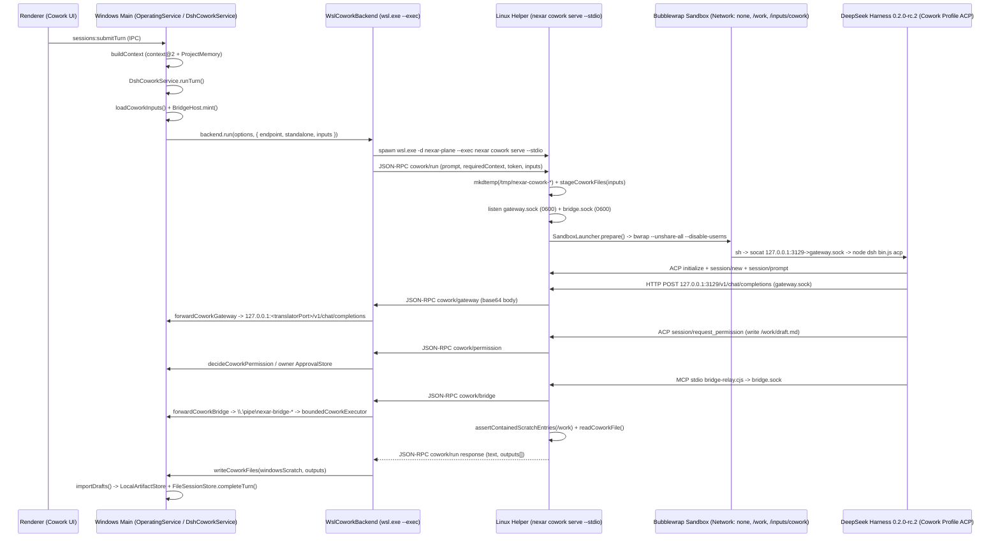

# NXR-SEC-02 Independent Security, Architecture & Production Readiness Review

- **Audit Milestone:** `NXR-SEC-02` — Isolated Cowork via WSL2 / Bubblewrap
- **Auditor:** Gemini 4 Argon (High Reasoning Mode) — Independent Principal Security Architect & Senior Software Engineering Auditor
- **Original Implementation Engineer:** GPT-6.1 Sol / OpenAI Codex
- **Audit Date:** 2026-10-16
- **Repository:** `mohmedhat797/Nexar-Ai`
- **Evaluated Worktree:** `D:/Nexar-Ai-main/.nexar/sec02`
- **Evaluated Branch:** `feat/nxr-sec02-isolated-cowork`
- **Tested Implementation Commit:** `3b3e26a3ab641f5273ad43ddce6de0ca4065f847`
- **Tested Implementation Git Tree:** `bf749cfcb88ed5adb2be80f3c0b9e6c2ed1ebafb`
- **Final Documentation HEAD:** `1ed40384cc467aaf0b997455664acf2e1226ea47` (Tree: `1e59a65d818ee6aa0eafa40e76ae52bc6b0173c5`)
- **Consolidated Baseline Parent:** `8e35e46c192e11022185e6d12117b610f107351e`

---

## 1. Executive Summary

This document records the independent source code, runtime boundary, and CI provenance audit of **NXR-SEC-02** (`feat/nxr-sec02-isolated-cowork`). NXR-SEC-02 remediates the FCR-01 host-file exposure vulnerability in which DeepSeek Harness (`@deepseek-ai/dsh@0.2.0-rc.2`) executed directly on the Windows host under the owner's user token and could read arbitrary host files via its built-in `read` / `glob` / `grep` tools.

### Core Audit Conclusions

1. **OS-Enforced Security Boundary (`NXR_SEC02_INDEPENDENT_SECURITY_REVIEW_APPROVED`):**
   Production Windows Desktop ([`apps/desktop/src/main/main.ts`](../../.nexar/sec02/apps/desktop/src/main/main.ts)) now routes Cowork turns through [`WslCoworkBackend`](../../../apps/desktop/src/main/wsl-cowork.ts), which spawns `wsl.exe -d <distro> --exec <command> cowork serve --stdio`. Inside WSL2 (`nexar-plane`), the Linux CLI helper ([`apps/cli/src/commands/cowork.ts`](../../../apps/cli/src/commands/cowork.ts)) invokes [`runSandboxedCoworkSession`](../../../integrations/deepseek-harness/src/acp/sandboxed.ts) via [`SandboxLauncher`](../../../packages/sandbox/src/launcher.ts) and Linux Bubblewrap (`bwrap`). The sandbox unshares user, mount, PID, IPC, network, UTS, and cgroup namespaces (`--unshare-user --unshare-ipc --unshare-pid --unshare-net --unshare-uts --unshare-cgroup --disable-userns --cap-drop ALL`). Host Windows drives (`/mnt/c`, `/mnt/d`), WSL user homes, `/run/WSL`, `WSLInterop`, Docker sockets, Nexar state directories, Project Memory, and canonical session files are absent from the sandbox mount table (`ENOENT`).
2. **Host Relays & Confused Deputy Resistance (`HOST_RELAYS_SECURITY_ACCEPTED`):**
   Network egress inside Bubblewrap is disabled (`network: { mode: 'none' }`). Model completions and MCP delegations traverse turn-private `0700` UNIX sockets (`/run/nexar-services/gateway.sock` and `/run/nexar-services/bridge.sock`) bridged over the `wsl.exe` stdio JSON-RPC pipe to the Windows host. [`forwardCoworkGateway`](../../../apps/desktop/src/main/wsl-cowork.ts) pins requests to the local loopback translator (`127.0.0.1:<port>/v1/chat/completions`), injects the host-held turn token, and keeps provider credentials on Windows. [`forwardCoworkBridge`](../../../apps/desktop/src/main/wsl-cowork.ts) verifies the per-turn grant token in constant time before opening the Windows named pipe, blocks `'control'` operations, strips/rejects `documentRefs`, enforces monotonic unit limits via [`DelegationUnitLimit`](../../../packages/engine-gateway/src/bridge.ts), and restricts delegated execution to bounded non-agent model adapters (`pi`, `echo`) via [`boundedCoworkExecutor`](../../../apps/desktop/src/main/cowork-executor.ts).
3. **Cryptographic Source & CI Provenance (`SOURCE_AND_CI_PROVENANCE_VERIFIED`):**
   Although the Windows Full CI run (`report-2026-10-15T22-31-19-362Z.json`, 16/16 required stages `PASS`) executed on a dirty working tree over baseline `8e35e46c192e11022185e6d12117b610f107351e` prior to creating commit `3b3e26a3ab641f5273ad43ddce6de0ca4065f847`, independent cryptographic reconstruction of `SHA-256(git_status_porcelain_z + git_diff_binary)` from `8e35e46..3b3e26a` produces the exact 64-hex fingerprint `7f0df05ccb9c8ac8f5fb9363121983539a73dadee66c869d4f2538f790582d2e` recorded at both the start and end of the CI run (`sourceStable: true`).
4. **Operational Deployment Blocker (`HELPER_DEPLOYMENT_REQUIRES_WORK`):**
   Separately from security boundary approval, Linux helper deployment is **not production-ready**. The Windows installer (`Nexar-0.1.0-windows-x64-setup.exe`) does not install or update the Linux CLI helper inside `nexar-plane`. Live inspection of `nexar-plane` confirmed that the default path `/usr/local/bin/nexar` (`DEFAULT_COMMAND` in [`apps/desktop/src/main/wsl-cowork.ts`](../../../apps/desktop/src/main/wsl-cowork.ts)) still points to an older Oct 3 build (`/home/nexar/src/Nexar-Ai/apps/cli/dist/main.js`) that fails with `nexar: unknown command "cowork"`. All real WSL tests passed by overriding the helper command to `/var/tmp/nexar-sec02-20261015-2f415e0b/nexar-sec02-helper`.

---

## 2. Repository and Source Identity (Phase A)

### 2.1 Git Commit, Tree, and Ancestry Verification

Independent inspection of worktree `D:/Nexar-Ai-main/.nexar/sec02` established:

| Attribute                      | Verified Value                                          | Status                         |
| ------------------------------ | ------------------------------------------------------- | ------------------------------ |
| Worktree Path                  | `D:/Nexar-Ai-main/.nexar/sec02`                         | Verified                       |
| Branch                         | `feat/nxr-sec02-isolated-cowork`                        | Verified                       |
| Working Tree Status            | Clean (`git status --short` empty prior to this report) | Verified                       |
| Final Documentation HEAD       | `1ed40384cc467aaf0b997455664acf2e1226ea47`              | Verified                       |
| Final HEAD Git Tree            | `1e59a65d818ee6aa0eafa40e76ae52bc6b0173c5`              | Verified                       |
| Tested Implementation Commit   | `3b3e26a3ab641f5273ad43ddce6de0ca4065f847`              | Verified                       |
| Tested Implementation Git Tree | `bf749cfcb88ed5adb2be80f3c0b9e6c2ed1ebafb`              | Exact match                    |
| Consolidated Baseline Parent   | `8e35e46c192e11022185e6d12117b610f107351e`              | Verified parent of `3b3e26a`   |
| Remote PR #41 Ancestor         | `7337aa00b667429834478c719532464b3a81b195`              | Verified ancestor of `8e35e46` |

- **Scope of `8e35e46..3b3e26a`:** 36 files changed (13 added, 23 modified across `apps/cli`, `apps/desktop`, `integrations/deepseek-harness`, `scripts`, `tests`, and `docs`). Zero changes were made to `packages/sandbox` (`SandboxLauncher` and `buildBwrapArgs` were reused intact).
- **Scope of `3b3e26a..1ed4038`:** 5 documentation/evidence files only (`docs/architecture/unified-dsh-runtime/NXR_SEC02_Architecture_Implementation.md`, `docs/architecture/unified-dsh-runtime/NXR_SEC02_Security_Assessment.md`, `docs/development/NXR_SEC02_Final_Owner_Handover.md`, `docs/development/NXR_SEC02_Windows_WSL_Acceptance.md`, `docs/development/evidence/nxr-sec02-evidence.json`). Zero production or test code files changed between `3b3e26a` and `1ed4038`.

### 2.2 Dirty-Tree CI Fingerprint Proof

In `.nexar/ci/reports/report-2026-10-15T22-31-19-362Z.json`, the Windows Full CI run recorded:

- `metadata.git.commit`: `8e35e46c192e11022185e6d12117b610f107351e`
- `metadata.git.isDirty`: `true`
- `metadata.git.dirtyFingerprint`: `7f0df05ccb9c8ac8f5fb9363121983539a73dadee66c869d4f2538f790582d2e`
- `metadata.sourceEnd.dirtyFingerprint`: `7f0df05ccb9c8ac8f5fb9363121983539a73dadee66c869d4f2538f790582d2e`
- `metadata.sourceStable`: `true`

Per [`scripts/local-ci/platform.mjs:39-48`](../../../scripts/local-ci/platform.mjs), `dirtyFingerprint` is computed as `SHA-256(git status --porcelain=v1 -z -uall + "\n" + git diff HEAD --binary --no-ext-diff --no-color)`. Reconstructing the staged `git status --porcelain=v1 -z -uall` (`M  ` for the 23 modified paths and `A  ` for the 13 added paths in `8e35e46..3b3e26a`, sorted in Git index order) concatenated with `"\n"` and `git diff 8e35e46 3b3e26a --binary --no-ext-diff --no-color` yields:

```text
7f0df05ccb9c8ac8f5fb9363121983539a73dadee66c869d4f2538f790582d2e
```

This proves mathematically that the working tree tested during the 16-stage Windows Full CI run is byte-for-byte identical to committed tree `bf749cfcb88ed5adb2be80f3c0b9e6c2ed1ebafb` (`3b3e26a3ab641f5273ad43ddce6de0ca4065f847`). Additionally, `.nexar/sec02-final-state.json` and `.nexar/sec02-pnpm-check.log` verify that `pnpm check` passed against clean commit `3b3e26a` at `2026-10-16T02:25:18+03:00`.

### 2.3 WSL Validation Clone Identity

Inside `nexar-plane`, `/var/tmp/nexar-sec02-20261015-2f415e0b/repo` is based on commit `8e35e46c192e11022185e6d12117b610f107351e` with the NXR-SEC-02 changes applied. Hashing all 457 non-test production source entries (`apps/`, `packages/`, `integrations/`) yields `b02fb44c1b3ac2b9c751eccf1fbff9437d61cbc109909f6e2cd912e935b5974f` on both Windows (`3b3e26a`) and the WSL clone. One Windows-only test file (`apps/desktop/src/main/wsl-cowork.real.test.ts`, which skips on Linux via `process.platform !== 'win32'`) had a 1-line formatting difference in the WSL clone (`55bcb91beced4b6a5ba9449b64f34dcad7284095`, 249 lines) vs Windows `3b3e26a` (`6ddf11a1...`, 250 lines). All Linux-executed test files (`sandboxed.real.test.ts`, `sandboxed.test.ts`, `cowork-files.test.ts`, `real.test.ts`, `launcher.integration.test.ts`) match `3b3e26a` byte-for-byte.

**Phase A Verdict:** `SOURCE_AND_CI_PROVENANCE_VERIFIED`

---

## 3. Actual Runtime Architecture (Phase B)

### 3.1 End-to-End Call Graph



### 3.2 Component Execution Placement

1. **Desktop IPC & Operating Layer ([`apps/desktop/src/main/bridge.ts`](../../../apps/desktop/src/main/bridge.ts), [`apps/desktop/src/main/operating.ts`](../../../apps/desktop/src/main/operating.ts), [`packages/operating/src/service.ts`](../../../packages/operating/src/service.ts)):** Runs in the Windows Electron main process. Resolves the canonical session, builds the `context@2` prompt and `requiredContext` from `ProjectMemoryStore`, and routes Cowork turns to `DshCoworkService.run()`.
2. **Cowork Service ([`apps/desktop/src/main/dsh-cowork.ts`](../../../apps/desktop/src/main/dsh-cowork.ts)):** Runs on Windows. Wired in [`apps/desktop/src/main/main.ts:276-292`](../../../apps/desktop/src/main/main.ts#L276-L292) with `backend: new WslCoworkBackend(settings)`, `approvedInputs: (request) => loadCoworkInputs(engine, sessions, request)`, and `executor: boundedCoworkExecutor(engine)`. Mints a turn-scoped `BridgeGrant` and `DelegationUnitLimit`, starts the loopback OpenAI translator (`controlChild`), and delegates execution to `WslCoworkBackend`.
3. **Windows-to-WSL Transport ([`apps/desktop/src/main/wsl-cowork.ts`](../../../apps/desktop/src/main/wsl-cowork.ts)):** Spawns `C:\Windows\System32\wsl.exe -d <distro> --exec <command> cowork serve --stdio` with `windowsHide: true` and a sanitized environment (`PATH`, `SystemRoot`, `WSL_UTF8=1`). Speaks newline-delimited JSON-RPC 2.0 over stdio via `JsonRpcStdioClient`.
4. **Linux Helper ([`apps/cli/src/commands/cowork.ts`](../../../apps/cli/src/commands/cowork.ts)):** Runs inside WSL2 (`nexar-plane`) outside Bubblewrap as the WSL user (`nexar`). Creates a per-turn `0700` root under `/tmp/nexar-cowork-*` containing `scratch`, `home`, `inputs`, and `services`. Stages approved input files into `inputs`, binds `services/gateway.sock` (`0600`) and `services/bridge.sock` (`0600`), and invokes `runSandboxedCoworkSession`.
5. **SandboxLauncher & Bubblewrap ([`packages/sandbox/src/launcher.ts`](../../../packages/sandbox/src/launcher.ts), [`packages/sandbox/src/profile.ts`](../../../packages/sandbox/src/profile.ts)):** Validates mounts/services/toolchains and constructs the `bwrap` command line with inherited FD 3 carrying null-delimited `--setenv` pairs.
6. **Sandboxed DSH & Relays Inside Bubblewrap ([`integrations/deepseek-harness/src/acp/sandboxed.ts`](../../../integrations/deepseek-harness/src/acp/sandboxed.ts)):**
   - `/bin/sh -c` starts `socat TCP-LISTEN:3129,bind=127.0.0.1,fork,reuseaddr UNIX-CONNECT:/run/nexar-services/gateway.sock`, waits up to 1s for loopback readiness, and `exec`s `/opt/node/bin/node /opt/dsh/lib/node_modules/@deepseek-ai/dsh/lib/bin.js --patch /home/agent/nexar-overlay.yaml acp`.
   - When MCP delegation is enabled, DSH spawns `/opt/node/bin/node /opt/nexar/bridge-relay.cjs` inside the same Bubblewrap sandbox, connecting to `/run/nexar-services/bridge.sock`.
7. **Artifact Extraction & Session Persistence ([`integrations/deepseek-harness/src/cowork-files.ts`](../../../integrations/deepseek-harness/src/cowork-files.ts), [`apps/desktop/src/main/cowork-drafts.ts`](../../../apps/desktop/src/main/cowork-drafts.ts)):** After DSH exits, the Linux helper verifies scratch containment (`assertContainedScratchEntries`), reads top-level `.md`/`.txt`/`.json`/`.csv` files, and returns them over JSON-RPC to Windows. `WslCoworkBackend` writes them into the Windows turn scratch with `flag: 'wx'`, and `DshCoworkService` imports them as draft artifacts into `LocalArtifactStore` before `OperatingService` completes the canonical turn in `FileSessionStore`.

---

## 4. Trust Boundary Analysis (Phase B & D)

| Trust Zone                     | Components                                                                                                                                                                     | Authority                                                                                                    | Trust Level                                              |
| ------------------------------ | ------------------------------------------------------------------------------------------------------------------------------------------------------------------------------ | ------------------------------------------------------------------------------------------------------------ | -------------------------------------------------------- |
| **Zone 1: Windows Host TCB**   | Electron Main, `OperatingService`, `DshCoworkService`, `WslCoworkBackend`, `BridgeHost`, `ControlModelGateway`, `LocalArtifactStore`, `FileSessionStore`, `ProjectMemoryStore` | Windows User (`%APPDATA%\Nexar`, DPAPI keys, project roots, network egress)                                  | **Trusted / Authoritative**                              |
| **Zone 2: WSL2 Host Helper**   | `nexar cowork serve --stdio`, `SandboxLauncher`, `gateway.sock` & `bridge.sock` listeners (`apps/cli/src/commands/cowork.ts`)                                                  | WSL2 Linux User (`nexar` in `nexar-plane`), no Windows keys, no project mounts                               | **Trusted Broker (No Credentials / No Canonical State)** |
| **Zone 3: Bubblewrap Sandbox** | `bwrap` child tree: `socat`, `dsh` (`0.2.0-rc.2`), `bridge-relay.cjs`                                                                                                          | Unprivileged userns (`--cap-drop ALL`, `--disable-userns`), `--unshare-net`, `/work` RW, `/inputs/cowork` RO | **Untrusted / Sandboxed Agent**                          |

### Critical Question: Can any component controlled by sandboxed DSH cause a trusted host process to perform an unauthorized operation?

**No.** Every channel crossing from Zone 3 (Bubblewrap) to Zone 2 (WSL2 helper) and Zone 1 (Windows host) is schema-validated, size-bounded, and authority-restricted:

1. **ACP Server-to-Client Calls:** Handled by `AcpClient` ([`integrations/deepseek-harness/src/acp/local.ts`](../../../integrations/deepseek-harness/src/acp/local.ts)). Only `session/request_permission` is registered; any other method (such as `fs/*` or `terminal/*` client capabilities, which Nexar never advertises) is rejected by `JsonRpcStdioClient` with `-32601 Method not found`.
2. **Permission Decisions (`cowork/permission`):** Evaluated twice — first lexically against `/work` inside the Linux helper ([`apps/cli/src/commands/cowork.ts:251-258`](../../../apps/cli/src/commands/cowork.ts#L251-L258)) and second on the Windows host (`options.decide`), which rewrites `/work/...` to the Windows scratch root (`toWindowsScratchInput` in [`apps/desktop/src/main/wsl-cowork.ts:96-107`](../../../apps/desktop/src/main/wsl-cowork.ts#L96-L107)) and enforces `decideCoworkPermission` + owner approval.
3. **Gateway Relay (`cowork/gateway`):** Cannot specify URLs, headers, or provider keys; pinned to the turn's `ControlDecision`.
4. **MCP Bridge Relay (`cowork/bridge`):** Cannot specify project IDs, session IDs, lineages, or file paths; `documentRefs` and `control` ops are rejected before the Windows named pipe is even opened.
5. **Scratch Output Return:** Inspected with `lstat` + `realpath` containment before reading in WSL2, validated against `SAFE_NAME` and SHA-256 digests on Windows, written with `O_CREAT | O_EXCL` (`wx`), and re-verified by `importDrafts` before entering `LocalArtifactStore`.

---

## 5. Filesystem Isolation (Phase C)

### 5.1 Bubblewrap Configuration Analysis

Inspection of [`packages/sandbox/src/profile.ts:89-178`](../../../packages/sandbox/src/profile.ts#L89-L178), [`packages/sandbox/src/launcher.ts:116-247`](../../../packages/sandbox/src/launcher.ts#L116-L247), and [`integrations/deepseek-harness/src/acp/sandboxed.ts:69-105`](../../../integrations/deepseek-harness/src/acp/sandboxed.ts#L69-L105) confirms the exact `bwrap` profile used for every Cowork turn:

- **Namespaces & Capabilities:**
  `--unshare-user --unshare-ipc --unshare-pid --unshare-net --unshare-uts --unshare-cgroup --disable-userns --die-with-parent --new-session --cap-drop ALL`
- **Base Root & System Mounts:**
  - `--ro-bind /usr /usr`
  - `--symlink usr/bin /bin`, `--symlink usr/lib /lib`, `--symlink usr/lib64 /lib64`, `--symlink usr/sbin /sbin`
  - `--ro-bind-try` for `/etc/ld.so.cache`, `/etc/ssl`, `/etc/ca-certificates`, `/etc/alternatives`
  - Synthetic `/etc/passwd` and `/etc/group` (`--ro-bind <runDir>/passwd /etc/passwd`, `--ro-bind <runDir>/group /etc/group`) containing only `agent:x:<uid>:<gid>:Nexar Sandbox:/home/agent:/sbin/nologin` and `nobody`/`nogroup`.
  - `--proc /proc --dev /dev --tmpfs /tmp --tmpfs /home/agent`
  - `--remount-ro / --chdir /work --clearenv`
- **Toolchain & Runtime Mounts:**
  - `--ro-bind /opt/node /opt/node`
  - `--ro-bind /opt/dsh/lib/node_modules /opt/dsh/lib/node_modules`
  - `--ro-bind <dshHome>/nexar-overlay.yaml /home/agent/nexar-overlay.yaml` (mounted after `--tmpfs /home/agent`, while the host `<dshHome>` directory itself is never mounted, so each turn gets an empty ephemeral tmpfs at `/home/agent` plus its read-only overlay file)
  - `--bind <scratchDir> /work` (turn-private `0700` directory)
  - `--ro-bind <inputDir> /inputs/cowork` (turn-private `0700` directory with `0400` staged files)
  - `--ro-bind <servicesDir> /run/nexar-services` (`0700` directory containing `gateway.sock` and `bridge.sock`)
  - `--ro-bind <relayScript> /opt/nexar/bridge-relay.cjs`
- **Environment & File Descriptors:**
  - `--clearenv` + `--args 3` (reads null-delimited `--setenv KEY VALUE` pairs from pipe FD 3 created by `spawnWithEnvironmentFd` in [`integrations/deepseek-harness/src/acp/sandboxed.ts:207-237`](../../../integrations/deepseek-harness/src/acp/sandboxed.ts#L207-L237)).
  - Only `HOME=/home/agent`, `PATH=/usr/local/bin:/usr/bin:/bin:<nodeDir>`, `LANG`/`LC_ALL` (if UTF-8), `TERM=dumb`, `NO_COLOR=1`, `DSH_HOME=/home/agent`, `DSH_PERMISSION_MODE=read-only`, `NEXAR_CONTROL_TOKEN=<turnToken>`, and (when bridge is enabled) `NEXAR_BRIDGE_STANDALONE=1` are passed.
  - `WSL_INTEROP`, `WSL_DISTRO_NAME`, `WSLENV`, `SSH_AUTH_SOCK`, `OPENAI_API_KEY`, `ANTHROPIC_API_KEY`, `DEEPSEEK_API_KEY`, and all other host environment variables are stripped.

### 5.2 Host Asset Visibility Matrix

| Target Resource             | Path Outside Sandbox                              | Sandbox Visibility         | Kernel Enforcement Mechanism                                            |
| --------------------------- | ------------------------------------------------- | -------------------------- | ----------------------------------------------------------------------- |
| Windows Drives              | `/mnt/c`, `/mnt/d`                                | `ENOENT`                   | Absent from new mount namespace (`--unshare-user` + pivot root)         |
| Synthetic Windows Host File | `/mnt/c/Users/.../outside-windows.txt`            | `ENOENT` (read & write)    | `/mnt` not mounted inside sandbox                                       |
| WSL Home Directories        | `/home/nexar`, `/root`                            | `ENOENT`                   | `/home` only contains `--tmpfs /home/agent`                             |
| Other Turns' Scratch / Home | `/tmp/nexar-cowork-*/...`                         | `ENOENT`                   | Fresh `--tmpfs /tmp`; only current turn's `scratch` bound to `/work`    |
| Project Memory & Sessions   | `%APPDATA%\Nexar\...`                             | `ENOENT`                   | On Windows `/mnt/c`; never mounted or passed                            |
| Provider Credentials        | Windows DPAPI / Host Env                          | Unavailable                | Stripped by `--clearenv` and `sanitizedEnv`; never sent to WSL          |
| SSH / Cloud Keys            | `~/.ssh`, `~/.aws`, `SSH_AUTH_SOCK`               | `ENOENT` / Unset           | Blocked by `DENIED_SEGMENTS` in `mounts.ts` and `--clearenv`            |
| Docker / Container Sockets  | `/var/run/docker.sock`                            | `ENOENT`                   | `/var` not mounted; `DENIED_SEGMENTS` blocks `docker.sock`              |
| WSL Interop Interfaces      | `/run/WSL`, `/proc/sys/fs/binfmt_misc/WSLInterop` | `ENOENT`                   | Fresh `--proc /proc` inside user/PID namespace and unmounted `/run/WSL` |
| Staged Approved Inputs      | `/inputs/cowork/*`                                | Read: `OK`, Write: `EROFS` | `--ro-bind <inputDir> /inputs/cowork` enforced by kernel VFS            |
| Escape Symlink in `/work`   | `/work/escape.txt -> ../outside.txt`              | `ENOENT`                   | Target outside `/work` does not exist in sandbox mount namespace        |

### 5.3 Verification of Raw Kernel Isolation Evidence

Inspected [`integrations/deepseek-harness/src/acp/sandboxed.real.test.ts:50-131`](../../../integrations/deepseek-harness/src/acp/sandboxed.real.test.ts#L50-L131), [`scripts/verify-cowork-wsl.mjs:76-107`](../../../scripts/verify-cowork-wsl.mjs#L76-L107), and raw evidence file `/var/tmp/nexar-sec02-20261015-2f415e0b/repo/.nexar/sec02-kernel-evidence.json`.

Crucially, the negative boundary test does **not** rely on model refusal, DSH tool disabling, or ACP policy rejection. Instead, it executes `node -e <script>` **directly inside the `SandboxLauncher.prepare()` Bubblewrap container** using raw `fs.readFileSync`, `fs.writeFileSync`, and `net.connect` calls against real existing files created outside the sandbox (including `NEXAR_SEC02_WINDOWS_FIXTURE=/mnt/c/Users/MOHAME~1/AppData/Local/Temp/nexar-sec02-kernel-4cfaJc/outside-windows.txt` created on the Windows host before invoking `wsl.exe`). All 10 unauthorized reads returned `ENOENT`, unauthorized host writes returned `ENOENT`, writing to `/inputs/cowork/approved.md` returned `EROFS`, reading `/work/allowed.txt` and `/inputs/cowork/approved.md` succeeded, and connecting to the live host loopback TCP server (`127.0.0.1:41957`) failed with `EACCES`.

**Phase C Verdict:** `FILESYSTEM_BOUNDARY_VERIFIED` (`FILESYSTEM_ISOLATION_ACCEPTED`)

---

## 6. Network Isolation (Phase C & M)

1. **Unshared Network Namespace:** `buildBwrapArgs` always passes `--unshare-net` ([`packages/sandbox/src/profile.ts:98`](../../../packages/sandbox/src/profile.ts#L98)), and `runSandboxedCoworkSession` hardcodes `network: { mode: 'none' }` ([`integrations/deepseek-harness/src/acp/sandboxed.ts:95`](../../../integrations/deepseek-harness/src/acp/sandboxed.ts#L95)). No egress proxy socket (`proxy.sock` / port `3128`) is mounted in Cowork mode.
2. **Loopback-Only Gateway Socket Bridge:** Inside the isolated network namespace, only `127.0.0.1:3129` is bound by `socat` and forwarded to the mounted UNIX domain socket `/run/nexar-services/gateway.sock`.
3. **DSH Web & Telemetry Rows Disabled:** `COWORK_PROFILE` and `COMMON_DISABLED_ROWS` ([`integrations/deepseek-harness/src/profiles.ts:27-61`](../../../integrations/deepseek-harness/src/profiles.ts#L27-L61)) disable `tool-web`, `web`, `web-fetch-http`, `web-search-deepseek`, `session-log-deepseek`, `otel`, `session-telemetry-otel`, `llm-deepseek-account`, and `llm-deepseek`.Even if DSH code attempted a raw socket connection, the kernel network namespace drops it (`EACCES` / `ENETUNREACH`).

**Network Security Verdict:** `NETWORK_ISOLATION_ACCEPTED`

---

## 7. Gateway and MCP Bridge Security (Phase D)

### 7.1 Control Gateway Relay (`cowork/gateway`)

- **WSL Helper Side ([`apps/cli/src/commands/cowork.ts:127-162`](../../../apps/cli/src/commands/cowork.ts#L127-L162)):**
  - Listens on `<root>/services/gateway.sock` (`chmod 0600`).
  - Caps concurrent connections at `maxConnections = 4`.
  - Accepts only `POST /v1/chat/completions` (returns `404` otherwise).
  - Enforcesconstant-time bearer token check (`sameSecret(req.headers.authorization, "Bearer " + token)`) before forwarding over JSON-RPC (`cowork/gateway`), returning `401` on mismatch.
  - Bounds request body to `MAX_GATEWAY_BYTES` (`8 MiB`) and response payload to `12 MiB` base64.
- **Windows Host Side ([`apps/desktop/src/main/wsl-cowork.ts:127-189`](../../../apps/desktop/src/main/wsl-cowork.ts#L127-L189)):**
  - Schema-validates payload with `z.strictObject({ body: z.string().min(1).max(MAX_RAW_B64) })` — any injected `url`, `headers`, or extra properties throw `VALIDATION_ERROR`.
  - Validates `baseURL` against `/^http:\/\/127\.0\.0\.1:\d{1,5}\/v1$/`.
  - Sends `POST ${baseURL}/chat/completions` with `Authorization: Bearer ${token}` to the local translator child (`controlChild`), which translates the OpenAI request into a `control` op on `BridgeHost`.
- **NRC Authority & Token Scoping ([`packages/engine-gateway/src/endpoint.ts:204-272, 463-485`](../../../packages/engine-gateway/src/endpoint.ts#L204-L272), [`packages/engine-gateway/src/gateway.ts:159-225`](../../../packages/engine-gateway/src/gateway.ts#L159-L225)):**
  - `BridgeHost.mint()` generates a 32-byte random hex token (`sha256` stored, verified via `timingSafeEqual`), bound to `sessionId`, `turnId`, `correlationId`, `projectId`, and `controlDecisionId`.
  - `ControlModelGateway.turn()` looks up `entry = this.active.get(request.controlDecisionId)`, verifies `entry.decision.engine === 'dsh'` and `sameLineage(entry.lineage, request.lineage)`, and routes the call exclusively to the NRC-pinned `snapshot.descriptor` (`decision.resourceId`). The model string inside the HTTP body (`nexar-control`) has no influence on provider/model selection.
  - In `DshCoworkService.runTurn()` (`finally` block, [`apps/desktop/src/main/dsh-cowork.ts:563-566`](../../../apps/desktop/src/main/dsh-cowork.ts#L563-L566)), `this.options.bridgeHost.revoke(grantId)` and `unitLimit.close()` execute unconditionally on turn completion, error, or cancellation.

### 7.2 Intelligence Bridge Relay (`cowork/bridge`)

- **In-Sandbox MCP Server ([`integrations/mcp/src/bridge-relay.ts:50-93, 234-315`](../../../integrations/mcp/src/bridge-relay.ts#L50-L93)):**
  - Registers only two MCP tools: `nexar.intelligence_submit` and `nexar.intelligence_status`.
  - When `NEXAR_BRIDGE_STANDALONE=1` (set whenever `maxDelegatedUnits <= 1`), `StandaloneSubmitInput` omits `reviewOf` from both schema discovery and Zod validation.
- **WSL Helper Socket ([`apps/cli/src/commands/cowork.ts:164-198`](../../../apps/cli/src/commands/cowork.ts#L164-L198)):**
  - Listens on `<root>/services/bridge.sock` (`chmod 0600`), capped at `maxConnections = 4` and `MAX_BRIDGE_FRAME_CHARS = 524,288` (512 KiB).
- **Windows Host Pre-Pipe Filter ([`apps/desktop/src/main/wsl-cowork.ts:191-225`](../../../apps/desktop/src/main/wsl-cowork.ts#L191-L225)):**
  - Parses the JSON frame with `BridgeFrame` (`z.strictObject` discriminated union allowing only `op: 'submit'` or `op: 'status'`). Any `op: 'control'` frame is rejected immediately.
  - Verifies `sameSecret(parsed.token, token)` in constant time before opening the Windows named pipe (`\\.\pipe\nexar-bridge-*`).
  - For `op: 'submit'`, explicitly rejects any frame where `documentRefs` is non-empty (`parsed.request.documentRefs !== undefined && parsed.request.documentRefs.length > 0`) or where `standalone && parsed.request.reviewOf !== undefined`.
- **Host Bridge Execution & Native Agent Exclusion ([`packages/engine-gateway/src/bridge.ts:269-357`](../../../packages/engine-gateway/src/bridge.ts#L269-L357), [`apps/desktop/src/main/cowork-executor.ts:11-26`](../../../apps/desktop/src/main/cowork-executor.ts#L11-L26)):**
  - `IntelligenceBridge.submit()` derives `projectId`, `sessionId`, `turnId`, `access`, `budgetUsd`, and `maxUnits` from the host `GrantState`, never from tool arguments.
  - `DelegationUnitLimit.admit()` increments `#used` monotonically prior to allocation and never refunds failed or cancelled units, preventing retry-loop budget/unit exhaustion.
  - `boundedCoworkExecutor` inspects all registered resources and injects every resource with `kind.type !== 'model'` or `!['pi', 'echo'].includes(String(resource.runtime.adapter))` into `requirements.excludedResourceIds`. Delegated units execute as tool-less, workspace-less text completions with untrusted inputs wrapped in `<untrusted-input>` blocks.

**Phase D Verdict:** `HOST_RELAYS_SECURITY_ACCEPTED`

---

## 8. Approved Input Staging (Phase E)

Reviewed [`apps/desktop/src/main/cowork-inputs.ts`](../../../apps/desktop/src/main/cowork-inputs.ts) and [`integrations/deepseek-harness/src/cowork-files.ts`](../../../integrations/deepseek-harness/src/cowork-files.ts).

1. **Owner-Selected Document Set Only:** `loadCoworkInputs` looks up the project in `ProjectRegistry`, verifies that `session.projectId === project.id` (throwing `POLICY_REJECTED` on mismatch), and iterates exclusively over `[...(project.documentSets['cowork'] ?? [])].sort()`. Unselected files in the project directory are never read or mounted.
2. **Symlink, Hard-Link, and TOCTOU Checks on Windows (`readApprovedFile`, lines 40–66):**
   - Calls `lstat(sourcePath)` and rejects non-files, symbolic links (`isSymbolicLink()`), hard-linked files (`nlink > 1`), and files exceeding `MAX_COWORK_FILE_BYTES` (`2 MiB`).
   - Resolves `realpath(sourcePath)` and verifies via `isContainedInRoot` that the canonical path resides strictly inside one of `project.realRoots` (blocking junctions and directory symlinks pointing outside the project).
   - Reads the file bytes and calls `lstat(canonical)` a second time, verifying that `after.ino === before.ino`, `after.dev === before.dev`, `after.size === before.size`, and `after.mtimeMs === before.mtimeMs`, mitigating file-replacement races during staging.
3. **Prior-Turn Session Draft Continuity (lines 68–88):**
   - Also stages drafts from previous turns of the **same canonical session** (`session.turns`), resolving each `ArtifactRef` only if `ref.projectId === project.id`, verifying containment inside `join(root, '.nexar', 'artifacts')`, and applying the same `readApprovedFile` checks.
4. **Naming, Digest, and Size Bounds (`cowork-files.ts`):**
   - `MAX_COWORK_FILES = 32`, `MAX_COWORK_FILE_BYTES = 2 MiB`, `MAX_COWORK_TOTAL_BYTES = 4 MiB`.
   - `loadCoworkInputs` prefixes each staged file with its 1-based index (`input-${files.length + 1}-${safeName}`), preventing collisions when two approved files in different subdirectories share a basename.
   - `parseCoworkFiles` enforces `SAFE_NAME = /^[A-Za-z0-9][A-Za-z0-9._-]{0,127}$/`, rejects Windows reserved device names (`CON`, `PRN`, `AUX`, `NUL`, `COM0-9`, `LPT0-9`), rejects case-insensitive duplicate names, validates strict base64 encoding, and verifies `sha256(bytes) === item.sha256`.
   - Inside WSL2, `stageCoworkFiles` verifies the target directory is a real `0700` directory, writes each file with `flag: 'wx'` and `mode: 0o400`, and mounts the directory read-only at `/inputs/cowork`.

---

## 9. Artifact Extraction (Phase E)

Reviewed [`apps/cli/src/commands/cowork.ts:268-277`](../../../apps/cli/src/commands/cowork.ts#L268-L277), [`integrations/deepseek-harness/src/cowork-containment.ts`](../../../integrations/deepseek-harness/src/cowork-containment.ts), [`integrations/deepseek-harness/src/cowork-files.ts:62-97`](../../../integrations/deepseek-harness/src/cowork-files.ts#L62-L97), and [`apps/desktop/src/main/cowork-drafts.ts`](../../../apps/desktop/src/main/cowork-drafts.ts).

1. **Pre-Extraction Containment (`assertContainedScratchEntries`):**
   - Before reading any output in WSL2, the helper recursively walks `/work` (up to `MAX_SCRATCH_ENTRIES = 256`), calling `lstat` on every entry.
   - Any symbolic link (`info.isSymbolicLink()`), special file/FIFO/socket/device (`!info.isDirectory() && !info.isFile()`), hard-linked file (`info.nlink > 1`), or path whose `realpath` resolves outside `realpath(scratchRoot)` immediately throws `POLICY_REJECTED` and aborts the entire turn before any bytes are returned to Windows.
2. **Helper Output Filtering & Reading (`readCoworkFile`):**
   - Filters top-level entries in `scratch` matching `/\.(md|txt|json|csv)$/i` (note: see **Finding SEC02-F04** regarding subdirectory writes).
   - `readCoworkFile` re-verifies `SAFE_NAME`, `lstat` (`isFile()`, `!isSymbolicLink()`, `nlink === 1`, `size <= 2 MiB`), `realpath` containment, and post-read `lstat` identity (`ino`, `dev`, `size`), returning `{ name, content: base64, sha256 }`.
3. **Windows Scratch Write & Draft Import (`writeCoworkFiles` & `importDrafts`):**
   - On Windows, `WslCoworkBackend.run()` validates the returned `outputs` array via `parseCoworkFiles` (enforcing the 32-file, 2 MiB/file, 4 MiB total caps and SHA-256 verification) and writes them into the Windows turn scratch directory only when `options.permissionMode === 'read-only'` and the turn succeeded (`writeCoworkFiles` uses `flag: 'wx'`, `mode: 0o600`).
   - `DshCoworkService` then runs `assertContainedScratchEntries` on the Windows scratch directory and calls `importDrafts` (skipped when `request.permission === 'read-only'`), which re-checks `lstat` and `realpath` at open time and stores each file as `draft: true` in `LocalArtifactStore`.

**File Transfer Security Verdict:** `FILE_TRANSFER_SECURITY_ACCEPTED`

---

## 10. Project Memory and Canonical Sessions (Phase F)

Reviewed [`apps/desktop/src/main/dsh-cowork.context.real.test.ts`](../../../apps/desktop/src/main/dsh-cowork.context.real.test.ts), [`apps/desktop/e2e/cowork-isolated.e2e.ts`](../../../apps/desktop/e2e/cowork-isolated.e2e.ts), [`packages/operating/src/service.ts`](../../../packages/operating/src/service.ts), and [`integrations/deepseek-harness/src/profiles.ts`](../../../integrations/deepseek-harness/src/profiles.ts).

1. **Pinned Runtime & Profile:** Confirmed `@deepseek-ai/dsh@0.2.0-rc.2` runs with `COWORK_PROFILE` (`shell: false`, all bash/pwsh/jobs/web/plugin/subagent/workflow rows disabled in the YAML patch overlay).
2. **Owner-Only Project Memory (`context@2`):**
   - `OperatingService` loads `ProjectMemoryEntry[]` from the host `ProjectMemoryStore` and renders `requiredContext`.
   - `WslCoworkBackend` forwards `requiredContext` in `cowork/run` to the Linux helper, which renders it into `/home/agent/nexar-overlay.yaml` under `system-prompt.config.personaSuffix` via `renderProfileOverlay` (sanitizing control characters and breaking `{{...}}` template delimiters).
   - Verified in `dsh-cowork.context.real.test.ts` (run both locally and with `NEXAR_SEC02_CONTEXT_WSL=1` across the real Windows-to-WSL-to-Bubblewrap path in `.nexar/ci/cowork-wsl.json`):
     - Owner constraints appear in every real model request's `system` prompt.
     - Model output claiming owner authority (`FORGED`) is never promoted to `ProjectMemoryStore` and appears on subsequent turns only inside `<untrusted-input name="conversation">`.
     - Project memory from Project A never leaks into Project B.
     - Real DSH automatic conversation compaction (`<compacted-summary>`) preserves the protected `personaSuffix` system block unchanged.
     - Persisted oversized project memory (>15 entries / budget overflow) fails closed with `VALIDATION_ERROR` before spawning ACP or calling any model.
3. **Multi-Turn Revision, Delegation, Cancellation & Restart Persistence:**
   - Verified in [`apps/desktop/e2e/cowork-isolated.e2e.ts`](../../../apps/desktop/e2e/cowork-isolated.e2e.ts) (executed in both `desktop-e2e-source` and `desktop-e2e-packaged`):
     - Turn 1 reads `/inputs/cowork/input-1-readme-seed.txt` (`seeded file content`) and drafts `proposal.md`.
     - Turn 2 automatically receives Turn 1's draft staged at `/inputs/cowork/input-2-proposal.md`, reads it, and produces a revised `proposal.md` containing both the initial and revised content.
     - Delegated units traverse `bridge-relay.cjs -> bridge.sock -> cowork/bridge -> BridgeHost -> boundedCoworkExecutor` and produce `draft.md`.
     - Closing and relaunching Electron restores the 2-turn canonical session and artifact cards from `FileSessionStore`.

**DSH Runtime Verdict:** `REAL_DSH_COWORK_ACCEPTED`

---

## 11. Fail-Closed Behavior (Phase G)

Reviewed [`apps/desktop/src/main/dsh-cowork.ts:291-326, 483-487`](../../../apps/desktop/src/main/dsh-cowork.ts#L291-L326), [`apps/desktop/src/main/wsl-cowork.ts:227-305`](../../../apps/desktop/src/main/wsl-cowork.ts#L227-L305), [`apps/cli/src/commands/cowork.ts:288-308`](../../../apps/cli/src/commands/cowork.ts#L288-L308), and [`integrations/deepseek-harness/src/acp/sandboxed.ts:69-121`](../../../integrations/deepseek-harness/src/acp/sandboxed.ts#L69-L121).

| Failure Condition                       | Enforcement Location                                | Resulting Behavior                                                      | Host Fallback?           |
| --------------------------------------- | --------------------------------------------------- | ----------------------------------------------------------------------- | ------------------------ |
| WSL2 unavailable / `wsl.exe` fails      | `WslCoworkBackend.probe()` / `run()`                | `state: 'startup-failed'`; turn fails with `INTEGRATION_UNAVAILABLE`    | **None** (0 model calls) |
| WSL distro missing (`nexar-plane`)      | `wsl.exe -d <distro>` non-zero exit                 | `state: 'startup-failed'`; turn fails with `INTEGRATION_UNAVAILABLE`    | **None**                 |
| Linux helper missing or invalid path    | `coworkWslArguments()` / `wsl.exe --exec`           | Rejects non-canonical command or exits non-zero; `startup-failed`       | **None**                 |
| Pinned DSH missing or wrong version     | `cowork/hello` (`cowork.ts:294-300`)                | Returns `dsh-missing` or `unsupported-version`                          | **None**                 |
| Bubblewrap unavailable / userns blocked | `checkSandboxAvailability()` (`cowork.ts:301`)      | Returns `startup-failed` (`bwrap` probe fails)                          | **None**                 |
| Isolation setup / `prepare()` downgrade | `runSandboxedCoworkSession` (`sandboxed.ts:69,108`) | Throws `SANDBOX_UNAVAILABLE` and disposes prepared launch before spawn  | **None**                 |
| ACP initialization failure              | `runLocalAcpSession` (`local.ts:154-205`)           | Kills process tree, throws `EXECUTION_FAILED`/`INTEGRATION_UNAVAILABLE` | **None**                 |
| Gateway relay failure                   | `forwardCoworkGateway` / `cowork.ts:155`            | Returns HTTP `502` to DSH; turn fails without partial draft import      | **None**                 |
| Bridge relay failure                    | `forwardCoworkBridge` / `cowork.ts:183`             | Returns `{ ok: false, code: 'INTEGRATION_UNAVAILABLE' }`                | **None**                 |
| Helper disconnects mid-turn             | `WslCoworkBackend.run()` (`wsl-cowork.ts:302`)      | Kills `wsl.exe`, rejects turn, imports no partial outputs               | **None**                 |

### Why Unrestricted Host-Local Cowork Cannot Launch in Production

1. In [`apps/desktop/src/main/main.ts:276-288`](../../../apps/desktop/src/main/main.ts#L276-L288), `localCoworkTest` is `true` **only** when `underTestOverride` (`NEXAR_DESKTOP_USER_DATA` set and `!app.isPackaged`, or `NEXAR_DESKTOP_EXECUTABLE` matches the unpacked test binary under `release/desktop/win-unpacked/Nexar.exe`) **and** `NEXAR_DESKTOP_TEST_LOCAL_COWORK === '1'` **and** `NEXAR_DESKTOP_TEST_WSL_COWORK !== '1'`. In all normal production runs, `backend: new WslCoworkBackend(settings)` is wired.
2. In [`apps/desktop/src/main/dsh-cowork.ts:291-295`](../../../apps/desktop/src/main/dsh-cowork.ts#L291-L295), when `this.options.backend !== undefined`, `DshCoworkService.available()` returns `true` (unless disposed). Consequently, `decideLane` in `OperatingService` always routes Cowork turns into `DshCoworkService.run()`, where `runTurn()` checks `status.state !== 'ready'` and fails the turn with `INTEGRATION_UNAVAILABLE` (`0` model calls, `0` host processes spawned), as verified in [`apps/desktop/e2e/cowork-isolated.e2e.ts:137-154`](../../../apps/desktop/e2e/cowork-isolated.e2e.ts#L137-L154) and [`apps/desktop/src/main/dsh-cowork.test.ts:177-191`](../../../apps/desktop/src/main/dsh-cowork.test.ts#L177-L191).
3. Furthermore, even if a session runs in Direct mode (`executeDirect` in [`apps/desktop/src/main/operating.ts:66-87`](../../../apps/desktop/src/main/operating.ts#L66-L87)), `executeDirect` hard-excludes all resources except bounded tool-less model adapters (`kind.type === 'model'` and `adapter in ['pi', 'echo']`).

**Phase G Verdict:** `FAIL_CLOSED_EXECUTION_VERIFIED`

---

## 12. Linux Helper Deployment Assessment (Phase H)

Evaluated all 10 mandatory Phase H criteria:

1. **How the helper is deployed:**
   Currently, there is **no automated deployment** of the Linux helper from Windows Desktop. During NXR-SEC-02 verification, the engineer manually created a temporary directory `/var/tmp/nexar-sec02-20261015-2f415e0b/` inside `nexar-plane`, cloned/copied the repo there, built `apps/cli/dist/main.js`, created a wrapper script `/var/tmp/nexar-sec02-20261015-2f415e0b/nexar-sec02-helper`, and passed `NEXAR_SEC02_WSL_COMMAND` via environment/settings override.
2. **How the expected version is identified:**
   `cowork/hello` ([`apps/cli/src/commands/cowork.ts:294-308`](../../../apps/cli/src/commands/cowork.ts#L294-L308)) reads `/opt/dsh/lib/node_modules/@deepseek-ai/dsh/package.json` and reports `version: manifest.version`, which `WslCoworkBackend.probe()` checks against `version: z.literal('0.2.0-rc.2')` (see **Finding SEC02-F02**).
3. **Whether protocol compatibility is checked:**
   Yes. `HelloResult` ([`apps/desktop/src/main/wsl-cowork.ts:39-44`](../../../apps/desktop/src/main/wsl-cowork.ts#L39-L44)) requires `protocol: z.literal('nexar-cowork@1')` and `isolation: z.literal('WSL2_BUBBLEWRAP')`.
4. **Whether stale helpers are rejected:**
   - A pre-SEC-02 helper (such as the current `/usr/local/bin/nexar` in `nexar-plane`) rejects `cowork serve --stdio` with `nexar: unknown command "cowork"` and exit code `1`, which `WslCoworkBackend.probe()` catches and reports as `state: 'startup-failed'`.
   - However, because `HelloResult.version` checks DSH's `0.2.0-rc.2` version rather than a Nexar CLI build hash, future changes to `cowork.ts` would not be detected as stale unless `nexar-cowork@1` is incremented (**Finding SEC02-F02**).
5. **Whether the helper can be replaced without compromising integrity:**
   `coworkWslArguments` ([`apps/desktop/src/main/wsl-cowork.ts:65-75`](../../../apps/desktop/src/main/wsl-cowork.ts#L65-L75)) validates that `distro` matches `/^[A-Za-z0-9._-]{1,64}$/` and `command` is an absolute normalized POSIX path (`posix.isAbsolute(command) && posix.normalize(command) === command`). Inside `nexar-plane`, `/usr/local/bin/nexar` is owned by `root:root` (`0755`), while `/home/nexar/src/Nexar-Ai` is owned by `nexar:nexar`.
6. **Whether a clean installation can reach Cowork-ready status:**
   **No.** On this machine, `/usr/local/bin/nexar` (`DEFAULT_COMMAND`) points to `/home/nexar/src/Nexar-Ai/apps/cli/dist/main.js` from Oct 3, which lacks the `cowork` command. A clean installation using default `codePlane` settings fails `probe()` with `startup-failed` (**Finding SEC02-F01**).
7. **What happens when deployment is incomplete:**
   The system fails closed (`state: 'startup-failed'`, reason: `'Isolated Cowork is unavailable: check WSL, sandbox prerequisites, and the Cowork helper'`). No host-local DSH process or model call is executed.
8. **Whether any elevated permissions are required:**
   Running Cowork requires no Windows UAC elevation or Linux `sudo`. Installing/updating `/usr/local/bin/nexar`, `/opt/node`, or `/opt/dsh` inside `nexar-plane` requires root inside the WSL2 distro (`wsl.exe -d nexar-plane -u root`), or the helper can be deployed under a user-owned path or read-only Windows resource path invoked by `/opt/node/bin/node`.
9. **Whether the installation process is reproducible:**
   The WSL2 environment setup is documented in [`docs/integration/wsl2-engineering-plane.md`](../../../docs/integration/wsl2-engineering-plane.md), and DSH `0.2.0-rc.2` installation is scripted in [`scripts/install-dsh-runtime.mjs`](../../../scripts/install-dsh-runtime.mjs), but deploying the updated `nexar` CLI into `nexar-plane` is not automated.
10. **Whether the product clearly communicates missing dependencies:**
    Yes. `CoworkBanner` and `CoworkSettingsPanel` ([`apps/desktop/src/renderer/components/CoworkStatus.tsx`](../../../apps/desktop/src/renderer/components/CoworkStatus.tsx)) display the `startup-failed` state, the message `'Isolated Cowork is unavailable: check WSL, sandbox prerequisites, and the Cowork helper'`, and a `Refresh` button.

- **Classification:** **Operational deployment blocker** (`DEPLOYMENT_GAP`, `HELPER_DEPLOYMENT_REQUIRES_WORK`). Not a security vulnerability because incomplete deployment fails closed.

---

## 13. Windows CI and Packaging Evidence (Phase I)

Inspected `.nexar/ci/reports/report-2026-10-15T22-31-19-362Z.json`, `.nexar/ci/cowork-wsl.json`, `.nexar/sec02-final-state.json`, and WSL artifacts `/var/tmp/nexar-sec02-20261015-2f415e0b/repo/.nexar/ci/cowork-kernel.json`, `sec02-kernel-evidence.json`, and `sec02-coding-regression.json`.

| Validation Gate / Suite                                | Raw Evidence Source                                 | Verified Result                                                                                                                                                                                                                             |
| ------------------------------------------------------ | --------------------------------------------------- | ------------------------------------------------------------------------------------------------------------------------------------------------------------------------------------------------------------------------------------------- |
| Windows Full CI (`windows_full`)                       | `report-2026-10-15T22-31-19-362Z.json`              | **16/16 required stages `PASS`** (`1605.75s`), `linux-sandbox` honestly `BLOCKED` on Windows host                                                                                                                                           |
| Offline Unit & Integration (`test-offline`)            | `report-2026-10-15T22-31-19-362Z.json`              | **295/303 files, 4,335 `PASS`, 0 `FAIL`, 167 `skipped`, 4 `pending`, 0 `unclassified`** (`4,506` total)                                                                                                                                     |
| Real DSH Context (`dsh-context-real`)                  | `1760566912858-dsh-context-real.log`                | **3/3 `PASS`** (`17.64s`)                                                                                                                                                                                                                   |
| Windows ↔ WSL Isolated Cowork (`cowork-isolation-wsl`) | `.nexar/ci/cowork-wsl.json` + `cowork-kernel.json`  | **8/8 Windows→WSL tests `PASS`** (`wsl-cowork.real.test.ts` 5/5 + `dsh-cowork.context.real.test.ts` 3/3) + **15/15 Linux kernel/ACP tests `PASS`** (`sandboxed.real.test.ts` 2/2, `real.test.ts` 2/2, `launcher.integration.test.ts` 11/11) |
| WSL2 Coding Lane Regression                            | `sec02-coding-regression.json` (in WSL repo)        | **15/15 `PASS`** (`sandbox/availability.test.ts` 2/2, `launcher.integration.test.ts` 11/11, `acp/real.test.ts` 2/2)                                                                                                                         |
| Source Desktop E2E (`desktop-e2e-source`)              | `1760567028135-desktop-e2e-source.log`              | **6/6 files, 25/25 `PASS`, 0 skipped** (`320.23s`, includes `cowork-isolated.e2e.ts` 3/3 `PASS`)                                                                                                                                            |
| Windows Packaging (`desktop-package-win`)              | `release/desktop/Nexar-0.1.0-windows-x64-setup.exe` | **322,016,429 bytes**, SHA-256 `a9ab53e7b4aa64d35939b131e538958c2aff48595ab4cacab176e0830b3d5b1e` (independently recomputed & matched), `NotSigned`, bundled DSH `0.2.0-rc.2` verified                                                      |
| Packaged Desktop E2E (`desktop-e2e-packaged`)          | `1760567577615-desktop-e2e-packaged.log`            | **6/6 files, 25/25 `PASS`, 0 skipped** (`353.39s`, includes `cowork-isolated.e2e.ts` 3/3 `PASS`)                                                                                                                                            |
| Gitleaks Full History Scan (`8.28.0`)                  | `1760567931015-gitleaks-scan.log`                   | **`PASS`** (`3.92s`, exit code `0`, 0 leaks)                                                                                                                                                                                                |

### Important Packaging Distinction: Unpacked Executable vs Installed Copy

Inspection of [`scripts/local-ci/stages.mjs:523-534`](../../../scripts/local-ci/stages.mjs#L523-L534) confirms that `desktop-e2e-packaged` validates the NSIS installer file (`Nexar-0.1.0-windows-x64-setup.exe`) for existence, mtime freshness, and SHA-256 match, and then sets `NEXAR_DESKTOP_EXECUTABLE = release/desktop/win-unpacked/Nexar.exe` (with `NEXAR_DSH_ENTRY` deleted). Therefore:

- **What was tested:** The packaged production binary `win-unpacked/Nexar.exe` (`app.isPackaged === true`) resolving its bundled resources without repository path overrides.
- **What was NOT tested:** Executing `Nexar-0.1.0-windows-x64-setup.exe` to install into `%LOCALAPPDATA%\Programs\Nexar` and running E2E against the installed copy (nor does the installer deploy the WSL2 Linux helper, as documented in Section 12).

---

## 14. Platform Acceptance Gap (Phase J)

- **Owner-Pinned Baseline (`OD-SEC-06`):** Windows 11 Pro 25H2, **Build 26200**.
- **Tested Host Environment:** Windows 11 (`win32 x64`), `os.release: "10.0.26300"` (**Build 26300**), Node `v22.22.0`, `pnpm 9.15.4`, WSL2 Ubuntu 24.04 (`nexar-plane`), Linux kernel `6.6.87.2-microsoft-standard-WSL2`, Bubblewrap `0.9.0`.

### Technical Impact Analysis of Build 26300 vs Build 26200

1. **Does any NXR-SEC-02 mechanism require Build 26300 over Build 26200?**
   **No.** The Windows-side implementation uses standard Win32 APIs present in all Windows 11 builds: spawning `C:\Windows\System32\wsl.exe -d <distro> --exec ...` over anonymous stdio pipes (`node:child_process`), loopback TCP (`127.0.0.1`), and Windows named pipes (`\\.\pipe\nexar-bridge-*`). All OS namespace isolation (`--unshare-user`, `--unshare-net`, mount namespaces, `EROFS`) executes inside the WSL2 Linux kernel (`6.6.87.2-microsoft-standard-WSL2`), which is delivered via the WSL2 package independent of whether the host OS is Build 26200 or Build 26300.
2. **What remains unverified on Build 26200?**
   Direct execution of the Windows Full CI suite on a physical/VM host reporting `10.0.26200`.
3. **Is the mismatch release-blocking under `OD-SEC-06`?**
   As a **governance rule**, `OD-SEC-06` explicitly specified Windows 11 Pro 25H2 Build 26200. An auditor must not silently revise an owner-pinned baseline.
4. **Recommendation:**
   Because no code or isolation boundary depends on Build 26300 specifics, the owner should either **(a)** issue a formal baseline update/waiver accepting Build 26300 (`10.0.26300`) as a superset of Build 26200 for NXR-SEC-02, or **(b)** run `pnpm ci:local:full` once on a Build 26200 host after the Linux helper deployment step (`SEC02-F01`) is completed. Native Ubuntu Full CI remains deferred per `OD-SEC-06`, and WSL2 Coding regression passed (`15/15 PASS`).

---

## 15. Security Debt & Historical Diagnostics Review (Phase K)

### 15.1 Known Dependency Advisories

1. **MCP OAuth Authorization-Server Substitution (`GHSA-4h98-2769-gh6h` in `@modelcontextprotocol/client@1.0.0-alpha.0`):**
   - **Reachability in NXR-SEC-02:** **Unreachable.** NXR-SEC-02 adds [`apps/cli/src/commands/cowork.ts`](../../../apps/cli/src/commands/cowork.ts) and [`apps/desktop/src/main/wsl-cowork.ts`](../../../apps/desktop/src/main/wsl-cowork.ts), which use newline-delimited JSON-RPC over `wsl.exe` stdio and local `0600` UNIX domain sockets (`bridge.sock`) with [`integrations/mcp/src/bridge-relay.ts`](../../../integrations/mcp/src/bridge-relay.ts) (`@modelcontextprotocol/server` over `StdioServerTransport`). No MCP HTTP/SSE client or OAuth discovery flow is invoked or reachable on the Cowork path.
2. **Nested `fflate` ZIP64 Buffer Overflow (`GHSA-2g4f-4pwh-qvx6` in `fflate@0.8.2` transitive under `@opentelemetry/sdk-trace-web`):**
   - **Reachability in NXR-SEC-02:** **Unreachable.** NXR-SEC-02 transfers approved inputs and draft outputs as raw UTF-8/base64 JSON fields validated by `parseCoworkFiles` ([`integrations/deepseek-harness/src/cowork-files.ts`](../../../integrations/deepseek-harness/src/cowork-files.ts)), never ZIP archives, and disables `otel` and `session-telemetry-otel` in `COMMON_DISABLED_ROWS` ([`integrations/deepseek-harness/src/profiles.ts:57-58`](../../../integrations/deepseek-harness/src/profiles.ts#L57-L58)).

### 15.2 Historical Intermittent Failures

1. **Control-Gateway Child Early Exit (`9c04e2f`):** Structured exit diagnostics (`exitCode`, `signalCode`, `phase`) remain intact in `apps/desktop/src/main/control-child.ts`. Did not recur during NXR-SEC-02 CI, but remains an open monitored diagnostic item (not declared fixed).
2. **Providers E2E Second-Turn Timeout (`e2a82ae`, `0187bda`):** Per-turn timing and failure bundle diagnostics remain active in [`apps/desktop/e2e/providers.e2e.ts`](../../../apps/desktop/e2e/providers.e2e.ts) (which also explicitly sets `NEXAR_DESKTOP_TEST_LOCAL_COWORK = '1'` at line 119 for its hermetic provider tests). Did not recur during NXR-SEC-02 CI (`providers.e2e.ts` passed in both source and packaged E2E), but remains preserved as a monitored historical issue.

---

## 16. Security Findings Register (Phase L)

### Finding `SEC02-F01` — Linux Cowork Helper Not Deployed to Default WSL Path (`/usr/local/bin/nexar`) or by Windows Installer

- **Severity:** `HIGH` (Operational Deployment Blocker — **not** a security vulnerability)
- **Category:** `DEPLOYMENT_GAP`
- **Affected Component:** WSL2 Helper Provisioning / Windows Packaging (`apps/desktop/src/main/wsl-cowork.ts`, `nexar-plane:/usr/local/bin/nexar`)
- **Source File and Line:** [`apps/desktop/src/main/wsl-cowork.ts:62-75`](../../../apps/desktop/src/main/wsl-cowork.ts#L62-L75)
- **Evidence:**
  `DEFAULT_COMMAND` in `wsl-cowork.ts:62` is `/usr/local/bin/nexar`. Live inspection of `nexar-plane` shows `/usr/local/bin/nexar` is a wrapper script from Oct 3 (`exec /usr/local/bin/node /home/nexar/src/Nexar-Ai/apps/cli/dist/main.js "$@"`) whose build predates NXR-SEC-02 and exits with `nexar: unknown command "cowork"`. All NXR-SEC-02 real WSL tests passed by overriding `codePlane.command` via `NEXAR_SEC02_WSL_COMMAND=/var/tmp/nexar-sec02-20261015-2f415e0b/nexar-sec02-helper`. Furthermore, the Windows NSIS installer does not provision or update the Linux helper inside `nexar-plane`.
- **Impact:**
  A default or freshly installed Windows Desktop instance fails `WslCoworkBackend.probe()` with `state: 'startup-failed'` and cannot execute Cowork turns unless `codePlane.command` is manually pointed to a NXR-SEC-02 helper build or `/home/nexar/src/Nexar-Ai` is updated and rebuilt. Security is unaffected because `DshCoworkService` fails closed.
- **Root Cause:**
  NXR-SEC-02 implemented the runtime isolation and CLI subcommand (`nexar cowork serve --stdio`) and tested it from an isolated `/var/tmp/nexar-sec02-*` build inside `nexar-plane` to avoid mutating the existing owner-installed `/usr/local/bin/nexar` during development.
- **Required Correction:**
  Provide a supported, reproducible provisioning mechanism (e.g., an installer/plane-sync script or Desktop-managed helper bundle invocation) and update `/home/nexar/src/Nexar-Ai` / `/usr/local/bin/nexar` in `nexar-plane` so default settings (`command: '/usr/local/bin/nexar'`) pass `nexar cowork serve --stdio` (`cowork/hello`).
- **Suggested Regression Test:**
  Run `WslCoworkBackend.probe()` with default `codePlane` settings (`distro: 'nexar-plane'`, `command: '/usr/local/bin/nexar'`, no `NEXAR_SEC02_WSL_COMMAND` env override) and assert `{ state: 'ready', version: '0.2.0-rc.2' }`.
- **Acceptance Condition:**
  Clean Desktop launch with default `codePlane` configuration reaches `cowork-banner` `data-state="ready"` and `data-placement="WSL2_BUBBLEWRAP"`.

---

### Finding `SEC02-F02` — `cowork/hello` Verifies Pinned DSH Version (`0.2.0-rc.2`) Rather Than Nexar Linux Helper Build Identity

- **Severity:** `MEDIUM`
- **Category:** `TECHNICAL_DEBT`
- **Affected Component:** Windows ↔ WSL Handshake (`apps/cli/src/commands/cowork.ts`, `apps/desktop/src/main/wsl-cowork.ts`)
- **Source File and Line:** [`apps/cli/src/commands/cowork.ts:288-308`](../../../apps/cli/src/commands/cowork.ts#L288-L308), [`apps/desktop/src/main/wsl-cowork.ts:39-44, 232-238`](../../../apps/desktop/src/main/wsl-cowork.ts#L39-L44)
- **Evidence:**
  `HelloResult` checks `protocol: z.literal('nexar-cowork@1')`, `version: z.literal('0.2.0-rc.2')`, and `isolation: z.literal('WSL2_BUBBLEWRAP')`. In `cowork.ts:294-308`, `version` is populated from `/opt/dsh/lib/node_modules/@deepseek-ai/dsh/package.json` (`manifest.version`), without including `CLI_VERSION` or a helper build/protocol revision field.
- **Impact:**
  If `apps/cli/src/commands/cowork.ts` or `@nexar/sandbox` is modified in a future commit without bumping `nexar-cowork@1`, an older post-SEC-02 helper binary inside WSL2 will still pass `cowork/hello` as long as DSH `0.2.0-rc.2` is installed at `/opt/dsh`.
- **Root Cause:**
  `HelloResult.version` was overloaded to represent the pinned DSH runtime version (`0.2.0-rc.2`) required by `DshCoworkService` rather than separating `dshVersion` and `helperVersion`.
- **Required Correction:**
  Include `helperVersion: CLI_VERSION` (or a protocol/helper revision constant) in `cowork/hello` and validate it in `HelloResult` alongside `version: '0.2.0-rc.2'`.
- **Suggested Regression Test:**
  Unit test in `apps/desktop/src/main/wsl-cowork.test.ts` verifying that `WslCoworkBackend.probe()` returns `unsupported-version` when `cowork/hello` returns a mismatched `helperVersion`.
- **Acceptance Condition:**
  `WslCoworkBackend.probe()` rejects both mismatched DSH runtime versions and mismatched Nexar Linux helper versions.

---

### Finding `SEC02-F03` — Shared Callback Concurrency Cap (`callbacks >= 4`) in `WslCoworkBackend.run` Can Return `-32601` Under Concurrent Relay Load

- **Severity:** `LOW`
- **Category:** `CONFIRMED_FUNCTIONAL_DEFECT`
- **Affected Component:** Windows Host JSON-RPC Callback Handler (`apps/desktop/src/main/wsl-cowork.ts`)
- **Source File and Line:** [`apps/desktop/src/main/wsl-cowork.ts:246-248`](../../../apps/desktop/src/main/wsl-cowork.ts#L246-L248), [`apps/cli/src/commands/cowork.ts:132, 166`](../../../apps/cli/src/commands/cowork.ts#L132)
- **Evidence:**
  In `wsl-cowork.ts:247`, `peer.setRequestHandler` checks `if (!live || signal.aborted || callbacks >= 4) return undefined;`. Meanwhile, `cowork.ts` permits up to 4 concurrent `gateway.sock` connections (`line 132`), 4 concurrent `bridge.sock` connections (`line 166`), and 1 `cowork/permission` request (`line 250`). When `setRequestHandler` returns `undefined`, `JsonRpcStdioClient` immediately replies with JSON-RPC error `-32601 Method not found`.
- **Impact:**
  Does not weaken security, and is not triggered in normal sequential turns (where DSH makes 1 gateway request at a time and `BridgeClient` serializes over 1 socket). However, if DSH issues parallel tool calls (`write` permission + MCP bridge status/submit) while callbacks overlap, the 5th concurrent callback fails immediately with `-32601`.
- **Root Cause:**
  A single hard cap of `4` was applied across all three callback types (`cowork/gateway`, `cowork/bridge`, `cowork/permission`) instead of matching the sum of per-channel socket limits (`4 + 4 + 1 = 9`) or queueing.
- **Required Correction:**
  Raise the host callback concurrency limit in `WslCoworkBackend.run` to `9` (or track per-channel limits: 4 gateway, 4 bridge, 1 permission) and throw a typed error instead of returning `undefined` (`-32601`).
- **Suggested Regression Test:**
  Unit test in `wsl-cowork.test.ts` issuing 4 concurrent `cowork/gateway` + 1 `cowork/bridge` + 1 `cowork/permission` requests and verifying all succeed without `-32601`.
- **Acceptance Condition:**
  Concurrent gateway, bridge, and permission callbacks within the helper's socket limits do not fail with `-32601`.

---

### Finding `SEC02-F04` — Subdirectory Draft Writes Inside `/work` Are Approved by Policy But Silently Omitted During Helper Output Extraction

- **Severity:** `LOW`
- **Category:** `CONFIRMED_FUNCTIONAL_DEFECT`
- **Affected Component:** Linux Helper Output Extraction vs Permission Policy (`apps/cli/src/commands/cowork.ts`, `integrations/deepseek-harness/src/cowork-policy.ts`)
- **Source File and Line:** [`apps/cli/src/commands/cowork.ts:269-276`](../../../apps/cli/src/commands/cowork.ts#L269-L276), [`integrations/deepseek-harness/src/cowork-policy.ts:78-95`](../../../integrations/deepseek-harness/src/cowork-policy.ts#L78-L95), [`apps/desktop/src/main/cowork-drafts.ts:70-116, 158`](../../../apps/desktop/src/main/cowork-drafts.ts#L70-L116)
- **Evidence:**
  `decideCoworkPermission` allows `write`/`edit` to any relative path strictly inside `/work`, including nested subdirectories (e.g. `/work/sub/draft.md`). Host-side `collectDrafts` (`cowork-drafts.ts`) walks up to `MAX_DEPTH = 4` and `importDrafts` flattens nested names via `file.name.replaceAll('/', '-')`. However, `cowork.ts:270-276` only scans top-level `await readdir(scratch)` and ignores subdirectories (`info?.isFile() !== true`).
- **Impact:**
  No security risk (`assertContainedScratchEntries` still validates all nested entries up to 256 items), but if DSH writes a draft into a subdirectory of `/work`, the tool call succeeds while the draft is silently dropped from turn artifacts.
- **Root Cause:**
  `cowork-files.ts` enforces flat `SAFE_NAME` on the wire (`parseCoworkFiles`), so `cowork.ts` only read top-level files from `scratch` without flattening nested paths or restricting `decideCoworkPermission` to flat paths.
- **Required Correction:**
  Either walk subdirectories (up to `MAX_DEPTH = 4`, skipping `tool-output` and `workers` as in `collectDrafts`) and flatten `/` to `-` in `cowork.ts` before calling `readCoworkFile`, or reject subdirectory paths in `decideCoworkPermission` so the model is told to write directly in `/work/<filename>`.
- **Suggested Regression Test:**
  Test in `cowork-files.test.ts` / `cowork-policy.test.ts` verifying consistent handling of `/work/sub/draft.md` between permission evaluation and output extraction.
- **Acceptance Condition:**
  No permitted write inside `/work` is silently dropped during draft extraction.

---

### Finding `SEC02-F05` — `DshCoworkService.probe()` Omits `placement: 'WSL2_BUBBLEWRAP'` on `configuration-missing` and `available()` Suppresses `dsh-control-unavailable` Fallback in Isolated Mode

- **Severity:** `LOW`
- **Category:** `CONFIRMED_FUNCTIONAL_DEFECT`
- **Affected Component:** `DshCoworkService` Status & Availability (`apps/desktop/src/main/dsh-cowork.ts`)
- **Source File and Line:** [`apps/desktop/src/main/dsh-cowork.ts:291-303, 418-426`](../../../apps/desktop/src/main/dsh-cowork.ts#L291-L303)
- **Evidence:**
  1. In `probe()` (lines 418–426), when `this.options.backend.probe()` returns `ready` but `await this.gatewayChoice()` is `undefined`, `probe()` returns `{ state: 'configuration-missing', reason: COWORK_REASONS['control-unavailable'], version: probed.version }` without `...(this.options.backend === undefined ? {} : { placement: 'WSL2_BUBBLEWRAP' as const })`.
  2. In `available()` (line 295), `if (this.options.backend !== undefined) return true;` returns `true` even when `cached.status.state === 'configuration-missing'`. Thus, in isolated mode, a Cowork turn with no control-compatible resource enters `cowork.run()` and fails with `INTEGRATION_UNAVAILABLE` rather than taking the `dsh-control-unavailable` bounded `executeDirect` fallback tested in `apps/desktop/e2e/cowork.e2e.ts:245-275`.
- **Impact:**
  Fail-closed security is preserved (and even stricter), but `CoworkBanner` sets `data-placement="UNSET"` when `state === 'configuration-missing'`, and `configuration-missing` behavior differs between `NEXAR_DESKTOP_TEST_LOCAL_COWORK=1` and production `WslCoworkBackend`.
- **Root Cause:**
  `probe()` bypassed `this.fixed(...)` when constructing the `configuration-missing` status object, and `available()` returned `true` unconditionally for `this.options.backend !== undefined`.
- **Required Correction:**
  Include `...(this.options.backend === undefined ? {} : { placement: 'WSL2_BUBBLEWRAP' as const })` on the `configuration-missing` return in `probe()`, and confirm whether `configuration-missing` in isolated mode is intended to fail closed (current behavior) or fall back to bounded `executeDirect` (`dsh-control-unavailable`).
- **Suggested Regression Test:**
  Unit test in `dsh-cowork.test.ts` with `backend` configured and `resources: []` asserting `status.placement === 'WSL2_BUBBLEWRAP'`.
- **Acceptance Condition:**
  `status.placement` is consistently `'WSL2_BUBBLEWRAP'` across all states when `WslCoworkBackend` is configured.

---

### Finding `SEC02-F06` — Platform Baseline Build Mismatch (Windows Build 26300 vs Owner-Pinned Build 26200) and Unpacked Binary E2E Coverage

- **Severity:** `MEDIUM`
- **Category:** `EVIDENCE_GAP`
- **Affected Component:** Windows Platform Acceptance (`OD-SEC-06`) & Packaged E2E (`scripts/local-ci/stages.mjs`)
- **Source File and Line:** [`scripts/local-ci/stages.mjs:523-534`](../../../scripts/local-ci/stages.mjs#L523-L534), `.nexar/ci/reports/report-2026-10-15T22-31-19-362Z.json`
- **Evidence:**
  1. `report-2026-10-15T22-31-19-362Z.json` was executed on Windows `10.0.26300` (Build 26300), whereas owner decision `OD-SEC-06` specified Windows 11 Pro 25H2 Build 26200.
  2. `desktop-e2e-packaged` verifies the SHA-256 of `Nexar-0.1.0-windows-x64-setup.exe` and runs Playwright against `release/desktop/win-unpacked/Nexar.exe`, without running the NSIS installer to test an installed copy.
- **Impact:**
  No security boundary impact (WSL2 kernel `6.6.87.2-microsoft-standard-WSL2` and `wsl.exe` stdio pipes behave identically across Builds 26200 and 26300), but formal acceptance against `OD-SEC-06` requires either an owner waiver for Build 26300 or a CI pass on Build 26200.
- **Root Cause:**
  The development/validation workstation runs Windows 11 Build 26300, and Local CI's `desktop-e2e-packaged` stage is designed to test `win-unpacked/Nexar.exe`.
- **Required Correction:**
  Owner decision to either accept Build 26300 evidence under `OD-SEC-06` or execute `pnpm ci:local:full` on a Build 26200 host after resolving `SEC02-F01`.
- **Suggested Regression Test:**
  Post-install smoke test executing `Nexar-0.1.0-windows-x64-setup.exe /S` into a temporary directory and running `cowork-isolated.e2e.ts` against the installed `Nexar.exe` with default helper settings.
- **Acceptance Condition:**
  Owner explicitly accepts Build 26300 or Build 26200 CI report is recorded, and installed-copy + default-helper smoke test passes.

---

### Finding `SEC02-F07` — Retained Pre-Existing Dependency Advisories and Historical Diagnostics

- **Severity:** `LOW`
- **Category:** `TECHNICAL_DEBT`
- **Affected Component:** `pnpm-lock.yaml` (`@modelcontextprotocol/client@1.0.0-alpha.0`, `fflate@0.8.2`), `control-child.ts`, `providers.e2e.ts`
- **Source File and Line:** `pnpm-lock.yaml`, [`apps/desktop/e2e/providers.e2e.ts:119`](../../../apps/desktop/e2e/providers.e2e.ts#L119)
- **Evidence:**
  Neither `GHSA-4h98-2769-gh6h` (MCP OAuth client) nor `GHSA-2g4f-4pwh-qvx6` (nested `fflate` ZIP64 under `@opentelemetry/sdk-trace-web`) is reachable through the NXR-SEC-02 stdio/UNIX-socket Cowork architecture. The two historical intermittent failures (gateway child early exit and Providers E2E second-turn timeout) did not occur in NXR-SEC-02 CI (`16/16 PASS`) and retain their diagnostic instrumentation.
- **Impact:**
  No reachability change in NXR-SEC-02; tracked for future dependency maintenance.
- **Root Cause:**
  Deferred by scope constraint (no dependency upgrades during NXR-SEC-02).
- **Required Correction:**
  Keep tracked in the project security debt register; upgrade in a dedicated dependency maintenance PR.
- **Suggested Regression Test:**
  Existing `check:boundaries` and `providers.e2e.ts` diagnostic gates.
- **Acceptance Condition:**
  Tracked transparently in handover documentation.

---

## 17. Independent Verdicts (Phase M)

| Review Dimension                      | Independent Verdict                                  |
| ------------------------------------- | ---------------------------------------------------- |
| **Phase A — Source & CI Integrity**   | `SOURCE_AND_CI_PROVENANCE_VERIFIED`                  |
| **Phase C — OS Filesystem Boundary**  | `FILESYSTEM_BOUNDARY_VERIFIED`                       |
| **Phase D — Host Relays Security**    | `HOST_RELAYS_SECURITY_ACCEPTED`                      |
| **Phase G — Fail-Closed Execution**   | `FAIL_CLOSED_EXECUTION_VERIFIED`                     |
| **Phase M — Source Integrity**        | `SOURCE_AND_CI_PROVENANCE_VERIFIED`                  |
| **Phase M — Filesystem Security**     | `FILESYSTEM_ISOLATION_ACCEPTED`                      |
| **Phase M — Network Security**        | `NETWORK_ISOLATION_ACCEPTED`                         |
| **Phase M — Host Relays**             | `HOST_RELAYS_SECURITY_ACCEPTED`                      |
| **Phase M — File Transfer**           | `FILE_TRANSFER_SECURITY_ACCEPTED`                    |
| **Phase M — DSH Runtime**             | `REAL_DSH_COWORK_ACCEPTED`                           |
| **Phase M — Fail-Closed Execution**   | `FAIL_CLOSED_EXECUTION_VERIFIED`                     |
| **Phase M — Deployment**              | `HELPER_DEPLOYMENT_REQUIRES_WORK`                    |
| **Phase M — Overall Security Review** | **`NXR_SEC02_INDEPENDENT_SECURITY_REVIEW_APPROVED`** |

> [!IMPORTANT]
> **Separation of Security Boundary Approval from Operational Deployment Readiness:**
> Per Phase M audit rules, the **security architecture and isolation boundary** is approved (`NXR_SEC02_INDEPENDENT_SECURITY_REVIEW_APPROVED`) because zero critical or high-severity security vulnerabilities exist and the OS-enforced WSL2/Bubblewrap boundary is proven by code and kernel evidence. However, **operational deployment readiness** is `HELPER_DEPLOYMENT_REQUIRES_WORK` (`SEC02-F01`), and **final owner acceptance** requires resolving `SEC02-F01` (deploying the Linux helper to the default path/installer workflow) and an owner decision on `SEC02-F06` (Build 26300 vs Build 26200 baseline).

---

## 18. Owner Decisions Required & Recommended Next Engineering Action

### 18.1 Owner Decisions Required

1. **OD-SEC-08 (Linux Helper Provisioning & Default Path Update — `SEC02-F01`):**
   Authorize updating `/home/nexar/src/Nexar-Ai` and `/usr/local/bin/nexar` inside `nexar-plane` (and/or bundling a reproducible WSL helper deployment script) so that default Desktop settings (`command: '/usr/local/bin/nexar'`) work out-of-the-box without requiring `NEXAR_SEC02_WSL_COMMAND`.
2. **OD-SEC-09 (Windows Build 26300 vs Build 26200 Baseline — `SEC02-F06`):**
   Decide whether to accept the Windows 11 Build 26300 (`10.0.26300`) Full CI evidence as satisfying `OD-SEC-06` (given that WSL2 kernel `6.6.87.2-microsoft-standard-WSL2` and `wsl.exe` stdio pipes have no Build 26200/26300 behavioral divergence), or require a Full CI run on a Build 26200 host.
3. **OD-SEC-10 (Integration into Draft PR #41):**
   Authorize merging `feat/nxr-sec02-isolated-cowork` (`1ed4038` + targeted fixes for `SEC02-F01`..`F05`) into the unified DSH runtime branch (`PR #41`) once the default Linux helper deployment (`SEC02-F01`) is verified.

### 18.2 Recommended Next Engineering Action (Narrowly Scoped for Codex)

1. **Provision Default WSL Helper (`SEC02-F01`) & Add Helper Version Check (`SEC02-F02`):**
   - Add `helperVersion: CLI_VERSION` to `cowork/hello` in [`apps/cli/src/commands/cowork.ts`](../../../apps/cli/src/commands/cowork.ts) and validate it in `HelloResult` in [`apps/desktop/src/main/wsl-cowork.ts`](../../../apps/desktop/src/main/wsl-cowork.ts).
   - Provide a deterministic provisioning script (e.g. `scripts/install-wsl-cowork-helper.mjs`) and update `/usr/local/bin/nexar` inside `nexar-plane` so `WslCoworkBackend.probe()` succeeds using the default `/usr/local/bin/nexar` command without `NEXAR_SEC02_WSL_COMMAND`.
2. **Apply Targeted Low-Risk Fixes (`SEC02-F03`, `SEC02-F04`, `SEC02-F05`):**
   - Raise the callback concurrency guard in [`apps/desktop/src/main/wsl-cowork.ts:247`](../../../apps/desktop/src/main/wsl-cowork.ts#L247) from `4` to `9` (matching `4` gateway + `4` bridge + `1` permission).
   - Align subdirectory handling between [`decideCoworkPermission`](../../../integrations/deepseek-harness/src/cowork-policy.ts) and [`apps/cli/src/commands/cowork.ts:270`](../../../apps/cli/src/commands/cowork.ts#L270) (either reject subdirectory paths in Cowork scratch or walk and flatten `/` to `-` up to depth 4).
   - Include `placement: 'WSL2_BUBBLEWRAP'` on the `configuration-missing` return in [`apps/desktop/src/main/dsh-cowork.ts:418-426`](../../../apps/desktop/src/main/dsh-cowork.ts#L418-L426).
