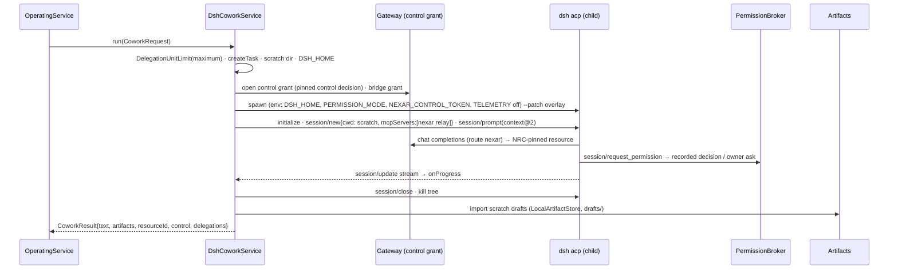

# Unified DSH runtime — target architecture

> NXR-SEC-02 (2026-10-16) changes production Cowork placement to the existing hardened
> WSL2/bubblewrap infrastructure. The original host-local placement below is historical.
> See [current implementation](NXR_SEC02_Architecture_Implementation.md),
> [security evidence](NXR_SEC02_Security_Assessment.md) and ADR-030's revised Proposed decision.

Status: Proposed with [ADR-030](../../adr/030-unified-dsh-first-agent-runtime.md). Baseline: `main`
at `677eefd` (v0.6, accepted implementation `9e71014`).

> One Nexar · one primary agent runtime (DeepSeek Harness) · specialized operating modes as DSH
> profiles · many models and providers · one resource intelligence system (NRC).

## 1. Current-state ownership map (v0.6, verified in source)

| Concern                                                            | Today                                                                                                                                                        | Class                                           | Target                                                    |
| ------------------------------------------------------------------ | ------------------------------------------------------------------------------------------------------------------------------------------------------------ | ----------------------------------------------- | --------------------------------------------------------- |
| Turn, session, intent, lane                                        | `@nexar/sessions`, `@nexar/operating`                                                                                                                        | Reusable Nexar                                  | Keep                                                      |
| Resource selection                                                 | `@nexar/resource-controller` (`deterministic@1`, `resource-intelligence@1`, `strategy@1`), `@nexar/resource-registry`                                        | Reusable Nexar                                  | Keep, single authority                                    |
| Control loop model calls                                           | `@nexar/engine-gateway` `ControlModelGateway`; Desktop `control-gateway-child.ts` (loopback Chat Completions translator, `@nexar/integration-openai-compat`) | Reusable Nexar                                  | Keep; DSH Cowork becomes its client                       |
| Delegated units                                                    | `BridgeHost` + `DelegationUnitLimit` (`engine-gateway`), relay `integrations/mcp/bridge-relay*`                                                              | Reusable Nexar                                  | Keep; mounted per DSH ACP session                         |
| Approvals / policy decisions                                       | `@nexar/approvals`                                                                                                                                           | Reusable Nexar                                  | Keep                                                      |
| Artifacts                                                          | `@nexar/artifacts` `LocalArtifactStore`                                                                                                                      | Reusable Nexar                                  | Keep                                                      |
| Cowork agent loop, tools, sessions, streaming, cancel              | `integrations/openworker` (`supervisor`, `session`, `client`, `policy`, `providers`), Desktop `cowork.ts`                                                    | OpenWorker-specific                             | **Replace with DSH Cowork profile**                       |
| Cowork permission translation                                      | `openworker/policy.ts` `decidePermission`                                                                                                                    | OpenWorker-specific                             | Replace by `PermissionBroker` + Cowork profile policy     |
| Cowork draft import                                                | `openworker/artifacts.ts` `collectDrafts` + Desktop `importDrafts`                                                                                           | Duplicate (generic logic in OpenWorker package) | Move generic scratch→draft import to a Nexar-owned module |
| Cowork provider config (direct keys)                               | `openworker/providers.ts`, `routeDirectKey`                                                                                                                  | OpenWorker-specific                             | Remove (gateway-only)                                     |
| Inbound MCP Work Bridge v2                                         | `integrations/openworker/bridge.ts`, `schema.ts`, `workflow-bridge`                                                                                          | Generic Nexar, misplaced                        | Move to `@nexar/work-bridge`                              |
| Code agent loop                                                    | `integrations/deepseek-harness` ACP (`acp/run.ts`, `launch.ts`, `permissions.ts`, `gateway.ts`) in WSL bwrap via `PlaneLaneEngine`                           | Existing DSH integration                        | Keep; add Coding profile overlay                          |
| DSH SDK adapter (`adapter.ts`, `json-rpc-client`, `run-collector`) | `integrations/deepseek-harness`                                                                                                                              | Existing DSH integration                        | Keep as direct agent resource (unchanged)                 |
| Engineering envelope                                               | `@nexar/engineering`, `@nexar/worktrees`, `@nexar/sandbox`                                                                                                   | Reusable Nexar                                  | Keep unchanged                                            |
| Project knowledge                                                  | none (context@1 = last 6 turns, older dropped)                                                                                                               | **Missing**                                     | New `@nexar/project-memory` + `context@2`                 |
| Runtime packaging                                                  | OpenWorker owner-installed (Python); DSH only in the plane                                                                                                   | Missing for Desktop DSH                         | Bundled pinned DSH runtime                                |

## 2. Interface selection

| Surface                                         | Cancel            | Permission round-trip  | Per-session MCP | Model per session                          | Verdict                                      |
| ----------------------------------------------- | ----------------- | ---------------------- | --------------- | ------------------------------------------ | -------------------------------------------- |
| **ACP v1** (`--profile acp`)                    | yes               | yes                    | yes             | yes (`set_config_option`, overlay default) | **Selected**                                 |
| SDK (`--profile sdk`)                           | no (kill process) | no ("dead capability") | via patch only  | no (one per process)                       | Rejected                                     |
| Headless (`--profile headless`)                 | no                | no                     | via patch only  | via patch                                  | Rejected (one-shot)                          |
| Cordis plugin / in-process                      | n/a               | n/a                    | n/a             | n/a                                        | Rejected (internals, ADR-008)                |
| Custom profile directory (`$DSH_HOME/profiles`) | —                 | —                      | —               | —                                          | Not used: Nexar uses `--patch` overlays only |

Configuration surface Nexar depends on (documented rows / variables only):

| Row / variable                                                                                                                                                                                                                 | Use                                                                                                     |
| ------------------------------------------------------------------------------------------------------------------------------------------------------------------------------------------------------------------------------ | ------------------------------------------------------------------------------------------------------- |
| `--profile acp`, `--patch <file>`                                                                                                                                                                                              | Entry point and Nexar overlay                                                                           |
| `DSH_HOME`                                                                                                                                                                                                                     | Per-turn isolated state                                                                                 |
| `DSH_PERMISSION_MODE` (`read-only` for Cowork, `workspace-write` inside the Coding sandbox)                                                                                                                                    | Cowork mutations request Nexar permission per call; Coding standing writes require OS sandbox isolation |
| `DSH_TELEMETRY_DISABLED=1`, rows `otel`, `session-telemetry-otel`, `session-log-deepseek` disabled                                                                                                                             | No upstream telemetry/session upload                                                                    |
| `llm-pi-ai.providers.nexar` (`openai-completions`, `baseURL http://127.0.0.1:<port>/v1`, `apiKeyEnv NEXAR_CONTROL_TOKEN`, model `nexar-control`)                                                                               | The only model route                                                                                    |
| `acp.config.{provider: nexar, model: nexar-control}`                                                                                                                                                                           | Default session route                                                                                   |
| `system-prompt.config.{personaPrefix, personaSuffix}`                                                                                                                                                                          | Profile persona; required project context                                                               |
| Cowork disables: `tool-bash`, `tool-pwsh`, `tool-jobs`, `tool-web`, `web-search-deepseek`, `tool-plugin-manager`, `tool-subagent`, `tool-subagent-control`, `tool-subagent-fork`, `tool-subagent-list-agents`, `tool-workflow` | Tool surface                                                                                            |

## 3. Target component view

```mermaid
flowchart TB
  UI[Nexar Desktop renderer] -->|validated IPC| OL[Operating Layer<br/>sessions · intent · lanes]
  OL --> PM[Project memory<br/>owner-confirmed, Nexar-owned]
  OL --> CTX[context@2]
  OL -->|cowork lane| DC[DshCoworkService<br/>Desktop main]
  OL -->|code lane| CP[Code plane bridge → EngineeringRunner<br/>PlaneLaneEngine]
  DC --> RT[DSH runtime contract<br/>profiles · overlay · ACP client · PermissionBroker]
  CP --> RT
  RT -->|stdio ACP| DSHW[dsh --profile acp<br/>host-local, per turn, scratch cwd]
  RT -->|stdio ACP in bwrap| DSHL[dsh --profile acp<br/>WSL2 sandbox, private clone]
  DSHW -->|route nexar| GW[Control Model Gateway]
  DSHL -->|route nexar via unix socket| GW2[Plane Control Gateway]
  DSHW -->|MCP relay| BR[Intelligence Bridge]
  DSHL -->|MCP relay| BR2[Plane Bridge]
  GW & BR --> NRC[NRC + strategy@1]
  GW2 & BR2 --> NRC2[Plane NRC — same package and policy]
  NRC --> RES[(Claude · OpenAI · Gemini · DeepSeek · Grok · local)]
  RT --> APR[Approvals: recorded policy decisions, owner asks]
  DC --> ART[LocalArtifactStore drafts]
```

Desktop and the WSL plane each keep a registry for their own machine boundary (ADR-025/027 §11).
They run the **same** `@nexar/resource-controller` code and policy ids; a task is admitted once, on
the machine that executes it, and usage is recorded once by the gateway/bridge that served it.

## 4. The runtime contract (`DshProfile`)

Nexar-owned, in `integrations/deepseek-harness/src/profiles.ts` (data + pure renderer):

```ts
type DshProfileId = 'cowork' | 'coding';
interface DshProfile {
  readonly id: DshProfileId;
  readonly persona: string;                 // personaPrefix, fixed text
  readonly disabledRows: readonly string[]; // overlay rows disabled for this profile
  readonly shell: boolean;                  // tool-bash/pwsh/jobs enabled
}
renderProfileOverlay({ profile, route, requiredContext? }): string  // YAML, validated, quoted
```

Placement and workspace boundaries are selected by Nexar's services/launchers, not by fields in DshProfile. The route is either the Nexar gateway or the explicitly selected native DSH resource.

`requiredContext` is the rendered project-memory block placed in `personaSuffix` (template braces
neutralized, bounded). The overlay always contains the privacy rows, the single `nexar` route and
the `acp` default route.

Host-local session runner (`integrations/deepseek-harness/src/acp/local.ts`) reuses `acp/run.ts`
(session lifecycle, update stream, cancel, permission broker) with a host launcher that refuses
`read-write` workspaces outside a Nexar-created scratch directory and never uses the sandbox
launcher's write path (Cowork never edits a project).

Cowork starts with DSH read-only standing permissions. The pinned write/edit tools must request workspace-write for a single file_path; the Nexar broker applies the selected draft/ask/read-only policy and fails closed on unrecognized payloads. Physical checks deny missing/invalid roots, lookup errors, links/junctions and hard links, and repeat after approval and policy recording. This remains a pre-operation check with a post-grant filesystem race. Host-local DSH has the user's OS read rights; HOME, scratch cwd and tool restrictions are not an OS read sandbox. See [the FCR-01 security decision](FCR01_Security_Findings.md).

## 5. Cowork turn flow



Control failure attributed by the gateway restarts the whole engine turn once (fresh process,
fresh scratch) when the owner's fallback is `auto` (ADR-027 §8), with the **same**
`DelegationUnitLimit` (B2).

## 6. Coding profile

Unchanged envelope: `EngineeringRunner` → lanes → `PlaneLaneEngine` → `prepareAcpLaunch` in bwrap
with private clone, harvest, patch policy, gates, review, owner approval and `commitPatch` (never
push). The change is that the ACP launch uses `renderProfileOverlay({ profile: coding, ... })`, so
persona, privacy rows and required project context are identical in shape to Cowork.

## 7. Context and memory

- **Agent working context** — DSH-owned, per engine turn, compacted by `compaction-basic`, deleted
  at turn end.
- **Conversation context** — Nexar `context@2`: required project context block (never truncated;
  fail closed above `MAX_REQUIRED_CONTEXT_CHARS`) + recent turns as in `context@1` (bounded,
  untrusted-wrapped) + artifact references.
- **Project memory** — `<stateDir>/.nexar/project-memory/<projectId>.json`, one writer (Desktop
  main lease holder, same hardened store pattern as sessions), entries `{id, kind: constraint |
decision | requirement | review-obligation | pending-work, text, createdAt, source: owner |
owner-confirmed, sessionId?, turnId?}`. Only owner actions add, confirm or remove entries.
- Session identity: Nexar `ses_`/`turn_` ids canonical; DSH session id recorded only on the turn's
  task record as an opaque, non-authoritative string (never resumed).

Writer lease acquisition is serialized by an exclusive .lease.claim before creating or replacing .lease. Unreadable leases and abandoned claims refuse writer authority; known dead-process leases can recover. A crash during acquisition may require operator repair after stopping/verifying all writers and preserving state. This availability limit is documented in [FCR-01](FCR01_Independent_Engineering_Review.md).

## 8. Resource intelligence

No new policy. The gateway selects the control resource with `selectControlResource` for engine
`dsh` (Auto or owner-pinned, explicit fallback); units are allocated by `strategy@1` through the
bridge. Connection identity is the existing connection-scoped resource metadata (ADR-027 §3,
NXR-070 compatible). A pinned control resource that is unavailable fails the turn unless the
owner's fallback is `auto`; it is never silently replaced.

## 9. Bounded direct session fallback

Desktop `operating.ts` passes direct session work through NRC after excluding every resource except
`kind.type = model` bound to the reviewed `pi` or `echo` execution adapters. The pi adapter performs
one model completion with user/system text and no tools; echo is deterministic offline execution.
There is no agent loop, runtime session, permission round-trip or delegation in this path. Nexar
may save returned text through `LocalArtifactStore`, respecting read-only Cowork.

This is classification **A: bounded, non-agent model execution**. Before UDSH-08 the same path could
route to an independent native agent or DSH SDK loop (classification **B**), contradicting the
declared fallback boundary. Registered forbidden preferences fail explicitly; empty eligible sets
fail through NRC. Code/native lanes retain their existing resource eligibility and sandbox contracts. New bounded adapters
need explicit review before joining this allowlist.
