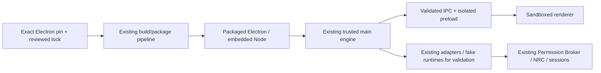

# Next milestone implementation blueprint — proposed

Date: 2026-11-01. **Research artifact only. A subsequent owner-approved implementation assignment is required.** Research base `6bc038021b66b8d093bad5a4fbd936794f048da3`. [Roadmap](NXR070_T3Code_Informed_Implementation_Roadmap.md), [evidence index](../research/upstream/NXR_T3Code_2026_11_Product_Evolution_Research.md#evidence-index).

## Selection and rationale

Recommend **NXR-T3-SEC01 / W02: Desktop Electron security maintenance** as the next bounded coding assignment after current D′ work, followed immediately by **NXR-070H′ Providers UI v2 / W03**. This is a proposed maintenance insertion, not a renamed D′/H′ scope. F′ remains independently ready from A′.

Nexar's committed Electron is 44.5.1. The official release embeds Node 24.21.0; Electron 44.10.0 embeds Node 24.22.1, a Node release listed in the October security advisory. T3 made the same-line patch for the Brotli decoder issue in commit `6d82a22e9df93f1dd14afa89d820b7dd1b624eef`. This supports a P0 review/correction, not a claim that Nexar was exploited. [Electron 44.5.1](https://releases.electronjs.org/release/v44.5.1), [44.10.0](https://releases.electronjs.org/release/v44.10.0), [Node advisory](https://nodejs.org/en/blog/vulnerability/october-2026-security-releases).

If another engineer is explicitly assigned security maintenance before D′ completes, start from accepted main and keep D′ untouched. Re-verify accepted main and open PRs at assignment time; this research cannot freeze concurrent development forever.

## A. Scope

In: dependency/runtime evidence, safe exposure analysis, one reviewed exact Electron maintenance patch, minimal lock/build metadata, source/preload/package compatibility tests and acceptance documentation. Reference candidate: **44.10.0**; re-check same-line security maintenance at implementation time and record the selected exact version and rationale. A newer version is not automatically authorized just because it is latest.

Out: DSH manifest/package lock, provider SDK upgrades, account homes, owner credentials, Plane deployment, routing policy, new UI feature, canonical session schema, runtime authority changes, exploits, auto-updates, machine toolchain or PATH changes. An Electron major upgrade or required unrelated dependency change stops for scope review.

## B. Existing state

- Desktop uses Electron 44.5.1 (`apps/desktop/package.json`) and Electron Builder 26.15.3. Root lock controls dependency resolution.
- Renderer is sandboxed behind preload and validated bridge; main hosts the engine. Existing provider and account tests use fake runtimes.
- DSH remains exactly `@deepseek-ai/dsh@0.2.1-rc.5`. Windows bundles and WSL helper/runtime acceptance are separate concerns.
- Existing gap G-07 reports packaging near its timeout; G-13 reports an old installed Plane. Neither is silently fixed by updating Electron.
- No acceptance in this research ran the proposed version. Existing synthetic acceptance is historical and does not prove this future binary.

Evidence N02/N04/N12/N13. Read `docs/development/Nexar_Workspace_Management.md` and local development instructions before creating a checkout or running packaging.

## C. Target user experience

The owner starts the packaged Desktop, opens a project/session, views providers/resources, performs fake-provider actions and quits with no regression. Failed provider/network/version states remain explicit. No sign-in or replay happens because the app restarted. The user need not see implementation version details except existing diagnostics; acceptance privately records exact embedded runtime versions.

Exercise: fresh disposable profile → app ready → Providers opens → fake connection lifecycle → fake task/stream/cancel → previous session read → restart shows interrupted rather than replayed work → quit during starting child → no owned process remains. A real account is unnecessary for this maintenance acceptance.

## D. Architecture and flow



No new product service or authority. Runtime identity is observed from the actual process; do not substitute developer `node --version` or a package.json value as evidence for embedded Node.

## E. API/IPC contracts

No new product API or IPC channel is needed. Existing zod-validated request/response/event contracts must remain byte/behavior compatible. Reject any workaround that adds Node access to renderer or relaxes origin/channel validation.

The acceptance report should contain this **planning-only evidence shape**, not a new product contract:

```ts
interface SecurityMaintenanceEvidence {
  readonly sourceCommit: string;
  readonly sourceTree: string;
  readonly electronVersion: string;
  readonly embeddedNodeVersion: string;
  readonly platform: 'win32' | 'linux';
  readonly artifactSha256: string;
  readonly lockfileSha256: string;
  readonly advisoryReferences: readonly string[];
  readonly exposure: 'reachable' | 'not-established' | 'not-reachable-in-reviewed-paths';
  readonly testedScenarios: readonly {
    readonly id: string;
    readonly result: 'pass' | 'fail' | 'skip';
  }[];
}
```

Validate evidence lengths/formats and avoid absolute private paths, environment dumps or account identifiers in public reports. Artifact hashes attest tested bytes, not all runtime behavior.

## F. Persistent/transient model

No persistent product migration. Existing settings, connections, tombstones, canonical sessions and Project Memory are preserved. Disposable fake profiles and process handles are transient test state. Record version/hash evidence in a new dated acceptance document; do not rewrite existing acceptance reports.

## G. Implementation slices

1. **Evidence and baseline:** verify Git/PR/worktree state, affected pin, official fixed runtime, current package/lock/build allowlists. Inventory HTTP/decompression consumers in main/adapters, including transitive Fetch/SDK paths. Record what remains unproven; no exploit.
2. **Minimal dependency patch:** update exact Electron pin and its lock resolution using the approved shared toolchain. Review native installer/build allowlist entries only if required. No general lock refresh or package-manager upgrade.
3. **Compatibility:** run existing relevant unit/preload/window/IPC/process/fake-provider tests and standard gates. If Electron API changes require broad code edits, stop the slice and report a concrete scoped alternative.
4. **Artifact acceptance:** build the intended Windows artifact once prerequisites pass; record digest and embedded versions, run packaged fake-provider E2E and quit/start tests. Re-run only on changes/failures requiring it.
5. **Reviewable draft PR:** version/lock diff, exposure note, exact-head evidence, residual risks, rollback and no unrelated DSH/provider changes. Independent review and owner approval before integration.

## H. Source-level change map

| File/component                                                                        | Expected action                                                                                                              |
| ------------------------------------------------------------------------------------- | ---------------------------------------------------------------------------------------------------------------------------- |
| `apps/desktop/package.json`                                                           | Exact Electron maintenance version only                                                                                      |
| `pnpm-lock.yaml`                                                                      | Electron resolution/integrity changes and necessary transitive closure only                                                  |
| Package build allowlist/config if present                                             | Minimal version-specific entry, only if existing configuration requires it; T3's workspace edit is not proof Nexar needs one |
| Existing Desktop/preload/process test suites                                          | Run unchanged first; add meaningful compatibility coverage only for a missing scenario                                       |
| `apps/desktop/e2e/providers.e2e.ts`, `connections.e2e.ts`, acceptance/process helpers | Existing fake-provider source and packaged scenarios; adjust only for demonstrated runtime compatibility issue               |
| `scripts/local-ci/stages.mjs`, runtime artifact scripts                               | Inspect execution and identity capture; no change expected                                                                   |
| New security acceptance document                                                      | Candidate/final SHA, artifact versions/hashes, tests, exposure, rollback                                                     |

`integrations/deepseek-harness/dsh-runtime.json` and `.package-lock.json`, accepted ADRs, account records, session schemas and current D′ files are protected exclusions. Verify exclusion diffs before publication.

## I. Security design

The security change replaces an affected runtime component; it does not grant new access. Preserve sandbox, contextIsolation, renderer Node restrictions, CSP, navigation/protocol policy and strict preload bridge. Preserve no-replay restart behavior and all existing native process/home leases.

Exposure review asks where untrusted compressed responses reach Node zlib/Fetch or SDKs. A local search finding no direct `brotli` call does not prove absence of transitive decompression. The official advisory's preconditions and patched version evidence justify maintenance without running a hostile payload. Do not contact real provider accounts to test the issue.

## J. Errors and recovery

Package/download failure: retain known source base and record failure; no floating fallback. Runtime mismatch: fail acceptance and quarantine only this candidate artifact, not owner data. UI/preload failure: investigate minimal compatibility fix; never weaken isolation. Provider failure: unchanged fixed NexarError behavior and retry rules. Quit/start race: owned processes must settle and leases release; cancellation cannot trigger continuation on next start.

## K. Migration and compatibility

No data rewrite. Verify a copied synthetic old profile is readable, IDs stable, and returned resource model choices unchanged. D′ acceptance uses its merged contracts; do not import its local unfinished implementation. Plane compatibility remains whatever the accepted helper contract establishes; this patch must not deploy or silently update it.

## L. Tests and regression gates

| Test                              | Pass condition                                                                                                                                                                                     |
| --------------------------------- | -------------------------------------------------------------------------------------------------------------------------------------------------------------------------------------------------- |
| SEC-01 dependency identity        | Reviewed exact version in source/lock and actual package; embedded Node is the reviewed fixed build                                                                                                |
| SEC-02 patch scope                | No DSH manifest/lock changes, no unrelated provider/session/credential modifications                                                                                                               |
| SEC-03 preload/IPC isolation      | Existing security tests pass unchanged; unknown/forged bridge requests rejected                                                                                                                    |
| SEC-04 fake provider              | Add/rotate/disable/remove/restore/forget/Replace flows and resource display work with fake credentials; no inference                                                                               |
| SEC-05 cancellation/quit          | Cancel/quit during starting and active fake task settles within existing documented bounds; no owned child remains                                                                                 |
| SEC-06 restart                    | Synthetic sessions readable; running work becomes interrupted; zero automatically replayed tasks                                                                                                   |
| SEC-07 network/error presentation | Existing local fake server success/failure paths preserve sanitized errors and cancellation; valid Brotli response test only if needed to cover an actual path                                     |
| SEC-08 packaged Windows           | Source and packaged E2E on final head; report artifact digest/runtime identity; no test-profile leakage into production launch                                                                     |
| SEC-09 shared gates               | Format/lint/boundaries/typecheck/unit/build and required exact-head CI/security scans pass; report skips and environment substitutions                                                             |
| SEC-10 WSL applicability          | If no Plane/bridge behavior changes, record no new WSL code and use required existing compatibility gates; if behavior changes, add targeted same-SHA helper/fake execution test before acceptance |

Do not add an implementation-mirroring assertion of the package.json string as the only security test. Do not run unrelated repeated Windows Full cycles; one required final implementation acceptance is different from this research, which ran no heavyweight CI.

## M. Acceptance criteria

All SEC-01–10 applicable gates pass on the final reviewed commit/tree. Official advisory→chosen Electron→embedded Node mapping is recorded. No package remains falsely reported as patched. All protected exclusions unchanged. Existing synthetic profile reads, no replay, no owner data mutation and isolation preserved. Independent reviewer sees exact diff, artifact and test evidence. Owner approves integration; live provider or installer release validation remains separately named/pending where not required for this maintenance slice.

## N. Rollback

Revert only the maintenance source/lock changes if incompatible; no downgrade script or automatic installed-app change. Preserve every settings/home/session/memory file. A rollback does not resolve the security discrepancy: keep affected distribution blocked from security sign-off until a compatible patched target is accepted. Do not “temporarily” disable isolation or silently ship the older version as fixed.

## O. Git strategy

Re-check main, open PRs and active work. Reuse a suitable isolated checkout or create one through approved worktree tooling; suggested branch `codex/nxr-t3-sec01-electron`, purpose `nxr-t3-sec01`, from latest **accepted** main. No branching from local D′. Commit sequence: evidence and bounded dependency patch → only necessary compatibility corrections → final acceptance documentation. Each is reviewable; no force-push/reset/shared checkout mutation. Draft PR, independent review, owner approval, then H′ from new accepted main. Do not proliferate a worktree for each test.

## P. Evidence requirements

Save concise safe command summaries, exact source/tree IDs, actual runtime versions, artifact/lock digests, relevant test results and skipped gates. Bind all screenshots/logs to fake profiles and final source. No raw env dump, native auth files, prompts, private paths or key material. Public research/source evidence remains pinned; future release selection must be separately recorded.

## Q. Owner decisions

Only new immediate decision: authorize this bounded security maintenance assignment and candidate-selection rule. Existing D′ independent homes, H′ sequencing, F′/G′/I′ authorities, E-1/E-2 gates and DSH pin are already decided. Do not ask the owner to re-answer them. Additional scope is returned only if an exact compatible Electron patch proves insufficient.

## H′ annex — coding-ready follow-on Providers UI design

This annex makes the next **product** milestone concrete without expanding the security slice. Authoritative scope remains REQ-15/23 and TST-23. Prerequisites: accepted B′+D′, W02 disposition. F′ is optional data enrichment, not a blocker. [W03 work package](NXR070_T3Code_Informed_Implementation_Roadmap.md#w03--h-providers-ui-v2), evidence N03–6/E07–10.

### Scope and current code

Current `ProvidersView` renders provider/method cards and Plane resources, and embeds `ConnectionManagement`, which already implements API lifecycle confirmations, assurance labels and same-account warnings. Shared `connections.ts` already defines bounded IDs/add/rotate/action confirmation/DTO schemas. `ConnectionRuntime` checks current admission and pin semantics. Preserve and reorganize these capabilities; H′ is not a new connection manager.

Target: overview → expand row → act/inspect models. Native Codex actions reuse accepted D′ channels. Keep built-in subscription controls and sequential Plan Replace. No new multiple-Plan/Claude subscription flow, provider installation framework, secret-provider UI, quota acquisition, runtime home picker, automatic login, NRC policy, context classifier or canonical session migration.

### Proposed status projection contract

The following is a **new DTO proposal**, not a claim it already exists. Implement strict zod input/output validation in the shared bridge; prefer existing fact types where structurally compatible. IDs travel internally for association; render owner labels instead.

```ts
type Observation<T> = {
  readonly value: T;
  readonly observedAt?: string; // absent only for configured/unsupported facts
  readonly source: 'configuration' | 'runtime' | 'registry' | 'nrc';
  readonly freshness: 'fresh' | 'stale' | 'unknown' | 'not-applicable';
};

interface ConnectionStatusRequest {
  readonly connectionId: string; // existing ConnectionIdSchema
}

interface ConnectionStatusView {
  readonly connectionId: string;
  readonly credentialGeneration: number;
  readonly configured: boolean;
  readonly installed: Observation<'yes' | 'no' | 'unknown' | 'not-applicable'>;
  readonly authenticated: Observation<'yes' | 'no' | 'unknown' | 'not-applicable'>;
  readonly reachable: Observation<'yes' | 'no' | 'unknown' | 'not-applicable'>;
  readonly inventory: Observation<'fresh' | 'stale' | 'unavailable' | 'unsupported'>;
  readonly quota: Observation<'known' | 'limited' | 'unknown' | 'unsupported'>;
  readonly eligibility: Observation<'eligible' | 'ineligible' | 'unknown'>;
  readonly reasonCodes: readonly string[];
  readonly active: boolean;
}
```

Validation requirements: existing max-128 ID with authoritative lookup; generation safe nonnegative integer; strict objects/enums; ISO timestamps; bounded reason-code allowlist/count; no paths/env/subjects/credentials/URLs/raw exceptions. Output freshness is derived from existing evidence rules, not a renderer TTL. Eligibility without task context remains unknown; a connection is not universally eligible. Quota “known” is not equivalent to unused capacity. Source/time belong to each field. Any numeric quota/detail extension reuses F′/existing observation contracts and supported sources.

Read projection performs no auth, install or paid work. Refresh action is a bounded explicit job using current inventory/probe ports, connection lease and cancellation; no arbitrary shell. Reuse existing subscription/provider refresh channels when sufficient; add `connectionStatus` only if no existing safe projection covers the data. Do not create a second polling manager. Late responses whose generation/state differs are discarded; main revalidates actions regardless of page state.

### Screen behavior and implementation slices

1. Reconcile accepted D′ DTO/channel names; enumerate every current action and state. Add projection tests before moving view structure.
2. Provider groups with connection rows: label/method/host, lifecycle and one actionable summary. Expand displays independent facts and uncertainty. “Saved key” is not “Authenticated.” Removed/retired remain inspectable without exposing raw identity.
3. Reuse B′ add/rotate/disable/enable/remove/restore/forget/Replace forms and one-time confirmations. Clear masked credential form state after settlement; token expiration/stale action produces safe retry prompt, not automatic repeated mutation.
4. Add D′ Codex create/login/re-login/Delete-home controls. Existing-account same-account assertion mandatory; busy connection has no override. Confirm Delete-home's data effect and history retention. Renderer supplies only connection ID and approved confirmation fields.
5. Inline models/options from validated inventory: native-agent versus model-turn retained, provider-default explicitly labeled, source/staleness shown. Preference/pin is next-turn NRC input; active Control loop cannot switch. Unsupported effort controls absent, never fabricated.
6. Accessibility/error states: empty/missing runtime, denied auth, unreachable Plane, stale inventory, unknown quota, unsupported version, busy/removed connection, canceled login/refresh. Visible text plus aria status; focus returns to initiating control; no layout jumps with long localized labels.

Source map: renderer `ProvidersView.tsx`/`ConnectionManagement.tsx`/`ResourcesView.tsx`; shared `connections.ts`/`channels.ts`; main `connection-channels.ts`, `providers.ts`, `provider-inventory.ts`, `connection-runtime.ts`; preload `preload.ts` and tests; existing `connections.e2e.ts`/`providers.e2e.ts`. New small details/model components are proposed only. Registry/NRC/session/memory/DSH modifications are out of H′; a need to alter those returns for scope review.

### H′ tests, acceptance, migration and rollback

Unit: every distinct fact combination, unknown/stale/probe-failed labels, model-default and unsupported options, strict DTOs and sanitized reasons. Integration: refresh generation race, active lease prevents mutation, expired confirmation, removed pin, late login and inaccessible Plane. Windows fake E2E: full TST-23 plus two D′ Codex homes, label-only rows, same-account assertions, busy/Delete-home refusals and rollback; sentinel scan page/console/IPC outputs. WSL: existing D′ home tests retained, H′ Plane projection errors/no new host routing. Keyboard-only add/edit/expand/confirm/cancel/focus return, screenreader names and status not conveyed by color alone.

Pass: each lifecycle effect matches accepted semantics; unknown remains distinct; no credential/home path/subject/raw ID exposed; main remains authority after stale UI; NRC goldens unchanged; no account substitution; no new paid probes or auto login; exact-head tests/independent review recorded. Synthetic E2E is not real-account owner validation.

Persistent state stays in accepted settings/home records. H′ adds presentation/transient refresh state only. Revert the UI/additive DTO path safely; owner-connections off keeps tombstones/homes/history and causes pins to fail explicitly. Estimated 5–9 engineering days under W03 assumptions. No unresolved architecture decision is needed for this bounded design; new quota probes, branching or account-family expansion are separate proposals.

Verdict: `NEXAR_NEXT_MILESTONE_BLUEPRINT_READY`.
