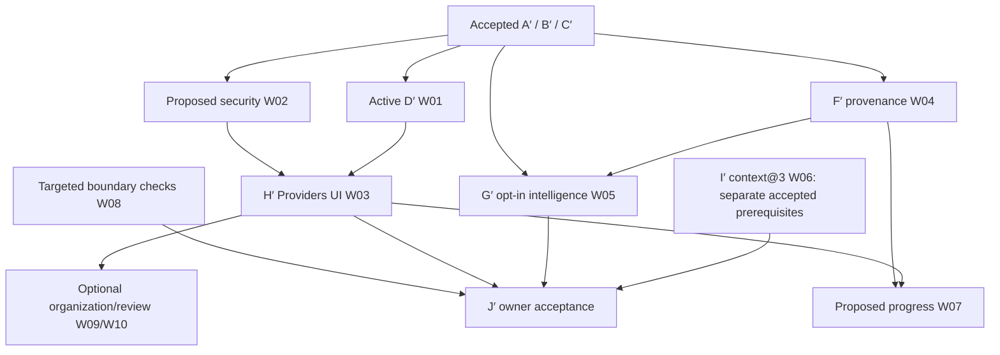

# T3-informed implementation roadmap

Date: 2026-11-01. Planning only. Fixed research base `6bc038021b66b8d093bad5a4fbd936794f048da3`. [Evidence](../research/upstream/NXR_T3Code_2026_11_Product_Evolution_Research.md#evidence-index), [gap register](../architecture/nxr-070/NXR070_T3Code_Latest_Architecture_Gap_Assessment.md), [priority model](NXR070_T3Code_Feature_Prioritization.md).

## Sequence and scope control

**Next coding assignment after active D′: W02, a small Electron security correction. Next product milestone: H′ (W03).** This explicit proposed maintenance insertion is not an amendment to D′ or an expansion of H′. If a separate engineer is authorized earlier, W02 can start from accepted main without waiting for or touching D′; integrate via normal review. H′ still requires accepted B′ and D′. F′ is independently ready from A′ and can run alongside D′/H′ with separate review capacity. No multi-agent implementation was started by this research.

The A→G edge stands for already accepted **C′**, not an exemption from F′. I′ depends on OD-1/10/13/14, independently of identity. J′ requires every in-scope approved unit and its exact-head acceptance. W07/09/10 are **new proposals**, so their arrows do not make them J′ prerequisites unless the owner adds them to release scope.

| Phase         | Approved scope retained                | Proposed adjustment / new scope                                                      | Exit gate                                                                          |
| ------------- | -------------------------------------- | ------------------------------------------------------------------------------------ | ---------------------------------------------------------------------------------- |
| 0             | Finish D′ in its existing worktree     | Review recommendations only, W01                                                     | D′ fake/Windows/WSL acceptance and independent review; owner live remains explicit |
| 1             | Existing exact-pin/runtime boundaries  | W02 security maintenance, separately authorized                                      | Patched runtime identity + packaged smoke + security review                        |
| 2             | H′ REQ-15/23, TST-23                   | Connection-first IA and evidence labels refine accepted UI scope                     | All lifecycle journeys; no secrets/paths/subjects; no routing change               |
| 2 parallel    | F′ REQ-21, TST-21                      | Concrete attribution envelope and reader migration strategy                          | All execution writers attributed; legacy readable                                  |
| 3             | G′ REQ-20/22, TST-22                   | Explicit source/freshness governance; optional official-port spike separately scoped | 1,000 seeded permutations; no hard-filter re-admission; quota rank parity          |
| 3 independent | I′ accepted classifier/sidecar         | Coverage inspector uses existing facts before new semantics                          | TST-24–27/32–40/44–56 including old store fixtures                                 |
| 4 optional    | No automatic expansion                 | W07 progress; W09 organization; W10 read-only commit review                          | Separate proposal approval and targeted UAT                                        |
| 5             | J′ and existing operational acceptance | Consolidated evidence index, no silent release                                       | Owner live matrix + installation/Plane/signing decisions                           |

## Work-package contract

Every package below specifies objective, requirements, architecture/data, implementation, security, tests, dependency, acceptance, rollback and effort. “Approved scope” means it exists in the roadmap, **not that this research authorizes coding**. A subsequent implementation assignment is required. Estimates assume one engineer familiar with Nexar, existing shared toolchain, fake runtimes and reviewer availability. They are engineering days, exclude owner delays, paid checks, CI queues and unresolved platform defects; they are not promises or measured velocity. Do not sum parallel/overlapping estimates into a delivery date.

### W01 — Close current D′ isolation milestone

- **Target/priority/source:** active D′; P1 prerequisite; N02, E04/E08. Already approved implementation scope; no research edit to its branch.
- **Objective/UX/success:** two owner-created Codex connections have independent private homes and inventory; lifecycle conflicts explain active work. H′ later exposes the workflow. No claim that bridge-only D′ is already owner-usable.
- **Requirements:** fixed root/marker/ACL before CLI writes; home matches connection; owner login only; existing connection re-login asserts same account; Delete-home refuses active processes and unsafe roots; rollback retains data and invalidates pins explicitly.
- **Architecture/data:** contracts' owner Codex ID form, Desktop/plane home store, ConnectionManager leases/records, ConnectionRuntime, native inventory and Codex env/adapter; no NRC change. Paths remain private main/plane data, never renderer inputs.
- **Change map/slices:** use current D′ readiness slices and eventual exact-head diff: contracts/rollback control → protected home store → adapter binding → per-connection inventory → leases/login → bridge/fake E2E → Plane equivalent. Names in readiness are proposals; use actual implementation after merge.
- **Security/errors:** reparse/symlink/marker substitution, API-key env leakage, active lifecycle, account mismatch, external native login residual risk. Fail `CONFIGURATION_ERROR` before spawn on mismatch; fixed conflict on active connection; no unsandboxed fallback.
- **Tests:** TST-08/09/14/17–19/42; fake processes and sentinel logs; Windows ACL/reparse/quit-during-start; WSL 0700/no `/mnt` homes/correct bind; independent head review. Owner live two-account check remains pending until explicitly performed.
- **Dependencies/conflicts:** B′; current Claude work owns the mutable D′ checkout. No new shared-home or account-switch design.
- **Acceptance/rollback:** all ten readiness criteria; original IDs/pins/golden routing unchanged. Owner-connections off retains homes/tombstones/history. Revert must not delete native state.
- **Effort:** remaining implementation cannot be estimated from a moving unreviewed tree; budget 1–2 days for eventual independent source/evidence review, excluding fixes and live checks.

### W02 — Desktop dependency security maintenance

- **Target/priority/source:** proposed `NXR-T3-SEC01`; P0; C40, E17–19/N13. Full [next-milestone blueprint](NXR070_Next_Milestone_Implementation_Blueprint_Proposed.md).
- **Objective/UX/success:** same Desktop behavior on a reviewed patched Electron maintenance release, with exact embedded runtime proof and compatible packaging.
- **Requirements:** verify current affected pin and reviewed target; trace Node/Brotli exposure without exploit execution; exact compatible patch, no DSH or unrelated dependency upgrades; attest packaged process. Treat reachable exploitation as unknown until demonstrated by safe analysis.
- **Architecture/data:** `apps/desktop/package.json`, corresponding `pnpm-lock.yaml` entries and only required build allowlist metadata; no IPC/domain/session/credential migrations.
- **Implementation:** evidence/call-path inventory → isolated exact-pin lock update → source/preload/fake-provider smoke → Windows package/runtime identity → review. Review any unexpected lockfile churn instead of accepting it wholesale.
- **Security/errors:** no weakening sandbox/contextIsolation/CSP/IPC to make new Electron pass. Package failure blocks shipping; retain current installed environment during evaluation.
- **Tests:** existing format/boundaries/typecheck/unit gates; focused Electron preload/window/protocol/quit tests; Windows source and packaged fake-provider E2E; WSL compatibility only if bridge/Plane interaction changes. No malicious Brotli payload, paid calls or pin-mirroring test.
- **Dependencies/acceptance:** separate assignment approval; accepted main base, D′ integrates independently. Pass criteria in blueprint; no old runtime labeled patched.
- **Rollback/effort:** revert source/lock if incompatible, retain owner data; previous vulnerable binary is not an approved production security resolution. 1–3 days plus packaging/review; larger compatibility work returns for scope review.

### W03 — H′ Providers UI v2

- **Target/priority/source:** H′; P1; REQ-15/23 and TST-23, C02–12/34/37/41, E07–10/N04–6.
- **Objective/UX/success:** owner can distinguish two connections, add/login through approved backends, choose a next-turn preference, understand status and perform every lifecycle action without technical IDs or hidden account substitution.
- **Requirements:** one overview with provider groups and connection rows; independent configured/installed/authenticated/reachable/inventory/quota/eligibility facts; assurance and retired-state labels; inline model options; fixed recovery codes; bounded manual refresh; active-operation conflicts; safe confirmation for destructive lifecycle actions. Reuse existing warnings and confirmations instead of duplicating them.
- **Architecture/data:** main composes safe status DTO from ConnectionManager/Runtime, Registry/provider checks and NRC explanations; shared zod bridge and preload; renderer presentation. No adapter acquisition, routing policy, native-home path picker or new durable resource store. F′ observations are optional read-only data, not an H′ prerequisite.
- **Change map:** `ProvidersView.tsx`, `ConnectionManagement.tsx`, `ResourcesView.tsx`, `apps/desktop/src/shared/connections.ts`, `channels.ts`, `src/main/connection-channels.ts`, `providers.ts`, `provider-inventory.ts`, preload and existing E2E. New proposed `ConnectionStatusDetails.tsx` / `ConnectionModels.tsx` only if splitting the existing large view improves reviewability.
- **Slices:** safe projection/schema → connection row/details → API lifecycle reuse → D′ Codex login/Delete-home controls → model preferences/status → keyboard/error/fake-provider journeys. Exact proposed DTO and interaction details are in the blueprint's H′ annex.
- **Security/errors:** no credential return fields, subjects, native paths, key names or raw IDs in rendered page. Renderer credentials exist only in explicit masked form entry and are cleared; no payload logging. Main rechecks state/generation/confirmation, rejects stale action, cannot be bypassed by stale visible status. No auto login/install.
- **Tests:** schema unknown-key/forged-ID/output sanitization; component auth/quota ambiguity cases; integration old-generation refresh ignored and busy conflict; Windows fake-provider TST-23 add/rotate/disable/remove/restore/forget/re-enter/Replace plus D′ login/delete; keyboard/focus/live-region/long-label/non-color status. WSL checks limited to Plane projection and approved lifecycle; no new Linux home logic in H′.
- **Dependencies/acceptance:** B′ + D′ accepted and W02 disposition closed. Every lifecycle journey yields correct fixed-state feedback, no routing/golden changes, no secret sentinel in renderer/log/IPC output; supported models/options only. Owner live usability remains separate from synthetic pass.
- **Migration/rollback/effort:** no new connection persistence semantics; use existing settings. Revert UI/DTO additive path while keeping IDs/homes/history; owner-connections rollback still governs. 5–9 days, assuming D′ exposes complete accepted actions.

### W04 — F′ provenance and attribution

- **Target/priority/source:** F′; P1; REQ-21/TST-21, C13/33; N10, E10/E27.
- **Objective/success:** every Nexar execution can be traced to the immutable connection/host and each observation's authority; legacy history is explicitly legacy.
- **Requirements/data:** extend existing ExecutionRecord with an optional **versioned attribution envelope** for backward compatibility: connectionKey, assurance-at-execution, and per-field source metadata. Preserve Measured<T> values/status/basis. Absence means legacy, not “current default account.” Proposed field-source values distinguish provider-reported, Nexar-accounted, derived-estimate, unavailable and legacy; map to existing quota source contracts rather than replace them. Include capture time and relevant generation privately or as approved opaque metadata, never credentials/subjects/labels/paths/key names.
- **Architecture/change map:** `packages/contracts/src/telemetry.ts`, existing intelligence/Measured types; writers `packages/core/src/engine.ts`, `packages/engine-gateway/src/gateway.ts`; host-resolved execution identity; readers `packages/telemetry/src/reader.ts`, `history.ts`, `quota-source.ts`; CLI/Desktop presentation DTOs only where records are already exposed. Do not change canonical session record schemas or add a writer there.
- **Slices:** envelope/legacy parse → writer identity capture before execution → all success/failure/cancel paths → bounded readers/aggregates → safe display/fixtures. Preserve old JSONL bytes; no destructive backfill or retroactive account inference.
- **Security/errors:** snapshot identity at admission, not after completion; stale generation cannot attach another account. Invalid/untrusted records do not contaminate aggregates; unknown fields bounded; no raw provider error persistence added.
- **Tests:** TST-21 legacy/new/corrupt records; direct engine and control gateway executions, retries/cancel/failure; two connections same model, removed identity and rotation; mixed-field measured/estimated/unavailable; Windows reader bounds and fake E2E; WSL/Plane host attribution where emitted, no credentials crossing wire. Sentinel scan all sinks.
- **Dependencies/acceptance:** A′ sufficient; B′/C′ are already merged. 100% enumerated execution writers emit envelope for new records; old records remain readable and labeled legacy; history cannot switch identity after removal. G′ does not begin before acceptance.
- **Rollback/effort:** revert writing envelope; old readers ignore additive approved data; retain logs, no backfill/deletion. 3–6 days, assuming no missing identity at a writer; missing authoritative identity is an explicit unknown, not guessed.

### W05 — G′ resource-intelligence@2

- **Target/priority/source:** G′; P2; REQ-20/22/TST-22, C13/14/34; N01/6 and observation governance in gap assessment.
- **Objective/success:** opt-in allocation explanations use trustworthy observations, preserving all hard exclusions and current defaults.
- **Requirements:** new policy module imports v1 scoring; immutable connection/review semantics; per-field source/freshness/coverage; quota rank-neutral; unknown does not become unlimited; no monetary budget enforcement. Reset expiry alone is not recovered headroom. Informational estimates never acquire stronger authority.
- **Architecture/data/change map:** `packages/resource-controller/src/intelligence-policy.ts` remains v1; proposed `intelligence-policy-v2.ts`; controller/settings/strategy/hard-filter integration as narrow registration; existing intelligence contracts and telemetry history/observation readers. Optional official native probe support belongs in the relevant integration and version gate as a separate reviewed slice, not a general authenticated scraper.
- **Slices:** freshness/source classifier with injected clock → policy@2 adapter of v1 scoring → filters/explanation → deterministic corpus → optional supported probe feasibility/contract tests. H′ only consumes resulting facts; no second allocator.
- **Security/errors:** unsupported/stale/failed evidence remains informational/unknown; no UA masquerade, keychain import, identity spoofing, account cycling or bypass of pins. Missing required review diversity fails explicitly.
- **Tests:** TST-22 at least 1,000 seeded permutations; zero rejected-resource re-admissions; equal ranking for otherwise identical known-headroom versus unknown quota; v1/deterministic goldens unchanged; stale/generation/reset/clock tests; fake native parser/version cases; Windows/WSL host separation. No paid probing or live accounts in CI.
- **Dependencies/acceptance:** C′ + F′ accepted. Benchmark opt-in behavior before any owner proposal to change default; no default change in package. All classifications explainable by codes and evidence time/source.
- **Rollback/effort:** disable @2 or revert registration; current policies untouched, observations retained informational. 4–8 days excluding uncertain provider-interface spikes (1–2 days each, stop at unsupported).

### W06 — I′ context@3 and transparent continuity

- **Target/priority/source:** I′; P2; REQ-24–27/32–35/40–45; N01/8/9, E11.
- **Objective/UX/success:** owner can see context coverage, preserve required constraints and recover explicitly when safe transfer does not fit.
- **Requirements:** retain context@2 semantics; new conservative classifier; C1–C3 never omitted; optional only as OD-13 permits; required/unclassified overflow rejects before send; sidecar methods only inside FileSessionStore, same lease/serialization/revision/atomic write; no canonical record schema change. Show historical output as untrusted source. “Keep as constraint,” “Mark optional,” “Reconstruct typed context” and independent-turn owner action remain distinct.
- **Architecture/change map/data:** `packages/operating/src/context.ts`, `service.ts`; `packages/sessions/src/store.ts` owns sidecar read/write/reconcile/quarantine/temp-cleanup; session manifest rendering in Desktop; confirmed facts remain ProjectMemoryStore. Sidecar carries approved item classifications/revision binding/integrity metadata; never native tokens or provider session files.
- **Slices:** render existing manifest facts without claiming @3 → classifier/assembler → store-owned sidecar integrity → explicit actions → overflow/reconstruction UX → legacy-fixture acceptance. Remove request-only fallback only for @3; no silent behavior reinterpretation.
- **Security/errors:** prompt injection/cross-provider omission, corrupt/stale sidecar, concurrent writer, symlink and crash recovery; quarantine per accepted design without rewriting legacy sessions. No automatic resume/replay or implicit promotion to confirmed project facts.
- **Tests:** accepted TST-24–27/32–40/44–56; old store/reader fixture pinned `9e71014` for TST-45/49/55; crash/atomicity/revision/lease/missing/forged sidecar, code-goal overflow, unclassified constraints and full required Project Memory. Windows E2E owner actions; WSL read/serialization boundary if applicable, no native credential fixtures. Required overflow means **zero provider sends**.
- **Dependencies/acceptance:** OD-1/10/13/14 already decided; no A′ dependency. Sidecar cannot introduce second writer; v0.6 fixtures read all retained canonical data; rollback restores context@2+Project Memory without deleting anything.
- **Effort:** 8–15 days plus independent persistence/security review; implementation should split multiple reviewable PRs only along accepted dependency gates.

### W07 — Execution and review status projection

- **Target/priority/source:** proposed post-H′ UX slice; P2; C15/16/18/35, E12/E32/N06/7.
- **Objective:** show what delegated work is doing, what is blocked, which review dimension was met, and which results settled.
- **Requirements/data:** read-only projection keyed by existing session/turn/correlation/allocation/job identifiers. Status discriminates running, waiting for human input, waiting for child/result, cancellation pending and terminal states only where source events support them; unsupported distinctions remain generic. Show actual resource/connection/provider diversity, required/preferred result and explicit unknown. No invented percent complete or agent count.
- **Architecture/change map:** Bridge event/job projection through existing main task/session event bridge, renderer SessionTurnView and related progress component; F′ attribution if displayed. NRC/Bridge remain authoritative. No independent persistent graph or session schema.
- **Implementation:** trace event coverage → minimal derived view model → progress/review display → cancellation race and accessibility E2E. If events are insufficient, propose a bounded additive event at its authority instead of polling another runtime.
- **Security/tests:** no grant issuance, task mutation or secret metadata; hostile labels/tool text untrusted. Unit event-order/duplicate/late settlement; integration parent waits/child fails/required review unavailable; Windows fake E2E stop/question/focus; WSL telemetry lineage where applicable. No new paid calls.
- **Acceptance/dependencies:** owner scope approval; H′ and C′, F′ for richer attribution. Exactly one final settlement shown per job; unknown identity never earns independence credit. Roll back presentation only. 3–5 days.

### W08 — Focused reliability and security regression work

- **Target/priority/source:** small owner-boundary patches; P1 evidence work, P0 correction only on demonstrated defect; C19/20/28/29/31/39, E12–16/24, N07/9/11.
- **Objective:** determine whether T3's actual failure modes exist in Nexar before modifying production code.
- **Requirements/implementation:** inspect existing tests, then add only missing meaningful scenarios: noncooperative child settlement, quit during spawn, lease release after real child exit; Windows path aliases/shared ownership; branch identity during guarded commit; truncated preview readonly if a write surface exists; URL/query/native stderr sentinel redaction. Close an item with existing evidence where equivalent protection already exists.
- **Architecture/change map:** relevant owner only: `integrations/codex/src/process.ts`, Claude process counterpart, engine-gateway Bridge; `packages/worktrees/src/commit.ts`, `remove.ts`; Desktop artifact/preview layer; telemetry redactor and actual error sinks. No database, orchestrator, state-library or whole-workspace cleanup rewrite.
- **Data/security:** no new persistent data. OS process ownership, canonical paths and action leases remain authoritative; no arbitrary PID or directory deletion. Test escaped/untrusted data, not real secrets or destructive host scenarios.
- **Tests:** targeted unit/contract/integration with fake runtime; Windows reparse/case/ACL and process tests; WSL symlink/sandbox cleanup where boundary differs. An irrelevant truncated-file test is NA if Nexar has no edit-from-preview path; record rationale. Existing no-replay tests remain.
- **Acceptance/dependencies:** reproducible fail-before/pass-after for any product fix, or documented existing protection; bounded sink output; no leftover owned process; no external path touched. Owner-approved scope if fixes exceed tests. Rollback code safely, no data migration. 1–2 days per concern, cap an initial review at 3–5 days and return remaining items for prioritization.

### W09 — Project pin/archive organization

- **Target/priority/source:** new P2 proposal, C27/E21; after H′.
- **Objective/requirements:** improve project retrieval; pin/archive reversible, active work remains reachable, archive does not delete projects/worktrees/sessions. Empty, archived and restored states clear. Do not silently settle active work.
- **Architecture/data/change map:** project metadata/presentation through approved existing project store/IPC owner; proposed optional pin-order/archive metadata, bounded and backward-compatible. Confirm exact persistence authority before adding fields; do not place project metadata into credential/session stores. `packages/projects/src/project.ts`/`registry.ts`, Desktop project view and bridge if suitable; absence of persistent metadata port is an explicit design slice, not guessed ownership.
- **Security/tests:** no cleanup, path mutation or resource routing. Unit deterministic ordering/legacy defaults; integration archive-with-active-work and restore; Windows keyboard/undo/E2E; WSL NA unless project metadata is served there. Owner approval prerequisite. Success: reversible state, zero deleted files/history and no hidden active task.
- **Rollback/effort:** optional metadata ignored by older readers; retain on revert. 2–4 days if current storage supports additive presentation metadata; otherwise re-estimate before coding.

### W10 — Read-only local commit review

- **Target/priority/source:** new P2 proposal, C30/E25; after H′.
- **Objective/requirements:** inspect local commit and turn changes without leaving Nexar; distinguish base/head, own patch versus imported changes and truncated/binary content. No new commit/push/PR publish authority.
- **Architecture/data/change map:** existing engineering patch/diff projection, `packages/engineering/src/patch-view.ts`, guarded Git read port in `packages/worktrees`, main/IPC and renderer diff component. DTO contains bounded change metadata and safe content, not arbitrary shell args or owner paths. Existing write/verification/Permission Broker flow untouched.
- **Security/tests:** malicious repository/file paths, symlinks, huge/binary diffs, branch changes during read and safe readonly truncated content. Unit DTO bounds; real disposable Git fixture integration; Windows fake Desktop E2E; WSL read scope if implemented. An observed branch/head change invalidates displayed snapshot and requests explicit refresh.
- **Acceptance/dependencies:** owner scope approval; read-only API rejects shell/path injection, zero repo writes, labels accurate on mismatched head. Rollback removes UI/port; no persistent migration. 4–7 days, excluding a new general-purpose Git client.

### W11 — J′ integrated and owner acceptance

- **Target/source:** J′, N01/N12. Approved acceptance, not release authorization.
- **Objective:** independently prove the in-scope product on exact accepted heads and distinguish synthetic evidence from owner operation.
- **Requirements/architecture:** evidence manifest binds source/tree, Desktop/Plane build IDs, pins, suite commands, pass/fail/skips, safe artifacts and residual gaps. Reconcile the accepted execution-plan live matrix and operational gap-register matrix by **named scenario**, because their L1/L2 numbering differs. Never overwrite old reports or claim earlier evidence as current.
- **Tests/acceptance:** required per-unit offline/security/Windows/source+packaged/WSL gates; native Ubuntu Full if Linux release; owner-initiated API/Codex isolation, rotation, diversity, continuity, Cowork containment and clean installation scenarios. Fix installed Plane G-13 via a separate authorized deployment; signing G-02 remains owner release decision. G-07 packaging near limit is monitored; do not raise timeout without analysis. No paid/live calls in CI.
- **Rollback:** preserve accepted baseline, sessions, confirmed memory, credentials and homes; disable only approved feature controls. Failed release gates block release, not data recovery. 2–4 engineering days for consolidation/review plus unbounded owner/environment time. No proposal W07/09/10 becomes mandatory without owner scope inclusion.

## Deferred research packages

| ID  | Question / stop rule                                      | Output / decision required                                                                                         |
| --- | --------------------------------------------------------- | ------------------------------------------------------------------------------------------------------------------ |
| R01 | Multiple Claude subscriptions or concurrent Plan accounts | E-2 / E-1 evidence and owner decision; no current implementation                                                   |
| R02 | Secret-provider integration                               | Official supported interfaces, revocation/timeout/identity design; separate credential authorization               |
| R03 | Durable agent queue/background continuation               | Admission/approval/idempotency/replay ADR; current no-replay preserved                                             |
| R04 | Side chats/native branching                               | Canonical session lineage/permissions/merge semantics ADR; not a sidebar-only feature                              |
| R05 | Long-session/rendering responsiveness                     | Reproducible local fixture, measured p50/p95/memory/render counts; choose smallest fix; no speculative SQL rewrite |
| R06 | Native images/artifact parity                             | Supported output contract, contained files, renderer security; no new inference provider assumed                   |
| R07 | Remote devices/federation                                 | Explicit product/security authorization; out of current local host boundaries                                      |

## Execution, documentation and definition of done

Use a single isolated checkout per active track, reusing approved worktrees where safe. Branch from newly verified accepted main, never Claude's unmerged work. Apply repository `.nexar/worktrees/<purpose>` conventions where tooling permits; use `create_worktree` and record tool-path exceptions. No new full clones or automatic cleanup. Preserve all owner data and unpublished branches.

Every slice: implement bounded behavior → targeted tests → normal shared gates → integration acceptance → draft PR → independent review → owner approval → next dependent unit. The accepted plan requires exact-head Ubuntu/Windows gates before stacking units; plan those runs for implementation, not this documentation research. Avoid one giant feature branch. Reviewers should receive concrete pass/fail evidence and scope diffs, not a request to design the feature after coding begins.

Update guides and versioned acceptance reports in each implementing PR. Do not amend accepted ADRs unless the actual implementation changes an authority/contract decision. At final acceptance, explicitly report implemented, merged, tested, independently accepted, owner-validated, planned and deferred states. Done means no secrets/unsafe paths in outputs, no production changes outside scope, all required tests bound to final head, rollback demonstrated where applicable, limitations documented and required owner scenarios completed. A green test run or a draft PR alone is not owner acceptance.

Verdict: `NEXAR_T3_INFORMED_ROADMAP_READY`.
