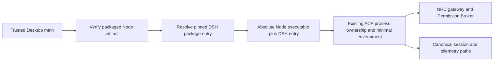

# Proposed dedicated Node runtime for Desktop DSH execution

Status: **implementation proposal only; not implemented or authorized by the Node 24 fallback delivery**. Prerequisite evidence is in the [compatibility investigation](NXR_DSH_Electron_Runtime_Compatibility_Investigation.md). The owner prefers this long-term separation: Electron hosts Desktop; an independently managed, exact-pinned Node executable runs DSH; Nexar retains every existing execution and credential authority.

## Objective and scope

Allow a supported, patched Electron 44 build to launch unchanged DSH rc.5 through an integrity-verified standalone Node runtime. Avoid coupling DSH's private Node internals to Electron's embedded Node/V8 patch combinations. Success means the same real ACP/SDK, permission, delegation, cancellation, credential, session and packaging tests pass with observed executable provenance.

In scope for a separate assignment: a Node artifact authority, bounded materialization, packaged binary verification, trusted launch resolution, process provenance, failure recovery, current-profile boot checks, source and packaged acceptance, documentation and rollback. Initial packaging target is Windows x64 because that is the current production installer; Linux source/WSL validation remains mandatory. A Linux packaged product is a separate release qualification, not inferred from WSL.

Out of scope: DSH package/lock/override changes; native credential reuse; new routing or permission authorities; replay/resume; automatic updates; renderer-selected executables; PATH fallback; new remote control or arbitrary plugins. NRC, ConnectionManager, Permission Broker, FileSessionStore and ProjectMemoryStore remain authoritative. Native provider agents keep their existing boundaries.

## Existing and proposed flow



`dshLaunchFor` and `runLocalAcpSession` already support the core execution path. Distribution, integrity and selection of the executable are missing. Do not put Node inside the DSH lock/seal tree. Proposed package layout:

```text
resources/
  dsh-runtime/             # existing unchanged package/lock/seal semantics
  node-runtime/
    node.exe              # Windows x64 official standalone executable
    runtime.json          # bounded generated identity manifest
    LICENSE               # required redistribution notices
```

## Authorities and contracts

Introduce a reviewed source catalog, for example `config/node-runtime-artifacts.json`, with schema version, exact Node version, supported OS/architecture, official archive URL, archive SHA-256, extracted executable SHA-256, executable relative path, and license inventory. Recommend an independently pinned application-runtime catalog, initially the already verified Node 24.22.2 artifact. Development `.nvmrc` updates must not silently replace the distributed runtime; catalog changes require their own compatibility acceptance. `.nvmrc` alone is not an artifact integrity authority.

Proposed internal contracts (names are design proposals):

```ts
type NodeRuntimeManifest = {
  schema: 'nexar-node-runtime@1';
  version: string; // exact reviewed release
  platform: 'win32';
  arch: 'x64';
  executable: 'node.exe';
  executableSha256: string; // must match trusted compiled catalog
  archiveSha256: string;
};

type VerifiedDshLaunch = {
  launch: DshLaunch; // existing adapter contract, no shell
  provenance: {
    kind: 'bundled-node' | 'approved-development-node';
    nodeVersion: string;
    executableSha256: string;
    dshVersion: '0.2.1-rc.5';
  };
};
```

The manifest is evidence to compare, not its own root of trust. Expected hashes must come from the reviewed catalog embedded in trusted application code. Match the actual binary, manifest, catalog, platform and architecture before executing any version probe. Preserve the app-signing/installation trust model; an attacker able to replace both the entire application and its trust anchor is outside a binary-sidecar hash's protection. Do not advertise hash checking as signed distribution or protection against the owner/root replacing the application.

No general executable-path IPC is added. If a user-visible runtime status is needed, return only typed version/source/verification-state fields through existing status DTOs; renderer input cannot select or mutate the executable. Logs use a provenance ID/hash and safe error class, avoiding credentials and private home paths.

## Implementation slices and source map

| Slice                       | Proposed work                                                                                                                                                                                                                                    | Reviewable output                                                                                                                               |
| --------------------------- | ------------------------------------------------------------------------------------------------------------------------------------------------------------------------------------------------------------------------------------------------ | ----------------------------------------------------------------------------------------------------------------------------------------------- |
| R1 — artifact authority     | New reviewed catalog and `scripts/node-runtime/` materializer/validation module; official artifacts only, no remote shell installer; exact OS/architecture and redistribution notices                                                            | Hash-valid extraction into a uniquely owned stage, atomic publication, corruption/path rejection tests, bounded disk accounting                 |
| R2 — packaging              | Extend `apps/desktop/scripts/package-win.mjs` and `electron-builder.json` with separate `node-runtime` resource; leave DSH manifest/lock/seal unchanged; reconcile Desktop package, Builder config and packaging guard for exact Electron target | Installer contents and executable/hash/license inventory; prove no dependency on ambient Node/PATH                                              |
| R3 — trusted resolution     | Extend `apps/desktop/src/main/dsh-runtime-path.ts` with verified executable-plus-entry resolution; retain `dshLaunchFor` API; update `main.ts` composition/probe call sites and focused tests                                                    | Packaged launches can use only the verified bundled Node; source launches use an explicit trusted development selection, never a renderer value |
| R4 — process and provenance | Reuse `RuntimeProcess`, RunGuard, per-turn homes and existing gateway/bridge grants; attach internal provenance to existing telemetry; audit `local.ts`, `runtime/resolve.ts`, `dsh-cowork.ts` consumers                                         | No new process supervisor or permission authority; cancel/fail/shutdown settles owned child and gateway/bridge work without replay              |
| R5 — profile qualification  | Add a real rc.5 profile/ACP initialization smoke before expensive UI suites, through the selected executable and synthetic transport; keep version probing as a separate limited check                                                           | Unsupported internals are reported before long UI waits; no loader bypass and no paid provider                                                  |
| R6 — acceptance and docs    | Local-CI stage/report inventory, hosted workflows if required, E2E harness, fresh packaged tests, toolchain/runbook/rollback docs                                                                                                                | One clean source-bound Windows Full and isolated WSL Full; exact-head hosted Windows/Ubuntu/security checks; independent review                 |

Do not silently broaden R3 into provider settings or a second Resource Controller. Review actual affected call sites before modifying types; keep the executable authority inside trusted main/runtime code. Avoid one giant branch: catalog/materializer, resolver/process contracts, packaging integration, then acceptance are small dependent reviews, with no deployable mixed state claimed between them.

Concrete R3/R4 call sites include `DshCoworkController.resolveLaunch` in `apps/desktop/src/main/dsh-cowork.ts`, `resolveDshEntry`/`dshLaunchForEntry` and their existing tests, and `integrations/deepseek-harness/src/runtime-process.ts::spawnRuntime`/`RuntimeProcess`. Ordinary SDK execution is already external through `adapter.ts` and `BinarySpec`; preserve that path. Reconcile existing owner-controlled entry settings and source-test overrides explicitly; a renderer value must never select the Node executable, and a packaged integrity failure must never fall through to a development/ambient executable. No settings behavior changes are authorized by this proposal's publication.

## Security and lifecycle requirements

- Resolve every executable/entry against the approved resource root; reject traversal, absolute manifest paths, symlink/reparse hops, non-regular files, unexpected architecture, missing files, size overflow and hash mismatch. Validate both the source stage and packaged copy. Do not execute an unverified file to ask its version.
- Materialization owns a unique bounded staging directory. Validate archive names and containment before extraction; no overwrite of installed applications, global PATH, system Node or another agent's worktree. Keep the previous verified artifact until rollback is accepted. Cleanup targets only the recorded owned stage.
- Direct `spawn(absoluteNode, [absoluteDshEntry, ...])`, `shell: false`, hidden helper windows, existing minimal environment. Remove Electron-specific RunAsNode flags for standalone execution. Do not forward `NODE_OPTIONS`, loader overrides, account tokens or native credential homes from ambient state.
- Preserve owner-granted workspace permissions, WSL/bubblewrap read-only toolchain bindings, per-turn homes, cancellation deadlines, output bounds and child-tree settlement. Executable substitution must not change credential resolution or resource routing.
- Corruption/absence/version mismatch fails closed with a repair-installation action. Never fall back to `process.execPath`, global Node, ambient PATH, copied credentials, a network installer or a loader-validation bypass. No automatic retry/replay of interrupted commands.
- Runtime refresh is an explicit app/build artifact update, not an automatic provider updater. Keep artifact catalog, application and installer provenance consistent; do not mutate a runtime used by an active child.
- State the trust assumption: expected hashes come from trusted reviewed application code/catalog, not from a colocated mutable manifest alone. This protects artifact corruption/substitution while that trust root is intact; it is not protection against an attacker who can replace the whole application/catalog under the same user or administrator. Preserve private-state ACLs and document verification-to-spawn race assumptions; do not claim hash checking supplies code signing or defeats arbitrary same-user compromise.

## Error and rollback design

Use bounded internal failure classes such as `node-artifact-missing`, `node-artifact-corrupt`, `node-version-mismatch`, `unsupported-platform`, `dsh-profile-boot-failed`, and `runtime-cancelled`. Preserve the existing sanitized public error boundary. Do not collapse integrity failure into “provider unavailable” or expose raw stderr containing secrets.

On pre-launch validation failure, start no DSH child and mint no usable execution grant. On profile failure, settle/revoke existing grants through current owners and retain bounded sanitized diagnostics. No session replay follows restart. Rollback restores the previous complete verified application/artifact set in a disposable environment; no real account/session/memory migration is needed. A recovery to older Electron remains temporary exposure, not successful security remediation.

## Mandatory tests and acceptance gates

1. Catalog/schema/strict exact-version and platform tests; truncated/altered binary, manifest/catalog mismatch, bad hash, unsupported architecture, escaping archive name, symlink/reparse ancestor and executable substitution regressions.
2. Real standalone Node 24 rc.5 ACP and SDK paths where used; synthetic model, gateway/bridge delegation, Review Diversity, key substitution, minimal environment, per-turn homes, permission denial, cancellation, shutdown and no orphan/replay.
3. Source and packaged Electron 44.10.1 observe their own embedded runtime separately from the DSH child's selected Node identity. DSH must actually initialize a profile and execute a synthetic turn; `--version` is insufficient.
4. Packaged execution with ambient Node/PATH absent or deliberately unsuitable; `NEXAR_DSH_ENTRY` and development overrides absent. Tampered/missing bundled Node fails closed before execution. Verify installer, unpacked executable, bundled Node, DSH seal/tree and raw evidence hashes.
5. Windows private-state ACL/renderer/preload/IPC/navigation/CSP regressions and fresh-profile packaged E2E. Clean-machine installation and signing are distinct release gates.
6. WSL2 current-source rc.5 kernel/Cowork/Coding containment, process cancellation, source build, sessions and memory; monitor the historical G-14 timer/fsync behavior without increasing its timeout. Preserve installed-Plane G-13 as a separate deployment gate.
7. One clean Full invocation per platform on the same final source, no aggregate PASS from partial runs, exact-head hosted checks, independent review, explicit owner acceptance. Reproduce the old Electron fingerprint failure as retained negative evidence; never make it pass by spoofing versions.

## Effort, dependencies and owner decisions

Estimate: roughly **one to two focused engineering weeks** for Windows x64 distribution, trusted resolver, regression tests and source/packaged acceptance, assuming the existing adapter and standard Node 24 rc.5 behavior remain unchanged. This is an order-of-magnitude planning range, not a benchmark or commitment. Signing infrastructure, additional packaged OS/architectures, CI provisioning delays and any newly discovered upstream native dependency issue are additional work.

Prerequisites: accepted Node 24 fallback baseline; reviewed artifact/trust contract; sufficient isolated disk for official archives, staged binaries and installer; one Windows acceptance environment plus isolated WSL. Product work D′/H′/F′/G′/I′ is not a dependency to start the artifact/security design and must not be modified by it.

Owner approval is needed for this separate distribution/security assignment; the recommendation is an independent exact-pin catalog and Windows x64 as the first packaged target. Additional release targets require separate qualification. NRC, permissions, credentials, sessions, memory, rc.5 and the ban on ambient fallback are already decided. No implementation of this proposal begins automatically from publication of the current Draft PR.
