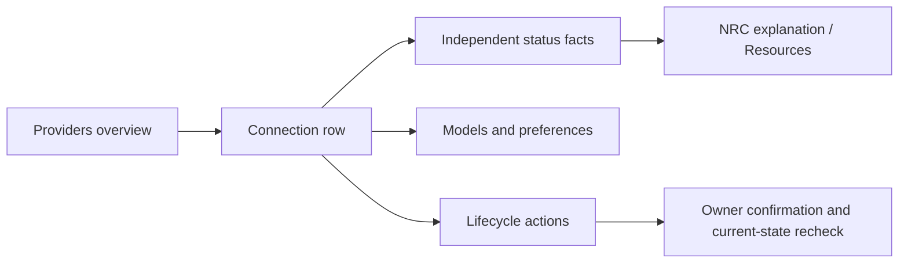

# T3 Code usability assessment

Date: 2026-11-01. Stable pin `2359643cffa6ba9ee84d6f2694b935de54a8013e`. [Evidence index](NXR_T3Code_2026_11_Product_Evolution_Research.md#evidence-index). This is a **source/documentation-supported heuristic assessment**, not a completed hands-on benchmark.

## Method, environment decision and scale

Official user guides for onboarding, providers, composer, usage, threads, source control, remote access, permissions, services and handoffs were read, along with selected UI logic and browser-test source. No provider login, inference, account-home inspection or T3 runtime execution occurred. Test files were inspected, not run. No completion times, error rates, memory benchmarks or accessibility certification are asserted.

Execution prerequisites were reviewed: stable root requests Node 26.12.1 and pnpm 12.14.0; root prepare runs `vp config --no-agent`; development scripts invoke a server and built workspace packages; web builds can require a Ghostty WASM shell build. The repository's existing Nexar toolchain is different. Published stable CLI archives are roughly 102–123 MB compressed on relevant platforms; isolated home, native provider auto-discovery, network behavior and cleanup would still require validation. Download size alone is not the reason to skip. No disposable OS/VM with verified separation from real Codex/Claude homes was established. A source build or host binary run was therefore not justified for this research's UX questions. No installer or install script ran, and disk cleanup is unnecessary.

Future hands-on protocol: disposable Windows VM/snapshot, fresh OS user, fixed release binary and digest, fixed empty project outside Nexar, empty HOME/USERPROFILE/APPDATA/CODEX_HOME/Claude config, deny outbound traffic initially, verify every child home/env and listener before enabling only required public endpoints. Use fake providers where supported; stop at authentication and paid-execution boundaries. Record screenreader/keyboard behavior separately. Destroy only the VM snapshot after retaining sanitized evidence. Real account steps require owner initiation under OD-12. This protocol is a proposal, not a performed test.

Ratings: 1 = serious predicted friction; 2 = material ambiguity; 3 = workable with caveats; 4 = clear supported design; 5 = strong and directly validated. A rating of 5 is unavailable without hands-on evidence. `D` = official DOCUMENTED flow; `S` = SOURCE_VERIFIED UI/test logic; `I` = evaluator inference. Confidence indicates evidence strength, not user satisfaction.

## Navigation and information hierarchy

T3 presents threads/projects in the sidebar, task and context controls in the composer, settings grouped by concern, usage as a dedicated destination and source control/diffs beside work. Side chats use a neighboring panel rather than changing the main task. This reduces navigation for coding, while the number of provider, permission, environment and history concepts can increase configuration load. [E07, E20, E25–E30; D/S → I]

Nexar should lead with **Providers → connection rows → inline details**, retaining Resources as the cross-resource inspection surface. The row leads with the owner's label and provider/method; host is a short Desktop/Plane label, not a location picker. Models, observations and advanced diagnostics expand within the connection. Seven separate tabs would force users to reconstruct account state. This is a Nexar design proposal, not a claim about T3's exact page layout.

## Journey matrix

Each journey records the goal, entry/steps, feedback/outcome, confusion/recovery, security consequence and Nexar comparison. These are documented or implemented flows, not simulated interaction observations.

| Journey | Goal, entry and steps | Feedback and success | Confusion, failure and security | Nexar equivalent / opportunity | Basis; rating |
| --- | --- | --- | --- | --- | --- |
| J01 First run | Open new install → welcome wizard → choose provider/environment → install/connect → choose project/thread | Setup flow guides connection; hosted client instead requires a connected computer | Installation, runtime readiness and sign-in are separate dependencies. Cancellation/network failure can leave setup incomplete. Installer/login access exceeds passive discovery | ProvidersView supports fixed subscription/API methods and Plane readiness. H′ add-connection flow should state prerequisites, explicit owner login and next action | E30 D, E07 S; 3, medium |
| J02 Multiple accounts | Settings → Providers → add same provider → managed Codex or manual home/config → sign in → choose instance | Named instances and masked account email help distinguish accounts; second-account note appears after signed-in account exists | T3 explicitly discourages many-account management. Shadow homes share sessions/config; direct homes lose cross-home native continuation. A different label is not identity proof | B′ already supports API connections; D′ independent homes in progress. H′ shows owner label, method, assurance and lifecycle; a new account always means a new connection | E04/E07/E08/E30 S/D; 3, high for design |
| J03 Model selection | Composer picker → instance/model → capability-specific effort/options | Choice visible at send control; setup/disabled reasons can be surfaced | Long labels/layout movement were still receiving nightly/main fixes. Runtime default is not a fabricated model slug; missing options are not unsupported entitlement | NRC Auto remains default; preference/pin semantics explicit and next-turn only. Long-label/keyboard tests; no renderer-selected bypass | E09/E02 S; 3, high |
| J04 Resource visibility | Provider settings/status → inspect account/model readiness | Provider card offers status, compatibility and setup actions | One status summary can hide stale observations; login doesn't prove model or quota availability. Refresh failure must not look like zero quota | ResourcesView already exposes separate auth/quota/inventory facts. H′ unifies presentation without recomputing eligibility; unknown labels remain visible | E07/E10 S; N04–6; 3, medium |
| J05 Task execution | Create thread/project → composer → send → follow timeline/tools → inspect result | Streaming replies, tool rows and status give progress; results and changes stay associated with task | Starting/first-reply and streaming rerender bugs were corrected. UI delivery is not proof process settlement happened | Operating sessions and DSH/Bridge execution already exist. Add a bounded progress projection, distinguish queued/running/waiting/settled only from authoritative events | E01/E22/E23 D/S; N07–9; 4, medium |
| J06 Delegation | Agent calls delegate tool → child thread → follow Agents/status → parent receives results | Child model/status/results and completion delivery are documented; parent may wait or continue | Native children versus delegated threads differ; settled acknowledgement must not reopen work. Parent completion does not mean every background process is gone | Bridge admission/lineage and review diversity exist. Present child linkage and review dimensions; no new child-runtime scheduler | E03/E32 D/S; N06/7; 4, medium |
| J07 Provider switch | Composer → another provider/model → next turn | Same app thread with adapter-specific reuse/resume or portable handoff | User can mistake one visible conversation for identical native state. Switching accounts must not silently transfer credentials or active authority | Canonical session continues; NRC selects new resource at accepted boundary. Explicitly describe context@2 coverage, preserve required Project Memory | E11/E30 D/S; N08/9; 3, high |
| J08 Context continuity | Switch/fork → inspect context meter/handoff references → retrieve omitted history | Bounded selected history and references described; new prompt not shortened | Attachments, opaque reasoning and tool execution state do not transfer. Fresh provider conversation can be started automatically in T3; this is not Nexar authorization | Existing manifest inspector first; I′ adds classifier/sidecar and explicit overflow rejection. Never say “all context transferred” | E11 D/S; N08; 2, high for limitation |
| J09 Usage limits | Composer usage panel or Usage destination → inspect account windows/reset → recovery setting | Timestamped windows and API-equivalent cost; unavailable/probe-failed concepts exist | Estimated cost ≠ bill; history coverage incomplete; stale bars may be retained. Reset time ≠ verified recovery. T3 auto-resume is a separate execution policy | Measured<T>/unknown quota already exist. F′ provenance and G′ freshness; no new automatic retry/account switch; show last checked and reason | E10/E27/E31 S/D; N10; 3, high |
| J10 Workspaces | New thread → New worktree → branch/project → inspect → delete/retain | Dedicated changes and thread/worktree linkage | Shared worktree alias fix protects deletion offer; server containment is not proven by this client patch. Thread deletion and physical cleanup differ | Existing engineering worktrees and maintenance policy; show owner/reference/retention, normalize platform aliases; no automatic cleanup | E13/E26 S/D; 3, medium |
| J11 Failure recovery | Stop active work → observe stopping/unresponsive → force stop where offered → inspect failure | T3 reports unresponsive stop; force-stop path exists | Killing a process is not confirmed clean settlement, and must stay inside owned process scope. Restart replay differs from manual retry | Nexar already has abort-aware Bridge settlement and process cleanup. Verify noncooperative runtime, quit/start races and lease release before adding UI states | E12 S; N07/N11; 4, medium |
| J12 Git review | Open Diff → turn/local commits → inspect changes → associate PR | Source-control guide distinguishes turn changes and integrated upstream changes; local commit mode added | Review state can be stale during branch changes. Truncated files must not become editable full-file replacements | Existing gated engineering patch/review/commit flow. Optional local-commit UX after H′; no unguarded publication path | E14/E24/E25 S/D; 4, medium |
| J13 Session organization | Sidebar search/find → pin/settle/archive → undo → revisit | Thread organization, find, archived projects and pinning documented; undo feedback exists | Pin, settle, archive and worktree deletion mean different things; long history pagination/search coverage is easy to misunderstand | Canonical sessions/project list already exist; project pin/archive is P2 proposal. Do not add native history import merely for a richer sidebar | E21/E26 D/S; N09; 4, medium |
| J14 Remote monitoring | Connect phone/browser/Desktop → pair/sign in → inspect environment and permissions → view thread | Connection routes and current capabilities are documented; revoke via session tools | Multiple routes/scopes, remote host uptime and background service behavior increase mental model cost. Cross-host allocation adds trust boundaries | Nexar desktop/Plane status is local approved boundary. Improve Plane diagnostics only; T3 Connect/federation/remote agent control rejected in current roadmap | E28 D; 3, medium |
| J15 Security/approvals | Tool requests permission → inspect operation → approve/deny | Composer permission modes and approval flow; agents cannot approve themselves per .0 docs; scope checks in MCP access code | Broad permissive modes, tool-specific capability differences and hidden native confirmations can confuse users. Claude MCP confirmation fix is release-documented, not tested here | Permission Broker remains sole authority. Explain action, resource and scope; renderer cannot issue grants or reuse past approvals | E03/E29/E01 D/S; N07; 3, medium |

## Heuristic comparison

Scores are qualitative design judgements (`I`) based on the listed `D/S` evidence. They are not measured improvements over Nexar.

| Criterion | T3 score / basis | Nexar implication |
| --- | --- | --- |
| Discoverability | 4; guided setup, settings, usage entry points | One add-connection entry; inline recovery CTA |
| Clarity and cognitive load | 3; many account/home/environment modes | Hide technical IDs, keep concepts separate, progressive disclosure |
| Workflow efficiency | 4; adjacent diff/side-chat controls | Prioritize execution/connection essentials; defer new panels |
| Visibility of system status | 3; richer status, still stale/recovery caveats | Preserve timestamps and distinguish local configuration from live observations |
| Error prevention | 3; account warning, deletion/preview corrections | Confirmation bound to current generation and action; never path input |
| Recovery | 4; explicit stop and retry presentation | Reuse bounded cancellation, never replay after restart |
| Consistency | 3; recent picker/settings changes | Stable control geometry and shared status language |
| Accessibility | Unscored; no assistive-technology run | Keyboard, focus return, live-region and non-color tests required |
| Responsiveness | Unscored; source optimizations verified, timings unmeasured | Benchmark realistic long sessions before optimizing |
| Perceived trust | 3; usage/permissions visible but native-history/shared-home complexity | Show assurance/source/freshness; make uncertainty explicit |
| Resource-selection transparency | 3; picker is explicit, provider preferences differ from allocation | Show existing NRC reasons and exclusions; never invent a score |
| Security comprehensibility | 3; scopes/modes documented, multiple authority contexts | One Permission Broker; explain effect of each lifecycle operation |

## H′ target interaction specification

1. Overview groups connections by provider; native subscription and API are labeled methods within that group. No mandatory separate Accounts/Models/Usage screens.
2. Each row shows label, method, Desktop/Plane, enabled/removed state and the most actionable unmet prerequisite. Expand reveals installed/auth/reachability/inventory/quota independently, with timestamps and source text.
3. Add API connection uses B′; add Codex uses D′ only after accepted. Existing built-in subscription controls remain. Multiple Plan and Claude subscriptions have no new add path.
4. Disable/Remove/Forget/Replace/Delete-home have distinct effects. Confirmation names the owner label, affected pins and history retention. Active work produces a fixed conflict and a useful next action, never an override.
5. Models use returned selection IDs and actual option ranges; static entries state their weaker authority. Preferences explain “next turn”; Auto links to NRC explanation. A stale row never authorizes a run.
6. Refresh is bounded, manual and per connection; no login/install or paid request. Preserve last good data with an explicit stale/error label. Late results from old generations are discarded.
7. Announce completion/error once; retain focus after row updates, restore focus after dialog close, support keyboard-only actions and text status independent of color.

## Outstanding UX evidence

No sanitized screenshot is included because no actual stable-product interaction was performed; screenshots of inferred layouts would misrepresent evidence. The diagram above is a proposed Nexar navigation model. Before declaring H′ accepted, capture sanitized fake-provider screenshots and Windows E2E traces on its exact head, then owner-run two-account usability steps under separate authorization. Do not treat that future test plan as completed research evidence.

Verdict: `T3_USABILITY_ASSESSMENT_PARTIAL`.
